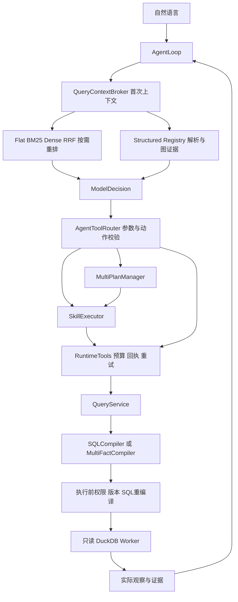

# MyAgent 架构导航

这份文档是源码阅读入口。先分清三条运行路径，再按职责阅读模块；详细学习与面试问答见 [学习手册](docs/PROJECT-STUDY-GUIDE.md)，当前源码位置见 [自动生成代码地图](docs/code-map.md)。

## 三条运行路径

|入口|谁决定步骤|核心路径|
|---|---|---|
|ask/chat|Task理解后，由Workflow组织查询/诊断|UnifiedRuntime → HarnessRuntime → StateGraph → SkillExecutor|
|agent / agent --multi-plan|模型逐轮选择合法动作|AgentLoop → AgentToolRouter → Skill或QueryService|
|profile / 画像ask/chat|有限规则或结构化参数|UnifiedRuntime → FeatureRuntime → FeatureTools|

三条路径最终使用只读Worker，但恢复、重试、发布版本和模型参与程度不同。MCP是另一个本地调用适配器，不是所有Agent动作的必经路径。

## 按职责理解源码

当前Python文件保持已有路径，通过下面的职责分组阅读；这不是宣称已经实现严格无环的分层包。

|职责|模块|主要对象|
|---|---|---|
|使用入口|cli、chat、mcp_server|命令分派、持续会话、本地stdio|
|意图与自主决策|tasks、agent_loop、agent_tools、multi_plan|TaskInterpreter、AgentLoop、AgentToolRouter、MultiPlanManager|
|业务能力|skills、skill_resources、diagnosis、reporting|SkillRegistry、SkillExecutor、DiagnosisEngine|
|运行管理|runtime、resilience、openai_provider|HarnessRuntime、RuntimeTools、SessionStore、CircuitBreaker|
|可信查询与计算|service、semantic、multi_fact、dimensions、query_templates、worker|QueryService、Registry、Compiler、Worker|
|检索与上下文|retrieval_service、retrieval、dense_retrieval、reranking、semantic_context、retrieval_context|RetrievalService、QueryContextBroker、SemanticContextResolver|
|资产与元数据|assets、structure、catalog、control_lineage、history|AssetBuilder、GraphService、MetadataCatalog|
|特征数据产品|feature_pipeline、feature_agent|加工器、FeatureRuntime、FeatureTools、UnifiedRuntime|
|横切约束|access、temporal、integrity|身份/行过滤、UTC/覆盖证据、稳定摘要|
|验证|evaluation、tests、验收脚本|规则案例、工程回归、真实数据独立对账|

## 两个核心名称

```text
QueryService                 service.py
  可信业务服务：发布 → 元数据 → 授权 → 计划 → 重编译 → 查询

AgentToolRouter              agent_tools.py
  模型动作适配：工具 schema → 参数验证 → 分发到 Skill / QueryService

RuntimeTools                 runtime.py
  运行包装：共享预算 → 回执 → 瞬时重试/熔断 → 内层 QueryService
```

早期的service.AgentTools与agent_tools.AgentTools仍分别作为兼容别名存在。CLI、MCP和自主循环已使用新名称；历史脚本/测试可继续运行。不要在新说明中仅写“AgentTools”而不指出模块和职责。

## 一次自主查询



```text
入口创建 QueryService
 -> AgentLoop 创建会话并绑定版本
 -> QueryContextBroker 准备候选与权威定义
 -> 模型决定一次动作
 -> AgentToolRouter 校验并分发
 -> Skill / 多候选计划 / 检索与关系查询
 -> RuntimeTools 包装实际数值查询
 -> QueryService.plan -> Registry -> AST
 -> QueryService.execute -> 再授权/再校验/再编译
 -> Worker -> 回执 -> 下一轮模型
```

图表示调用关系，不表示每个问题都执行所有分支。run_multi_fact直接走查询服务；search/resolve/relations不经过数值查询Skill。Schema Linking帮助发现指标和字段，执行合法性仍由权威合同决定。

## 数据与权威来源

|数据/定义|权威位置|派生或消费方|
|---|---|---|
|指标公式/grain/合法维度|contracts/commerce.json|编译器、Flat文档、Structured关系|
|业务别名/歧义/案例|knowledge/business.json|候选发现和理解，不覆盖公式|
|物理schema与dbt依赖|数据库、manifest、真实检查结果|MetadataCatalog，保留未解析血缘|
|已检查的查询数据|data/own-agent/releases + active.json|QueryService读取，不查正在加工的库|
|特征产品|data/feature-mart/releases|FeatureTools按日期/hash读取|
|语义投影|data/retrieval-index/snapshot-*|可替换派生索引，不是第二个指标注册中心|
|状态/事件/回执|本机SQLite|Harness恢复与观察，不是跨会话答案缓存|

## 阅读与修改顺序

1. 从cli.main查看入口，再读semantic.Query和合同，先弄清“合法请求”。
2. 读QueryService.plan/execute与worker，理解数字怎样被生成和校验。
3. 读AgentLoop和AgentToolRouter，理解模型在哪些位置能选择动作。
4. 读RuntimeTools和SkillExecutor，理解预算、复用、复合业务步骤。
5. 读检索服务与Resolver，最后扩展到图和资产发布。
6. 单独阅读特征加工/查询，不能把指标链的重试和恢复承诺套过去。

以后新增能力先确定职责位置，再更新契约/分发/证据；通用工具不要依赖业务服务。不要把所有模块从__init__.py集中导出，这会掩盖真实依赖和加重循环导入。

## 已知工程边界

物理目录仍为平铺模块；少数动态导入用于避开依赖环，不是完整Clean Architecture。源文件/资源hash参与部分版本绑定，搬文件或大范围格式化前要核对缓存与发布影响。本次整理保持合同、工具名、SQL规则、预算、状态和数据不变。

普通Agent缺日期及数值finish证据仍有模型提示依赖；自主resume未实现。完整限制见 [整体验收](docs/PROJECT-ACCEPTANCE.md)。上一轮Word与JSON是冻结验收快照，当前方法名称/行号以code-map和源码为准。
