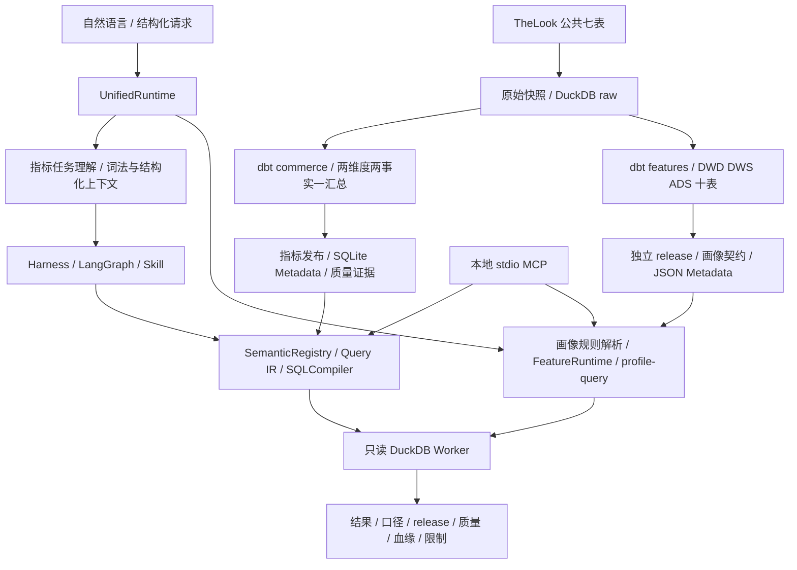

# MyAgent · 电商数据开发与证据驱动分析 Agent

基于 TheLook 公共模拟电商数据，自主实现一个可在本地运行的数据开发与分析闭环：**数仓生产可信数据，语义层固定计算口径，Agent 理解问题并调用受控工具，Harness 保存执行状态与证据。**

本项目重点是数据工程与可靠查询，不训练推荐算法。核心实现位于 `src/local_agent/`，代码含中文注释。MetricFlow、DataHub、WrenAI 是源码研究与设计参考，**不是运行服务依赖，也没有直接复制它们的核心类**。

## 项目能做什么

- 维护 12 个版本化指标；自然语言或结构化任务进入确定性 SQL 编译器。
- 查询、比较、合法维度下钻、质量检查、证据报告及有界异常分析。
- 独立加工 10 张 DWD/DWS/ADS 表，交付用户、商品、用户商品交互与会话数据产品。
- 统一 CLI 支持提问、澄清、持续会话、取消与恢复；画像按明确截止日期读取发布版本。
- 元数据目录包含表、字段、任务关系、字段值与控制依赖；复杂血缘保留未解析标记。
- 7 项注册查询/分析 Skill，另有独立数据加工 Skill；本地 stdio MCP 暴露 13 个工具。
- 指标路径支持有限瞬时错误重试与持久熔断；保存任务事件、查询回执、版本与质量证据。

这里的“双路检索”是词法候选发现与结构化上下文解析；没有 embedding 或向量重排。当前以有界 Workflow 为主，不是完全开放的 ReAct 自主规划器。

## 整体架构



文字调用逻辑：

```text
指标：用户 -> UnifiedRuntime -> TaskInterpreter -> 检索上下文 -> Task 校验
     -> HarnessRuntime -> LangGraph -> Skill -> AgentTools.plan
     -> SemanticRegistry + SQLCompiler -> 计划与版本检查
     -> AgentTools.execute -> 只读 Worker -> 证据报告
画像：用户 -> UnifiedRuntime -> 规则解析 -> FeatureRequest
     -> FeatureRuntime -> profile-query -> FeatureTools
     -> 指定日期 release/hash/权限校验 -> 固定 SELECT Worker -> 画像与证据
加工：原始数据 -> dbt -> 独立对账 -> 契约与血缘 -> 发布目录 -> active 指针
```

两条读取路径共享入口与只读执行思想，但发布、元数据存储和持久化机制仍有区别。完整说明见 [架构与调用关系](docs/architecture.md)。

## 快速开始（Windows / PowerShell）

需要 Python 3.12+、Git；下载真实公开数据还需要 Google Cloud CLI 和可读取公共表的本地账号。数据加工需要独立 dbt 环境。仓库不包含原始数据、数据库、运行会话或密钥。

```powershell
git clone https://github.com/Nidhogg-maker/MyAgent.git
cd MyAgent
.\scripts\bootstrap.ps1
# 无需数据或模型即可查看目录与运行工程测试
.\.venv\Scripts\python.exe -m local_agent.cli skills
.\.venv\Scripts\python.exe -m pytest
```

工程测试主要使用临时数据库与模拟接口；通过测试不等于已经下载公开数据或真实模型准确率达标。

### 获取数据与构建

```powershell
# 先在本机完成 Google Cloud CLI 登录；显式路径仅在 CLI 不在 PATH 时设置
# $env:THELOOK_GCLOUD = '你的 gcloud.cmd 绝对路径'
.\.venv\Scripts\python.exe scripts\thelook_ingest.py all
# 自动创建独立 .warehouse-venv，构建 commerce 并发布指标快照
.\scripts\build-warehouse.ps1
# 截止日期需不晚于本次源快照观测时间；以下是历史演示截止日期
.\scripts\build-feature-mart.ps1 -AsOf 2026-10-11 -VerifyRepeat
```

重新下载后数据行数、特征数值和 release_id 可能变化。`docs/thelook-source-manifest.json` 会在导入时更新，不应将仓库里的历史证据误作新快照。commerce 发布质量有效期为 24 小时，过期需重新验证/发布。详见 [安装、依赖与复现](docs/setup-and-dependencies.md)。

### 持续提问

```powershell
.\.venv\Scripts\python.exe -m local_agent.cli chat
.\.venv\Scripts\python.exe -m local_agent.cli ask "查看用户76706截至2026-10-11的画像"
.\.venv\Scripts\python.exe -m local_agent.cli query --request config\commerce-query.example.json
.\.venv\Scripts\python.exe -m local_agent.cli diagnose --task config\diagnosis.example.json
.\.venv\Scripts\python.exe -m local_agent.cli profile --product user_product --as-of 2026-10-11 --user-id 76706 --product-id 23546
```

聊天支持 `/show`、`/new`、`/resume`、`/exit`。缺口径或日期会澄清；证据不足会保留数值与限制。`CLARIFY`、`STOPPED`、`INSUFFICIENT_EVIDENCE` 的 CLI 退出码是 2，并不都表示程序崩溃。

### 可选真实模型

默认使用本地有限规则，不消耗模型 API。真实指标任务理解通过 OpenAI Responses 严格结构化输出接入；画像仍为规则解析。

```powershell
.\scripts\configure-openai.ps1
.\scripts\start-openai.ps1 -Chat
```

配置窗口在本机保存 Windows DPAPI 加密凭据，位置是 `%LOCALAPPDATA%/OwnDataAgent/openai.json`，不在仓库内。也可在当前进程配置 `OPENAI_API_KEY` 与 `OPENAI_MODEL` 后使用 `--intent-mode llm`。模型名称必须是账号 API 可用名称，不能用界面显示名称推断可调用性。请勿在代码、聊天、截图或提交中放密钥。更多见 [模型接入说明](docs/openai-integration.md)。

## 输入与输出示例

用户：`查看用户76706的画像` → Agent：`CLARIFY`，要求明确截止日期。

用户补充：`截至2026-10-11` → Agent：读取对应成功发布的数据产品，返回 `COMPLETE`，附 `rows`、`definition`、`release_id`、`quality`、`lineage` 与时间限制。

用户：`今天的转化率为什么比昨天低` → Agent：先澄清转化率口径与时间范围；不能把浏览当点击、订单完成当支付成功，也不能把未结束日期直接当完整业务下降。

真实历史指标示例：2026 年 9 月美国男性订单完成占比为 **24.0664%**，定义为本次快照 Complete 订单数 / 全部状态订单数，**不是支付成功率**。对应 [查询证据](docs/core-scope-query-report.md)。

完整模拟对话、结构化响应和历史回执见 [用户输入与 Agent 输出](docs/user-agent-examples.md)。

## 目录与依赖

|目录|内容|
|---|---|
|`src/local_agent/`|任务理解、语义编译、元数据、工具、Skill、运行管理、画像与加工|
|`contracts/`、`knowledge/`、`config/`|权威指标、业务别名、访问策略及请求样例|
|`warehouse-commerce/`|dbt 指标事实与维度模型|
|`warehouse-features/`|dbt DWD/DWS/ADS 数据产品模型|
|`skills/`|Skill 入口、领域参考与报告模板|
|`tests/`|临时数据、模拟模型、边界与回归测试|
|`scripts/`|安装、采集、构建、模型配置与演示入口|
|`docs/`|架构、使用说明、阶段证据及 Word 面试资料|
|`data/`|本机数据与运行状态；Git 忽略|

Agent 运行依赖 DuckDB、SQLGlot、Pydantic、LangGraph、HTTPX、MCP SDK；dbt-core/dbt-duckdb 单独放在数仓环境。源码相对仓库根目录加载合同和 Skill，当前推荐 clone 后 editable 安装，不宣称可脱离资源目录作为独立 wheel 使用。

## 已验证范围与未完成项

历史本机源快照：七表 3,358,422 行；特征交付十表。第二阶段记录包含 23 项 dbt 检查、48 项独立对账、14 项专项与 57 项相关回归；这些记录存在重叠，**不能相加成准确率**。当前上传前回归见 [GitHub 发布验收](docs/github-publication.md)。

当前没有生产增量、迟到修正、幂等补数、真实支付流水、曝光点击链路、可信源端水位、业务有效时间 SCD2、企业 SSO、多租户或远程 MCP。会话无 purchase 标为未知，不伪造负样本；数学贡献不是因果根因。画像读取不承诺指标路径同样的自动重试/熔断。

## 文档导航

- [整体架构、类与调用关系](docs/architecture.md)
- [安装、环境依赖、数据构建与故障排查](docs/setup-and-dependencies.md)
- [模拟对话与结构化输入输出](docs/user-agent-examples.md)
- [第二阶段数据开发与画像说明](docs/feature-phase2-guide.md)
- [Skill、会话与恢复操作](docs/runtime-skills-guide.md)
- [项目总报告](docs/MyAgent-项目总报告.md)
- [80 道 Agent / 数仓面试进阶问答](docs/MyAgent-Agent与数仓面试进阶问答.md)
- [Word 版面试问答](docs/MyAgent-Agent与数仓面试进阶问答.docx)

`docs/` 的阶段报告、JSON 回执、测试 XML 和 Word 是不同时间点的记录，可能包含当时工具数量与绝对本机路径；当前功能入口以本 README、架构文档和源码为准。Word 文件不随代码自动更新。
