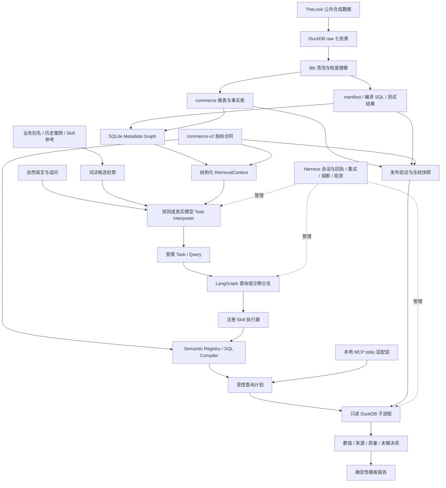
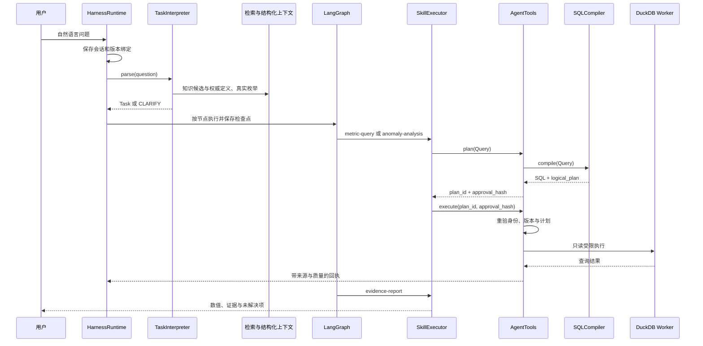
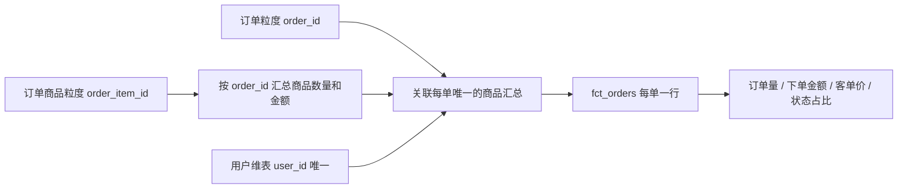
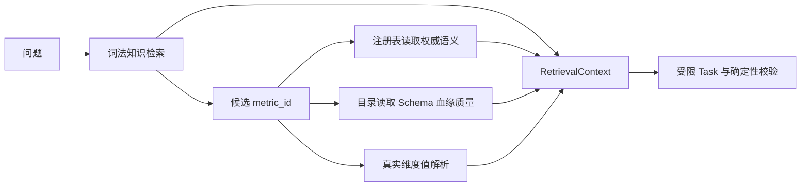
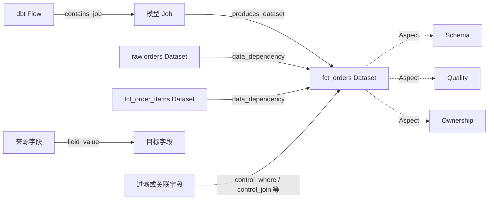
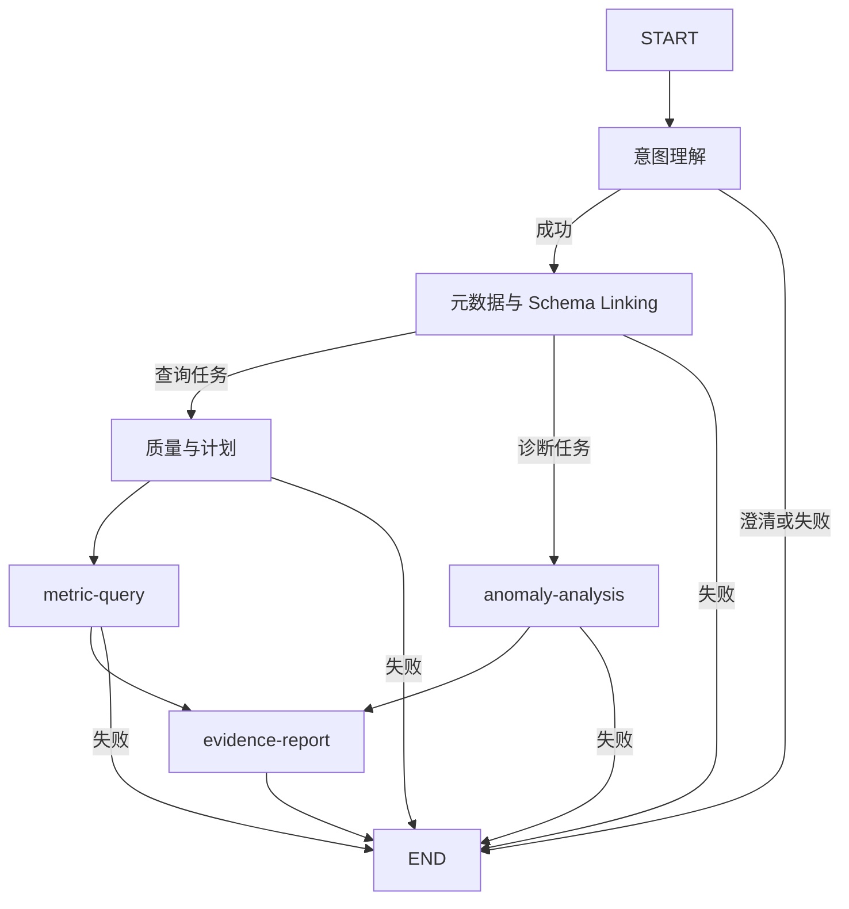
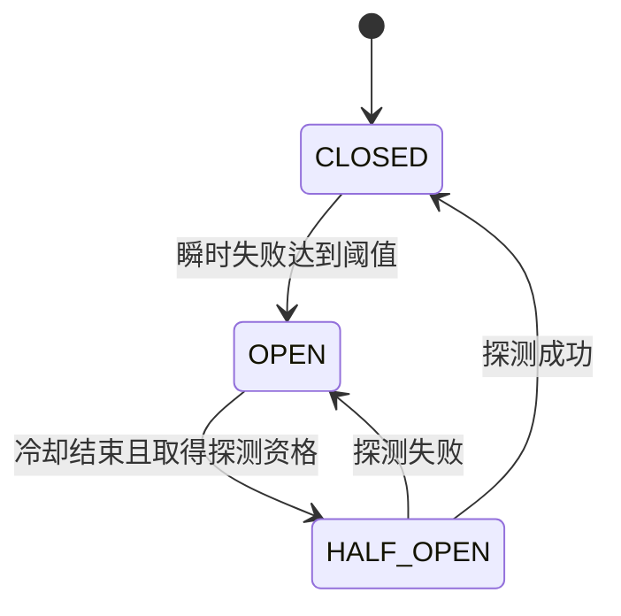

# MyAgent：语义驱动 Data Agent 实现与面试报告

审阅日期：2026-10-12。依据：当前本地源码、数据契约、dbt 模型，以及已经保存的真实模型与工具执行记录。本文是源码研究报告，本次没有重新请求模型、重新发布数据或修改核心代码。文中的运行数字来自 2026-10-11 保存的记录，不代表今天重新验收的结果。

## 1. 项目定位与可以诚实宣称的能力

MyAgent 是一个本地电商数据分析 Agent：自然语言先转换为受限任务，任务引用权威指标目录，由确定性语义编译器生成 SQL，再通过受控工具执行查询、比较、下钻与质量检查，最后输出有来源、有版本、有停止条件的证据报告。

项目重点是让模型理解业务问题，让代码保证计算与执行边界。它不要求模型自行编写任意 SQL，也不把能够算出贡献度等同于找到了业务根因。

| 概念 | 当前实际实现 | 不能宣称的能力 |
|---|---|---|
| Agent Loop | 交互入口持续接收问题；LangGraph 分支状态图执行一次任务；诊断内部有界查询 | 自由规划、任意工具选择、无限迭代的通用自主 Agent |
| ReAct | 有任务理解、工具执行、结果观察、证据输出这些环节 | 完整的模型驱动 Reason → Act → Observe → 再规划循环 |
| React | 目前使用终端交互 | React 网页前端；React 与 ReAct 是不同概念 |
| MCP | 8 个工具的真实本地 stdio 服务及调用演示 | 主 Workflow 每一次调用都经过 MCP、远程 MCP 平台 |
| RAG | 词法知识候选检索，加结构化权威上下文解析 | 向量检索、Embedding、RRF、Cross-Encoder 已实现 |
| Skill | 6 个注册能力，入口、领域参考、执行器及报告模板实际被加载 | 仅靠 Markdown 自动执行代码、通用插件市场 |
| Harness | 会话持久化、回执、预算、取消、恢复、瞬时错误重试及本地熔断 | 分布式调度、写操作 exactly-once、费用平台 |
| Metadata / 知识图谱 | SQLite 实体、Aspect、有向关系；表级、字段值及控制依赖 | 完整 DataHub 服务、专用图数据库、完整业务知识图谱 |
| Semantic Layer | 自建版本化指标合同和单事实 SQL 编译器 | MetricFlow 的完整多事实规划、任意 Join、跨引擎优化 |
| 异常分析 | 比较、前提反证、代数拆解、维度贡献、质量与观察条件检查 | 自动确认因果根因、支付转化或成熟 cohort 的历史状态分析 |

MetricFlow、DataHub、WrenAI 是设计研究参考。当前主运行链路不调用三个项目的服务，也没有把三个上游项目的核心类导入拼装：指标、目录、检索、执行和运行管理由 `src/local_agent` 自己实现。应表述为“借鉴语义规划、元数据建模和查询上下文组织思想”，不宜表述为“复刻了三个项目的全部能力”。

## 2. 端到端架构：数据怎样成为可信回答



**文字版调用逻辑**

```ascii
[Data preparation]
TheLook -> DuckDB raw -> dbt models + tests
                       |-> commerce facts
                       `-> manifest + compiled SQL
                                  |
                           publish validation
                                  |
                    frozen warehouse + catalog + release

[Request execution]
Question -> TaskInterpreter -> validated Task
                ^
                |-- lexical knowledge candidates
                `-- metric contract + metadata + real values

Task -> LangGraph -> SkillExecutor -> AgentTools.plan
     -> SQLCompiler -> AgentTools.execute -> read-only Worker
     -> evidence -> report template -> answer

Harness: state / receipts / deadlines / retry / circuit
MCP: optional local protocol adapter to the same AgentTools
```

数据平面是 DuckDB 中的业务记录；语义平面是权威指标合同；元数据平面是 Schema、血缘和质量证据；运行平面是工具、Skill、Workflow 与 Harness。四者分开后，更新业务解释不必重写执行引擎，增加指标不必允许模型自由生成 SQL，排查异常也能明确自己究竟缺数据、缺口径还是缺证据。

### 2.1 一次查询的实际调用链



**文字版调用逻辑**

```ascii
cli.main / chat_loop
  `-> HarnessRuntime.start(request)
       `-> HarnessRuntime.resume(session_id)
            `-> build_agent(..., registered_skills=True)
                 |-> intent: TaskInterpreter.parse(question)
                 |-> metadata: resolve_context + schema link
                 |-> quality_and_plan: AgentTools.plan(Query)
                 |-> execute: SkillExecutor.run(metric-query)
                 |    `-> plan -> compile -> execute -> Worker
                 `-> answer: SkillExecutor.run(evidence-report)
                      `-> render_report -> user

After each node: checkpoint + execution event
CLARIFY -> wait for reply; STOPPED -> terminate
Note: metric-query currently plans again after the plan node.
```

代码入口：`cli.main` → `HarnessRuntime.start/resume` → `build_agent` → `TaskInterpreter.parse` → `resolve_context` → `SkillExecutor.run` → `AgentTools.plan/execute` → `SQLCompiler.compile` → worker → `render_report`。当前查询分支还存在图节点先计划、注册查询 Skill 再次计划的重复，属于可精简的实现细节，见第 13 节。

## 3. 数据与数仓：先保证 Grain，再谈智能

### 3.1 本地数据有什么，缺什么

TheLook 是公共合成电商数据。已导入七张原始表，共 3,358,422 行：

| 表 | 行数 | 主要用途 |
|---|---:|---|
| distribution_centers | 10 | 仓储分布 |
| products | 29,120 | 商品属性 |
| users | 100,000 | 用户维度 |
| orders | 125,416 | 订单事实 |
| order_items | 181,946 | 订单商品事实 |
| inventory_items | 491,228 | 库存商品属性 |
| events | 2,430,702 | 行为事件，当前未形成可信转化漏斗 |

本地 commerce 层包括 `dim_users`、`dim_products`、`fct_order_items`、`fct_orders`、`dws_daily_sales`。用户维表避免直接携带姓名、邮箱等直接标识信息，年龄转成分段。数据来源与规模以 `docs/thelook-source-manifest.json`、`docs/thelook-profile.json` 为证据。

不能因为有 orders 和 events，就声称存在支付成功率或真实事件转化率。当前缺支付尝试事实、现金退款记录、可靠身份拼接及成熟观察窗口。项目选择有数据支撑的订单量、下单金额、订单状态占比，而不是给不存在的业务链路创造事实。

### 3.2 Fanout 如何避免

`fct_orders` 的一行是一张订单；`fct_order_items` 的一行是一条订单商品。订单与商品是一对多，直接关联后 `COUNT(*)` 会把订单数变成商品行数，订单金额也可能被重复累加。

当前做法是先按 `order_id` 聚合商品，再关联订单和用户维表；通过 dbt 唯一性、关联和金额对账验证，最终保持订单粒度。



**文字版调用逻辑**

```ascii
fct_order_items [one row per order_item_id]
  `-> GROUP BY order_id
       `-> item_totals [one row per order_id]
                    |
raw.orders --------+-- LEFT JOIN by order_id
dim_users ---------+-- LEFT JOIN by user_id (unique)
                    |
                    `-> fct_orders [one row per order_id]
                         |-> dbt grain / relationship tests
                         `-> publish: independent amount checks

Query -> metric contract -> legal fact dimensions
      -> single-fact SQL; no inferred multi-fact JOIN
```

实际源码：`warehouse-commerce/models/fct_orders.sql:1`。发布服务再次检查事实主键唯一且非空，并验证订单金额、商品金额、raw 商品价格总和一致，见 `service.py:32`。

**面试回答**：Fanout 不能靠“模型知道怎么 Join”解决。我先定义事实 Grain，在数仓侧将一对多分支预聚合，并做主键与金额对账；运行时编译器只查询合法单事实表，拒绝无法证明粒度安全的跨事实 Join。代价是当前订单指标不能随意按商品品类下钻。

## 4. Semantic Layer：权威计算定义，不是 Prompt 里的说明文字

### 4.1 指标合同

`contracts/commerce.json` 是当前唯一定义源，版本为 `commerce-v2`，包含事实表、Grain、日期列、维度、指标类型、单位、说明与指标级维度限制。12 个指标覆盖订单量、下单金额、客单价、购买用户数、商品量、完成商品金额、完成/取消/退货订单数及对应占比。

`SemanticRegistry.describe` 将指标解析到事实定义；`SQLCompiler.expression` 递归生成聚合表达式；`compile` 生成 SQL 和可解释逻辑计划。支持 count、sum、distinct、conditional_count、conditional_sum、ratio；比例的分子和分母必须属于同一事实，递归定义检查循环。

### 4.2 Query 是模型与编译器之间的中间表示

```json
{
  "metric_id": "complete_order_rate@1",
  "start": "2026-09-01",
  "end": "2026-10-01",
  "group_by": [],
  "filters": {"country": "United States", "gender": "M"},
  "limit": 1000
}
```

这只是结构示例，不是新的执行记录。日期统一为 UTC 闭开窗口 `[start, end)`；单窗口最多 31 天；维度和指标来自受信合同；过滤值由 SQLGlot 构造字面量，不能成为任意 SQL 结构。

完成订单占比的计算逻辑为：同窗口、同筛选内 Complete 订单数除以全部状态订单数，先分别聚合再相除，分母为零返回 null。不能平均各组占比，也不能先筛选 `order_status=Complete` 后再计算该占比，否则分母被破坏。合同对这类比例排除了状态筛选与状态分组。

购买用户数是 distinct 指标，跨国家、渠道或日期分组一般不能直接相加，除非证明集合互斥。金额是下单商品金额，不是实收收入；订单状态是当前快照状态，不是历史某一天已经完成的事实。

### 4.3 计划与执行分离

`AgentTools.plan` 输出 SQL、逻辑计划、计划标识及完整性校验 hash；`execute` 重验主体、策略、数据版本、语义版本，并重新编译比较计划。这个 hash 用来防止计划变化，不应描述为远程身份认证或人工审批。

执行子进程只读连接 DuckDB，禁用外部访问，限制线程、内存、时间和返回行数。最大返回 1,000 行；默认单次查询最多 30 秒。合法 SQL 仍可能昂贵，因此“SQL 合法”与“资源有界”是两项不同检查。

源码：`semantic.py:21/39/55/89`，`service.py:144/163`，`worker.py:6`。

## 5. 自然语言理解：模型输出任务，代码负责校验

`TaskInterpreter` 支持规则模式和真实模型模式。模型模式调用 OpenAI Responses API，使用严格 JSON Schema 输出 Task 或澄清信息。当前不是把 OpenAI 的原生函数调用 `tools` 接口接入循环；模型首先完成受限意图转换，随后服务端按 Task 路由能力。

Task 包括查询或诊断类型、当前 Query、对照 Query、预期变化方向和诊断维度。Pydantic 拒绝额外字段，并验证诊断两窗口同指标、同筛选、同分组、等长且不重叠。

需要解决的不只是识别“今天”和“下降”：

1. “转化率”是否有合法分子、分母和事实来源？没有时澄清。
2. “销售额”指下单金额、完成商品金额还是实收？有歧义时澄清。
3. “美国男性”能否链接到 `United States` 和 `M`？真实枚举验证后再执行。
4. 今天尚未结束，能否与完整昨天比较？日期和覆盖检查不能省略。
5. 用户说下降，实际是否真的下降？先查询验证前提。
6. “按品类看订单完成率”是否满足订单事实的合法维度？当前拒绝隐式 Join。

`DimensionResolver` 将业务别名链接到实际字段值。小枚举展示有限样本；高基数值通过参数化精确查询验证。未知值触发澄清，不把错误值造成的零结果当作业务没有数据。模型已识别的明确国家、性别筛选还有遗漏检查，但这项保护尚未推广到所有可能的筛选表达。

连续对话保存上一任务上下文；澄清回复创建关联的新会话。当前主要支持明确的指标澄清和分组延续，复杂多轮冲突合并还不完整。

源码：`tasks.py:13/23/38/76/165`，`dimensions.py:7`，`openai_provider.py:11/28`。

## 6. RAG、Flat RAG 与 Structured RAG 如何落地

### 6.1 知识候选路径

`KnowledgeRetriever.search` 检索指标文本、业务别名、历史案例和 Skill 参考。英文分词与中文二元片段参与词法评分，采用 BM25 风格的 TF/IDF 排名和显式别名加权。先做可访问指标过滤，再排名。

这可称为 Flat RAG 的基础实现：在平面知识条目中检索相关材料。它没有使用向量 Embedding，也没有构建向量数据库。含义接近但关键词完全不同的问法，召回仍可能不足；不能把工程用例通过等同于检索准确率已验收。

### 6.2 结构化权威路径

候选 metric_id 确定后，通过注册表和授权工具重新读取：

- 指标定义、分子分母、单位和事实 Grain；
- 合法维度与实际维度枚举；
- Schema、字段血缘、Owner、质量与时间覆盖证据；
- 语义版本、数据 release、来源与约束。

`RetrievalContext` 把 `knowledge_hits`、`semantic`、`metadata`、`constraints`、`dimension_values`、`metric_components` 分开存放。模型可以从案例了解问题，但公式重新从权威合同读取，不能由检索文本覆盖。

这是一种项目自建 Structured RAG：先发现候选，再解析结构化权威对象。它不是两套检索并行投票，也不是词法加向量的 Hybrid Search。



**文字版调用逻辑**

```ascii
Question
  `-> KnowledgeRetriever.search
       `-> aliases / metric text / cases / Skill references
            `-> candidate metric_id
                 |-> SemanticRegistry.describe
                 |-> AgentTools.context -> MetadataCatalog
                 `-> DimensionResolver -> real dimension values
                                  |
                                  v
                         RetrievalContext
                                  |
                      Task conversion + validation

Case text may suggest a candidate; it cannot replace a formula.
Untrusted metric source -> stop; unknown value -> clarify.
This is lexical + structured resolution, not vector fusion.
```

### 6.3 权威冲突检测的实际边界

当前会检查检索指标条目的来源是否指向权威合同，并重新读取定义。这是来源校验，不是完整的多版本业务口径冲突分析。`RetrievalContext` 外层有类型，内部多个字段仍是 dict，尚未把所有嵌套对象严格建模。

源码：`retrieval.py:14/29/69/78`，`retrieval_context.py:4/19`。面试中应说“实现了词法知识检索与结构化权威解析”，不要说“已实现向量混合检索及自动口径冲突治理”。

## 7. Metadata 与知识图谱：存什么，怎样查询

### 7.1 Entity、Aspect、URN、Relationship

`MetadataCatalog` 使用 SQLite 三张核心表：

| 表 | 核心字段 | 作用 |
|---|---|---|
| entities | urn、kind、name | 标识 dataset、field、job、flow |
| aspects | urn、name、payload | 同一实体的 Schema、Owner、质量、转换等属性 |
| relationships | upstream、downstream、kind | 有向数据与任务关系 |

本地表 URN 形如 `urn:local:dataset:duckdb:commerce.fct_orders`，采用自己的命名空间。字段实体附加字段名；任务和流有独立 URN。



**文字版调用逻辑**

```ascii
DuckDB information_schema -> Dataset + Field entities
dbt manifest depends_on   -> data_dependency edges
compiled SQL             -> field_value edges (SQLGlot)
compiled SQL             -> control_* edges (JOIN / filters)
dbt project + model      -> Flow -> Job -> output Dataset
owner / quality          -> Dataset Aspects
                                  |
                                  v
                        SQLite MetadataCatalog
                                  |
                 +----------------+----------------+
                 |                |                |
              context()       lineage()      field_lineage()
              Aspects         bounded BFS    values + controls

Unsupported SQL -> incomplete marker
Depth exhausted -> truncated marker; never claim full lineage
```

### 7.2 采集链路

1. 读取 DuckDB `information_schema.columns` 建表与字段实体。
2. 读取 dbt manifest 的 `depends_on` 建表级边。
3. 用 SQLGlot 对编译 SQL 解析字段值依赖，落 `field_value` 边。
4. 单独解析 Join、WHERE、HAVING、QUALIFY、GROUP 等控制依赖。
5. 将未解析字段、未支持语法或歧义写进不完整标记。
6. 建 Flow、Job、输出表关系，附转换 SQL 与快照质量证据。

Owner 目前是合同中的本地示例 Owner，`verified_business_owner=false`，不能声称已经接入真实责任人治理。质量 Aspect 主要是快照发布检查，不是每个字段都拥有独立质量规则。

### 7.3 查询与影响分析

`context` 按表读取 Aspect；`lineage` 做有环保护的有界 BFS，支持 upstream/downstream；`field_lineage` 追字段值来源，并单独附加行控制依赖。默认深度 5，允许 1～10，返回截断标记。

这套本地 Metadata Graph **不依赖专用图数据库**。图是关系模型与遍历语义，存储可以是 SQLite 邻接边表。当前查询规模适合本地学习，复杂深层路径和大规模并发需要进一步设计索引、缓存和存储。

字段值血缘解释“这个值从哪些字段算出来”；控制血缘解释“哪些条件改变了进入计算的记录”。知道一个 Join 存在，并不证明 Join 的基数正确；基数安全仍靠 Grain、唯一性与对账。

项目中的“知识图谱”主要是技术元数据图，尚未覆盖业务术语、Glossary、Domain、指标审批和外部事件实体的完整治理体系。不能用该图直接推出业务因果关系。

源码：`catalog.py:11/14/26/30/101/108/117/145`，`control_lineage.py:5`。

## 8. Skill：领域规范如何变成可执行能力

当前有六个注册能力：

| Skill ID | 输入 | 行为 | 依赖 |
|---|---|---|---|
| metric-query | Query | 计划并执行受控查询 | plan、execute |
| comparison | baseline/current | 校验可比性，执行两窗口查询 | metric-query |
| drilldown | 分组 Query | 合法维度下钻 | metric-query |
| quality-check | 指标及窗口 | 质量、覆盖、cohort 观察条件 | context、release |
| anomaly-analysis | Task | 串起比较、拆解、下钻、质量 | comparison、drilldown、quality-check |
| evidence-report | evidence/task | 用模板输出证据报告 | 报告资源 |

主要领域包结构：

```text
skills/warehouse-anomaly-attribution/
├── SKILL.md
├── references/
│   ├── metric-rules.md
│   ├── attribution-methods.md
│   └── tool-contracts.md
└── assets/
    └── report-template.md
```

`SkillRegistry` 注册输入/输出 Schema、工具、依赖与预算声明，并检查依赖存在、无环和深度。`SkillExecutor` 校验输入，调用确定性的对应处理器，记录开始、结束、耗时和资源 hash。`skill_resources` 实际读取入口和直接引用的领域规范；`render_report` 实际加载输出模板。

Markdown 提供目的、步骤与停止条件；Python 才负责约束与计算。不能因为 SKILL.md 写了“必须检查水位”，就认为工程约束已经完成。当前每个 Skill 的 `max_queries` 声明也不是通用自动限流器，查询总额度由 Harness 落实，诊断还有自身预算。依赖声明用于验证，不是任意动态 DAG 执行引擎。

为何需要 Skill：同一组查询工具本身不包含“先反证，再拆解，再检查数据质量”的业务过程。Skill 把领域过程集中成可复用能力，避免每个问题都在 Prompt 中临时拼步骤。

源码：`skills.py:7/49/67/76/81`，`skill_resources.py:10/13/26`，`reporting.py:8`。

## 9. Agent Loop、ReAct 与异常 Workflow

### 9.1 实际图结构



**文字版调用逻辑**

```ascii
START -> intent -> metadata
                     |
              +------+------+
              |             |
          kind=query    kind=diagnose
              |             |
     quality_and_plan   comparison
              |             |
          execute       premise check
              |             |-- contradicted -> PREMISE_REFUTED
              |             `-- consistent -> component split
              |                               -> drilldown
              |                               -> quality check
              +-------------+-----------------------+
                            |
                          answer -> END

Any guarded node: CLARIFY / STOPPED -> END
Missing causal evidence -> INSUFFICIENT_EVIDENCE
The model does not freely choose a new tool after every result.
```

`build_agent` 使用 LangGraph 的 StateGraph，但当前是有界分支图。模型在入口转换任务；后续工作流由代码选择和执行。诊断中的维度遍历与组件查询是固定策略，不是让模型看完每次 Observation 再自由挑选下一工具。

面试被问“有没有 Agent Loop / ReAct”时，可以回答：有持续交互与一次任务的状态推进，也有观察结果后进行前提验证和停止的控制逻辑；当前采用受控 Workflow，而不是完整自由 ReAct，目的是先保证指标计算、可追溯性和执行上限。LangGraph 的使用不自动意味着已经拥有自主规划和持久化恢复。

### 9.2 异常分析的真实步骤

1. 校验两窗口口径一致、时间可比及维度合法。
2. 查询 baseline/current，确认变化幅度。
3. 若用户说下降而实际未下降，返回 `PREMISE_REFUTED`。
4. 针对金额、加法或比例指标执行对应确定性拆解。
5. 最多两个维度下钻，计算贡献并对账残差。
6. 检查质量、数据覆盖、状态历史与 cohort 成熟度证据。
7. 输出观察、数学贡献、假设状态和未解决项，证据不足停止因果归因。

### 9.3 为什么不能平均各组比率

总体比例是 `ΣN_i / ΣD_i`，不是各组 `N_i/D_i` 的算术平均。当前某维度组的总体贡献定义为：

`contribution_i = N_i,current / D_current − N_i,baseline / D_baseline`

覆盖完整、可比且未丢组时，组贡献之和应等于总体比例变化。代码检查各窗口分子、分母对账及残差；抑制小组、截断或丢失组不能被当作完整贡献。

全局比例 `R=N/D` 采用对称代数拆解：

```text
分子贡献 = (N1 − N0) × (1/D0 + 1/D1) / 2
分母贡献 = (N0 + N1) × (1/D1 − 1/D0) / 2
两项之和 = N1/D1 − N0/D0
```

下单金额 `A=订单量×客单价` 采用对称拆解：

```text
量贡献 = (n1 − n0) × (p0 + p1) / 2
价贡献 = (p1 − p0) × (n0 + n1) / 2
```

这些是变化的数学分解，不是因果识别。按渠道和按国家得到的是两套替代视角，不能再把两个维度贡献相加，否则重复解释同一变化。

源码：`diagnosis.py:6/11`。注册诊断最多 16 次查询、自身约 60 秒预算；默认旧兼容路径是 8 次查询，不能混淆两个入口。

## 10. Harness：正确结果之外，还要控制执行过程

### 10.1 会话、回执与恢复

`SessionStore` 使用 SQLite 保存请求、状态、事件、查询计数、耗时、取消标记、运行 lease 和工具回执。正常入口默认单会话最多 16 次数据库尝试、120 秒总预算。

版本绑定包括主体、策略 hash、数据 release、指标注册表 hash、模式和 Skill/模板资源 hash。旧任务恢复时如果绑定变化，要求新会话。这样不会悄悄拿旧公式的中间结果和新数据继续计算。

恢复不是 LangGraph 原生 Checkpointer 从任意节点精确续跑：项目自己的 Runtime 重放只读图，重新生成计划，并依据有效查询和版本绑定复用已经保存的回执。已解析 Task 可以复用，进程内旧 plan_id 不直接复用。

对当前只读查询，这能降低重复查询；对转账、写回数据库、发通知等副作用，不能据此宣称 exactly-once。未来加入写操作必须另设幂等键、事务与副作用回执。

### 10.2 重试与熔断

| 情况 | 当前行为 |
|---|---|
| 网络瞬时失败、临时过载/限流、查询 worker 异常退出 | 最多 3 次尝试，退避与少量抖动 |
| 非法维度、口径错误、未知值、权限或身份错误 | 不重试 |
| 模型拒绝、无效结构、账号额度/配置问题 | 停止，不靠重试修复 |
| 查询超时、取消、预算耗尽 | 停止，避免重复昂贵超时操作 |
| 连续 3 次瞬时失败 | 熔断，冷却 30 秒 |
| 冷却结束 | 单个 HALF_OPEN 探测，成功关闭，失败再次打开 |

OpenAI 单次 HTTP 尝试最多 15 秒，整次操作最多 45 秒且受剩余预算约束。有效 Retry-After 被尊重；要求的等待超出当前允许范围时停止此次重试。每次实际数据库重试消耗查询额度，避免重试套重试导致次数失控。



**文字版调用逻辑**

```ascii
operation -> retry_call -> CircuitBreaker.before(key)
                               |
           +-------------------+-------------------+
           |                   |                   |
         CLOSED              OPEN              HALF_OPEN
         execute       cooling: reject       one probe only
           |                   |                   |
       success: reset     cooldown ends      success -> CLOSED
       transient fail     -> HALF_OPEN        fail -> OPEN
           |
           |-- below threshold + budget remains -> backoff
           |                                      -> retry
           `-- threshold reached -> OPEN

Max attempts: 3; failure threshold: 3; cooldown: 30 seconds
Permanent error / timeout / cancellation / deadline -> stop
Each actual database attempt consumes the session query budget.
```

### 10.3 可观测性

记录节点完成、Skill 运行、工具尝试、重试、熔断、回执复用、耗时和模型用量；聊天中 `/show` 看会话，`/health` 看熔断，`/resume` 恢复，`/cancel` 取消。当前关注观察，不计算费用，也不扩展为企业多租户运维平台。

源码：`runtime.py:16/92/144/150/195/215`，`resilience.py:28/35/84`。

## 11. MCP 与本地工具边界

`mcp_server.py` 暴露八个工具：describe_metric、get_context、get_lineage、plan_query、execute_query、compare_windows、search_business、run_diagnosis。它们适配现有领域服务，不另写一套指标算法。

`scripts/mcp-local-demo.py` 的真实演示执行 stdio initialize → list_tools → plan_query → execute_query；记录发现 8 个工具，查询 2026 年 9 月订单量为 6,319，见 `docs/mcp-local-call.json`。

核心 Workflow 直接调用 `AgentTools`，属于进程内调用。事件里的对应 MCP 工具名体现契约映射，不证明一次网络或协议调用已经发生。

MCP 解决工具发现、接口描述与调用边界的问题；Skill 解决业务过程；Harness 解决执行管理；Semantic Layer 解决计算定义。协议不会自动赋予工具正确性、权限或完整性。

源码：`mcp_server.py:12/17/23/29/34/39/44/51`。

## 12. 真实执行证据与项目难点

### 12.1 已保存证据

| 证据文件 | 能证明什么 | 不能证明什么 |
|---|---|---|
| core-scope-live-query.json | 真实模型理解美国男性订单完成占比，筛选落到正确枚举，结果 24.07% | 任意问法的模型准确率 |
| core-scope-live-diagnosis.json | 两个等长窗口诊断实际执行 14 次查询，并形成三项分解 | 找到了独立业务根因 |
| core-scope-diagnosis-report.md | 完成占比 24.8252% → 26.4920%，上升 1.6668 个百分点；报告明确证据不足 | 可以把上涨直接归因于某渠道策略 |
| mcp-local-call.json | 本地 MCP 协议真实发现和执行工具 | 主工作流全部通过协议 |
| core-scope-tests.xml | 保存的完整工程测试 121 项，0 失败、0 错误 | 模型准确率为 100%，或全部测试今天重跑 |
| thelook-dbt-run-results.json | 保存的 dbt 模型和质量检查执行证据 | 数据业务完整性、历史状态全部正确 |

真实诊断中，当前订单观察年龄为 34～40 天，对照为 65～71 天；历史状态和成熟度未验证，生产完整性水位也没有。最终是 `INSUFFICIENT_EVIDENCE`，`causal=false`。这不是没有产出：数值变化、分子分母贡献、维度贡献和质量缺口均已明确，只是没有把它们升级成根因结论。

### 12.2 五个可以重点讲的技术难点

**难点一：自然语言正确，过滤值错误。** “美国”与物理值 `United States` 不一致会产生伪零。解决方式是业务别名与实际枚举链接、未知值澄清，以及已知筛选遗漏检查。剩余问题是复杂筛选覆盖有限。

**难点二：SQL 能跑，指标却错。** Grain 错误、Fanout、比例分母被筛掉都不会必然报 SQL 错。解决方式是数仓预聚合、唯一性和金额对账、单事实编译、指标级维度限制和聚合后相除。代价是拒绝一部分跨表探索。

**难点三：模型会顺着用户错误前提讲故事。** 先比较窗口验证“下降”，再进行代数拆解；没有业务事件和时间完整性反证时停止因果结论。将正确性约束放到执行过程，不依赖最终回答中的提醒。

**难点四：失败恢复重复查询，或跨版本混合结果。** 会话绑定版本，数据库尝试先扣预算，成功回执持久化，恢复时重计划与受控复用。剩余问题是目前只适合只读任务，不提供写副作用 exactly-once。

**难点五：Skill 容易停留在说明文件。** 注册表、输入校验、确定性处理器、资源加载、执行事件与模板输出共同落地。剩余问题是部分声明式预算尚未做通用统一执行。

## 13. 已识别的遗漏与工程约束

以下是源码审阅发现的限制或风险，不等于已经复现的故障。除明确已有证据的行为外，均应在后续专项验证中确认，不宜写成“已解决”。

| 问题 | 现状与影响 | 后续方向 / 优先级 |
|---|---|---|
| 数据完整性水位 | 来源最大时间不等于生产完成水位；缺迟到/撤销证明 | 对接生产者完整性契约；本地仍明确未知，P0 |
| 状态历史与成熟度 | 当前快照状态不能恢复历史当时状态；已有观察历史不等于业务有效时间 SCD2 | 增量快照及明确历史口径，成熟 cohort 规则，P0 |
| 多轮澄清冲突 | followup 对原问题与回复作文本组合，复杂日期/筛选冲突不完全处理 | 基于字段级 Task 补丁合并，P1 |
| 知识与模型版本绑定 |会话绑定语义、数据和 Skill，但未完整绑定 business.json、模型配置与 Prompt 版本 | 统一知识/Prompt/model fingerprint，P1 |
| 口径冲突检测 | 主要检查权威来源，不比较多版本内容与业务批准状态 | 结构化变更、审批与冲突说明，P1 |
| 超时传播 | 有多级预算，但部分 Skill 在执行后检查耗时，所有内层操作并未统一接收一个截止时间 | 统一 deadline/cancel token，P1 |
| Skill 预算声明 | max_queries 并非统一的单 Skill 自动计量器 | 调用栈预算作用域与依赖累计，P1 |
| 发布一致性 | 数据快照冻结，目录却共用可变 SQLite；目录更新与 active 切换不是跨资源原子事务 | 每 release 冻结目录、串行发布及失败清理，P1 |
| 性能 | release 检查多次对较大文件算 hash；查询分支有重复计划；检索/枚举也有额外扫描 | 在安全前提下减少重复验证、测量端到端耗时，P1 |
| 元数据扫描预算 |查询计数主要覆盖事实执行，真实枚举与元数据读取没有完整统一资源计量 | 分类计量并限制候选数与扫描，P1 |
| SQLite 生命周期 | SessionStore.connect 返回连接，事务上下文不等于显式关闭；lease 也无通用心跳 | 显式连接管理、并发/锁定/崩溃专项验证，P1 |
| 回执来源 | 重用回执后需更明确区分原执行计划与本次重计划 | 独立 receipt_id/origin_plan_id，P1 |
| 数据保留 | 会话含结果与上下文，缺统一 TTL、脱敏与清理 | 本地保留策略及导出控制，P1 |
| 数值精度 | 数仓金额用 Decimal，部分贡献计算转 float | 大金额/极小变化下的精度与容差专项验证，P1 |
| 血缘完整性 | SQLGlot 无法保证任意 SQL、隐式列、相关子查询都解析完整 | 保留不完整标记及支持语法清单，P1 |
| 检索泛化 | 词法召回可能漏同义改写；没有向量与重排 | 按真实问法失败再决定是否加向量；准确率评测暂缓 |
| 因果与反证 | 固定数学分解与少量质量假设，没有独立事件体系或实验设计 | 扩展证据连接器；不承诺自动因果识别 |
| 企业权限 | 有本地受控执行边界，当前单用户学习范围 | SSO、ABAC、多租户不是本阶段目标 |
| 远程与生产运维 | 本地 stdio、SQLite、终端入口 | 远程 MCP、HA、调度、容灾不是本阶段目标 |

没有实际需求就不应急于把每个限制升级成平台建设。当前最值得补的是时间证据、版本绑定、统一预算和发布一致性，它们会直接影响已有核心链路；企业平台和模型准确率工程仍按当前范围暂缓。

## 14. 为什么使用这些框架与组件

| 组件 | 在本项目解决的问题 | 代价与选择边界 |
|---|---|---|
| DuckDB | 本地直接执行分析 SQL，降低演示与学习环境复杂度 | 当前单机快照，不代表生产仓库的并发与隔离能力 |
| dbt | SQL 模型依赖、编译产物、测试和数仓建模可追溯 | 测试 PASS 不能代替业务完整性证明；独立 warehouse 环境增加运维项 |
| SQLGlot | SQL AST 构造、结构检查、值血缘与控制依赖分析 | 不是业务语义验证器，也不能证明 Join 基数 |
| Pydantic | 模型输出和工具输入的类型、边界与额外字段校验 | 类型正确不等于口径正确；嵌套 dict 仍有弱约束 |
| LangGraph | 显式状态、查询/诊断分支、逐节点执行与停止 | 固定图不等于自主规划；本项目另写持久化恢复 |
| HTTPX + Responses API | 真实模型的受限结构化意图转换及可观测 HTTP 调用 | 模型仍可能理解错，需确定性验证；本次不重新验证外部模型目录 |
| SQLite | 元数据边表、会话、回执和熔断状态的本地持久化 | 并发、连接生命周期、跨资源事务需专项处理 |
| MCP SDK | 统一暴露工具与真实本地协议调用 | 主流程不必为了协议而增加一层跨进程调用 |
| 自建 Semantic Layer | 固定指标权威、Grain 与合法维度，缩小自由 SQL 风险 | 多事实、复杂时间语义和优化能力有限 |
| 目录式 Skill | 分离业务规范、执行器与输出模板，复用分析过程 | 需要防止规范文件和代码约束不一致 |

依赖版本以 `pyproject.toml` 为准：DuckDB 1.5.6、Pydantic 2.14.0、SQLGlot 30.22.0、LangGraph 1.2.14、HTTPX 0.28.1、MCP 1.30.0。它们是当前固定版本，不是对“最新版本”的声明。

### 与三个研究项目的职责对照

| 研究来源 | 借鉴的核心问题 | 自己项目的实现 | 差距 |
|---|---|---|---|
| MetricFlow | 指标语义如何进入确定性查询规划 | commerce-v2 合同、受限 Query、SQLCompiler | 没有完整多事实 Join 规划和高级度量时间语义 |
| DataHub | 元数据如何通过实体、属性、关系被组织 | 本地 URN、Aspect、关系边、dbt/Schema 采集 | 没有完整平台采集、搜索索引、治理和事件链路 |
| WrenAI | 业务上下文与查询语义如何辅助自然语言问数 | 知识候选、结构化上下文、真实枚举、受限 Task | 没有完整探索式语义引擎和产品交互 |

当前 SQL 已由自建语义编译器生成，不需要再交给 Wren 编译一次；元数据目录记录“数据是什么、从哪里来、是否可信”，指标合同负责“怎样计算”。避免把案例库、目录说明和 Prompt 各自维护一套权威公式。

## 15. 面试讲述参考

### 15.1 90 秒项目介绍

> 我做的是一个本地语义驱动的电商 Data Agent，使用 TheLook 七张公开合成表模拟数仓。先用 dbt 建用户、商品和订单事实，明确订单与商品的 Grain，通过唯一性和金额对账避免 Join Fanout。上层自己实现了 12 个版本化指标和 SQL 编译器，模型只输出受限任务，不能自行改公式或生成任意 SQL。
>
> 自然语言侧采用词法业务知识检索和结构化元数据解析，把指标、真实维度值、血缘和质量证据提供给模型。LangGraph 区分查询和异常分析，Skill 负责比较、分子分母拆解、维度下钻、质量检查和证据报告。Harness 保存会话与查询回执，提供预算、取消、恢复、瞬时重试和熔断；另有八个工具的真实本地 MCP 演示。
>
> 最有价值的一点是把结果计算与业务归因分开。真实执行完成了十四次查询和比例贡献分解，但因为缺历史状态与生产完整性水位，最终明确证据不足，没有把贡献度说成业务原因。项目目前是受控 Workflow，不是自由 ReAct，也没有宣称企业权限或模型准确率已经完成。

### 15.2 五分钟展开顺序

1. 为什么不能直接自然语言生成 SQL：口径、粒度、权限和时间证据的问题。
2. 一次请求怎样转换为 Task、链接真实枚举、进入确定性编译器。
3. dbt 如何先解决一对多 Fanout，Semantic Layer 如何拒绝非法维度。
4. 用完成订单占比的真实诊断说明分子分母、贡献与反证。
5. 解释 Harness 的版本绑定、只读重放、回执与熔断。
6. 主动说明 snapshot 状态、RAG 泛化、多事实和生产治理的边界。

### 15.3 三十道追问与回答要点

**1. 你的项目为什么叫 Agent，而不是 SQL 查询接口？** 入口理解问题并选择查询或诊断任务，运行领域 Skill、验证前提、组合多次工具结果并管理状态。但当前自主性是有界的，属于受控 Data Agent Workflow。

**2. 有没有完整 ReAct？** 没有自由的模型观察后再规划循环。当前模型主要做 Task 转换，固定图与确定性诊断控制后续步骤。

**3. LangGraph 在哪里用，解决什么？** `harness.build_agent` 用 StateGraph 表达意图、元数据、查询或诊断、报告及失败停止，便于理解状态流；恢复持久化另由 Runtime 实现。

**4. 为什么不直接用模型写 SQL？** SQL 能执行不代表 Grain、分母、时间窗口正确。受限 IR 与确定性编译把权威指标和合法维度固定在代码/合同边界内。

**5. Semantic Layer 与 Metadata 有什么区别？** 前者定义怎样计算，后者描述字段、来源、责任和质量。血缘不会自动成为正确指标公式。

**6. 你用了 MetricFlow 吗？** 研究过其语义规划思想，当前 agent 核心用自建合同和编译器，不依赖其服务。不能声称拥有它完整的多事实能力。

**7. 指标公式在哪里维护？** `contracts/commerce.json` 唯一权威；知识条目和案例只辅助发现，不覆盖公式。

**8. Grain 是什么，怎么保证？** 一行代表的业务对象。商品事实为 order_item_id，订单事实为 order_id；预聚合、唯一性检查、关联测试和金额对账共同验证。

**9. 为什么按品类查订单指标被拒绝？** 订单对应多个品类，没有明确订单分摊/去重语义时无法保证可加性。当前拒绝隐式 Join，而不是随便改成商品粒度。

**10. `COUNT(DISTINCT order_id)` 能彻底解决 Fanout 吗？** 只能解决特定计数重复，不能自动解决金额重复、维度分摊与多个一对多分支组合。应在模型 Grain 和聚合策略上解决。

**11. 比例为什么要先聚合再除？** 总体是 Σ分子/Σ分母。平均分组比率会忽略组规模权重；对零分母返回 null，避免伪零。

**12. distinct 用户数可以按渠道累加吗？** 一般不可以，同一用户可能出现在多个分组。需要集合互斥证明或重新按总体 distinct 计算。

**13. 订单完成占比等于支付成功率吗？** 不等于。当前只有订单快照状态，没有支付尝试事实，也没有历史当时完成状态。

**14. 你实现了哪种 RAG？** 词法知识候选与结构化权威解析。没有向量数据库、RRF 或 Cross-Encoder，不把“双路”说成词法向量混合检索。

**15. Structured RAG 的结构体现在哪里？** RetrievalContext 分开存语义、元数据、约束、实际维度值和组件；权威对象由授权服务重新读取，有数据和语义版本。

**16. 模型把“美国”写成 US 怎么办？** DimensionResolver 链接到真实枚举 United States。无法唯一识别时澄清，避免未知过滤造成伪零。

**17. Prompt 能保证筛选不遗漏吗？** 不能。已有国家、性别显式筛选检查，其他复杂筛选仍是限制，需要通用字段级约束补充。

**18. MCP、Tool、Skill、Harness 分别是什么？** Tool 是可调用能力；MCP 是调用契约与协议适配；Skill 是业务过程；Harness 管执行状态、预算、失败和恢复。

**19. 你的每次工具调用都走 MCP 吗？** 没有。主链路进程内调用 AgentTools，另有真实 stdio 工具发现和执行证据。

**20. SKILL.md 怎么执行？** 入口与参考文件被加载给任务理解和执行观测，注册执行器校验输入并调用 Python 处理器；Markdown 本身不执行 SQL 或 Python。

**21. 异常归因如何实现？** 同口径比较，验证用户前提，确定性拆解，最多两个维度下钻，检查残差与质量，输出证据等级。独立因果证据不足则停止归因。

**22. 贡献最大就是根因吗？** 不是，贡献解释变化的数学分布；根因需要独立业务事件、时间顺序、反证或实验支持。

**23. 用户说下降，查询结果却上涨怎么办？** 返回前提反证，不继续为不存在的下降寻找原因。

**24. 今天比昨天低，第一步看什么？** 先确定口径、时区和完整观察窗口，再检查覆盖水位。当天未结束或数据未到齐时不能直接比较两个数字归因。

**25. 测试通过为何还会证据不足？** dbt 测试验证粒度、关系和金额等已定义约束，不证明生产完整性、历史状态、成熟度或外部业务原因。

**26. 知识图谱必须用 Neo4j 吗？** 当前不需要：SQLite 存实体、属性和有向边，代码做有界 BFS。规模和路径查询需求变化时再评估专用存储。

**27. 恢复为什么不重复全部查询？** 版本和主体一致时复用已保存只读回执，重新生成计划。它是受控重放，不是任意节点原地恢复或写副作用 exactly-once。

**28. 为什么有些错误不能重试？** 非法口径、未知维度、身份错误和模型格式错误不会因重复调用自然变正确；只对明确瞬时错误重试，且受截止时间与熔断控制。

**29. 你怎么证明项目实际运行？** 指向真实模型 query/diagnosis JSON、MCP 调用记录、模板报告、dbt 结果和 121 项工程测试记录；准确率评测未做，不能把测试数作为模型准确率。

**30. 下一步你会优先改什么？** 补历史状态/成熟度证据、统一知识与模型版本绑定、统一截止时间、每 release 冻结目录、明确多轮字段合并；先提高已有链路一致性，再决定向量检索和多事实能力。

### 15.4 简历可用表述

- 基于 TheLook 七表合成数据搭建本地电商数仓，使用 dbt 建模、粒度约束与金额对账，构建 12 个版本化指标及单事实语义 SQL 编译器。
- 实现自然语言到受限任务转换、词法知识检索与结构化元数据解析，结合 LangGraph 和六项 Skill 完成查询、比较、下钻及证据驱动异常分析。
- 实现本地会话与回执持久化、版本绑定、预算、取消、恢复、重试和熔断，并通过真实模型及本地 MCP 调用记录验证核心执行链路。

不要补写不存在的生产用户量、业务收益、查询准确率、因果识别准确率或企业权限成果。

## 16. 源码与证据索引

以下为本次审阅时的方法入口行号，后续代码变化可能移动。路径均指向本地 MyAgent。

| 模块 | 源码入口 | 核实内容 |
|---|---|---|
| 入口 | [cli.py](C:/Users/Nidhog/OneDrive/Desktop/MyAgent/src/local_agent/cli.py:12) | CLI 与 Runtime 路由 |
| 图执行 | [harness.py](C:/Users/Nidhog/OneDrive/Desktop/MyAgent/src/local_agent/harness.py:27) | build_agent 与查询/诊断分支 |
| 意图模型 | [tasks.py](C:/Users/Nidhog/OneDrive/Desktop/MyAgent/src/local_agent/tasks.py:13) | Task 一致性、时间、规则和真实模型理解 |
| 真实模型 | [openai_provider.py](C:/Users/Nidhog/OneDrive/Desktop/MyAgent/src/local_agent/openai_provider.py:28) | 严格结构输出与瞬时重试边界 |
| 语义编译 | [semantic.py](C:/Users/Nidhog/OneDrive/Desktop/MyAgent/src/local_agent/semantic.py:89) | 合法维度、AST、单事实检查与逻辑计划 |
| 指标合同 | [commerce.json](C:/Users/Nidhog/OneDrive/Desktop/MyAgent/contracts/commerce.json) | commerce-v2、Owner 与权威指标 |
| Grain | [fct_orders.sql](C:/Users/Nidhog/OneDrive/Desktop/MyAgent/warehouse-commerce/models/fct_orders.sql:1) | 先聚合后关联避免 Fanout |
| 发布与工具 | [service.py](C:/Users/Nidhog/OneDrive/Desktop/MyAgent/src/local_agent/service.py:32) | 发布对账、版本验证、计划与执行 |
| 执行隔离 | [worker.py](C:/Users/Nidhog/OneDrive/Desktop/MyAgent/src/local_agent/worker.py:6) | 只读、外部访问关闭与资源限制 |
| 检索 | [retrieval.py](C:/Users/Nidhog/OneDrive/Desktop/MyAgent/src/local_agent/retrieval.py:29) | 词法检索、路径与 Schema Linking |
| 结构上下文 | [retrieval_context.py](C:/Users/Nidhog/OneDrive/Desktop/MyAgent/src/local_agent/retrieval_context.py:19) | 来源检查与权威重新读取 |
| 枚举链接 | [dimensions.py](C:/Users/Nidhog/OneDrive/Desktop/MyAgent/src/local_agent/dimensions.py:7) | 真实字段值解析 |
| 元数据 | [catalog.py](C:/Users/Nidhog/OneDrive/Desktop/MyAgent/src/local_agent/catalog.py:30) | 实体、Aspect、值血缘与任务关系 |
| 控制依赖 | [control_lineage.py](C:/Users/Nidhog/OneDrive/Desktop/MyAgent/src/local_agent/control_lineage.py:5) | Join、过滤及分组控制血缘 |
| Skill | [skills.py](C:/Users/Nidhog/OneDrive/Desktop/MyAgent/src/local_agent/skills.py:49) | 注册与确定性执行 |
| Skill 资源 | [skill_resources.py](C:/Users/Nidhog/OneDrive/Desktop/MyAgent/src/local_agent/skill_resources.py:13) | 入口、参考与模板实际加载 |
| 诊断 | [diagnosis.py](C:/Users/Nidhog/OneDrive/Desktop/MyAgent/src/local_agent/diagnosis.py:11) | 前提、数学拆解、下钻与证据不足 |
| 会话 | [runtime.py](C:/Users/Nidhog/OneDrive/Desktop/MyAgent/src/local_agent/runtime.py:215) | 只读重放、预算、回执与节点检查点 |
| 熔断 | [resilience.py](C:/Users/Nidhog/OneDrive/Desktop/MyAgent/src/local_agent/resilience.py:84) | retry_call 与熔断状态 |
| MCP | [mcp_server.py](C:/Users/Nidhog/OneDrive/Desktop/MyAgent/src/local_agent/mcp_server.py:12) | 八个实际工具 |
| 报告 | [reporting.py](C:/Users/Nidhog/OneDrive/Desktop/MyAgent/src/local_agent/reporting.py:8) | 确定性模板输出 |
| 时间覆盖 | [temporal.py](C:/Users/Nidhog/OneDrive/Desktop/MyAgent/src/local_agent/temporal.py:26) | 快照观察与完整性证据区别 |
| 历史观察 | [history.py](C:/Users/Nidhog/OneDrive/Desktop/MyAgent/src/local_agent/history.py:9) | 观察时间历史，不能冒充业务有效时间 |

实际执行材料：

- [真实模型查询](C:/Users/Nidhog/OneDrive/Desktop/MyAgent/docs/core-scope-live-query.json)
- [真实模型诊断](C:/Users/Nidhog/OneDrive/Desktop/MyAgent/docs/core-scope-live-diagnosis.json)
- [诊断证据报告](C:/Users/Nidhog/OneDrive/Desktop/MyAgent/docs/core-scope-diagnosis-report.md)
- [查询证据报告](C:/Users/Nidhog/OneDrive/Desktop/MyAgent/docs/core-scope-query-report.md)
- [本地 MCP 调用](C:/Users/Nidhog/OneDrive/Desktop/MyAgent/docs/mcp-local-call.json)
- [121 项工程测试记录](C:/Users/Nidhog/OneDrive/Desktop/MyAgent/docs/core-scope-tests.xml)
- [dbt 执行记录](C:/Users/Nidhog/OneDrive/Desktop/MyAgent/docs/thelook-dbt-run-results.json)
- [数据来源与快照说明](C:/Users/Nidhog/OneDrive/Desktop/MyAgent/docs/thelook-source-manifest.json)
- [当前本地范围说明](C:/Users/Nidhog/OneDrive/Desktop/MyAgent/docs/core-local-scope.md)

## 17. 未查证事项与复习使用方式

本次没有验证最新外部 API 模型目录、上游项目最新提交、生产性能、分布式故障、真实企业权限、多用户压力或任意自然语言准确率。没有重新运行全部工程测试；121 项是已有保存记录，此后针对性变更不据此扩大完整回归数量。

复习时先能口述第 2 节的一次请求调用链，再结合第 3～11 节解释各层约束；重点练习第 12 节真实诊断案例和第 15 节追问。面试官问“为什么这么设计”，应回到实际失败风险：错误 Grain、非法分母、未知筛选、证据不足、跨版本恢复和瞬时故障，而不是只列框架名称。

## 18. 核心代码速读

下面是当前源码的简化摘录，保留关键调用与判断，省略部分导入、日志及外围校验，便于面试讲解。这些片段不是可独立运行的完整程序；生产约束应以原方法为准。这里不新增模型准确率结论，也不改变已有运行逻辑。

### 18.1 结构化任务限制模型能提交什么

来源：`semantic.py:21`，`Query`。模型提交指标与窗口，不提交 SQL、物理表名或身份。

```python
class Query(BaseModel):
    model_config = ConfigDict(extra="forbid", frozen=True)
    metric_id: str
    start: dt.date
    end: dt.date
    group_by: tuple[str, ...] = ()
    filters: dict[str, str] = Field(default_factory=dict)
    limit: int = Field(default=100, ge=1, le=1000)
```

讲解要点：`extra="forbid"` 拒绝额外字段；`frozen=True` 限制模型属性重赋值，但不是对嵌套字典的深度冻结。窗口时长与维度数量另由 `bounds` 校验；类型校验不能替代业务语义校验。

### 18.2 编译前检查维度与事实粒度

来源：`semantic.py:89`，`SQLCompiler.compile`。

```python
metric = self.registry.describe(query.metric_id)
fact = metric["fact"]
allowed = set(fact["dimensions"])
if not set(query.group_by) <= allowed | {"day"}:
    raise ValueError("Illegal dimension for fact grain")
if not set(query.filters) <= allowed:
    raise ValueError("Illegal dimension for fact grain")
# 后续仅针对 fact["table"] 构造单事实 SELECT。
```

讲解要点：把原方法合并的判断拆成两句便于阅读。维度必须属于当前指标对应的合法事实定义；模型不能为了满足“按品类看订单占比”临时加 Join。合法维度和真实维度值验证是两个步骤。

### 18.3 比例递归展开且保护零分母

来源：`semantic.py:60`，`SQLCompiler.expression` 的 ratio 分支。

```python
for child in ("numerator", "denominator"):
    child_fact = self.registry.describe(m[child])["fact"]["table"]
    if child_fact != m["fact"]["table"]:
        raise ValueError("Cross-fact ratio unsupported")
numerator = self.expression(m["numerator"], seen + (metric_id,))
denominator = self.expression(m["denominator"], seen + (metric_id,))
return exp.Div(
    this=exp.Cast(this=numerator, to=exp.DataType.build("DOUBLE")),
    expression=exp.Nullif(this=denominator, expression=exp.Literal.number(0)),
)
```

讲解要点：子指标先形成聚合表达式，再相除；不是逐行比率再平均。`seen` 在原方法入口检查循环定义，`NULLIF` 使零分母结果为 null。跨事实比例没有明确规划时拒绝执行。

### 18.4 用显式分支表达 Workflow

来源：`harness.py:27`，`build_agent`。以下将源码中的路由 lambda 整理成等价命名函数，便于阅读。

```python
def route_after_metadata(state):
    if state.get("status") in ("STOPPED", "CLARIFY"):
        return END
    if state["task"]["kind"] == "diagnose":
        return "diagnosis"
    return "quality_and_plan"

graph.add_edge(START, "intent")
graph.add_conditional_edges("metadata", route_after_metadata)
```

讲解要点：这是确定性的任务分支，不是模型每次观察后自由选择工具的 ReAct。其他节点也有失败停止边，异常不会被静默吞掉后继续生成成功答案。

### 18.5 Skill 执行到真实工具

来源：`skills.py:81`，`SkillExecutor.run` 的查询分支。

```python
spec = self.registry.specs[identifier]
data = self.registry.inputs[identifier].model_validate(payload)
# resolver 已由执行器取得，链接到真实维度值。
data = resolver.query(data)
plan = self.tools.plan(data)
result = self.tools.execute(
    plan["plan_id"], plan["approval_hash"],
    timeout_seconds=spec.timeout_seconds,
)
```

讲解要点：注册表选择契约，执行器校验参数，再调用计划与执行工具。SKILL.md 是实际加载的领域规范，但强制约束和确定性计算由代码承担；不能把文档步骤当作已经执行的证据。

### 18.6 结构化 RAG 重新读取权威定义

来源：`retrieval_context.py:19`，`resolve_context` 的核心读取步骤。

```python
release = tools.release()
context = tools.context(metric_id)
metric = tools.describe(metric_id)
authoritative = "contracts/commerce.json#metrics/" + metric_id
components = {
    name: tools.describe(metric[name])
    for name in ("numerator", "denominator") if name in metric
}
```

讲解要点：检索先给候选，公式重新从授权注册表读取。原方法随后检查来源冲突，并将版本、语义、元数据、约束和真实枚举组织成 RetrievalContext；这段摘录不是完整的冲突检测器。

### 18.7 元数据属性如何从 SQLite 取出

来源：`catalog.py:108`，`MetadataCatalog.context`。这里假定原方法已验证实体存在。

```python
urn = self.urn(name)
with sqlite3.connect(self.path) as db:
    rows = db.execute(
        "SELECT name,payload FROM aspects WHERE urn=?", (urn,)
    )
    aspects = {key: json.loads(value) for key, value in rows}
return {"urn": urn, **aspects, "column_lineage_complete": False}
```

讲解要点：URN 定位实体，Aspect 分别存 Schema、Owner 和质量等属性。SQLite 能保存图的实体与边，不需要专用图数据库；不完整标记避免把部分解析结果声称为完整血缘。

### 18.8 Harness 通过版本绑定回执减少重复查询

来源：`runtime.py:109`，`RuntimeTools.execute`。此时原方法已经校验并重新计划请求。

```python
key = fingerprint({
    "query": validated["query"],
    "binding": self.store.get(self.identifier)["binding"],
})
cached = self.store.receipt(self.identifier, key)
if cached:
    self.emit("query-reused", {"query": validated["query"]})
    return {**cached, "plan_id": plan_id, "receipt_reused": True}
```

讲解要点：缓存键不只有 SQL，还包含请求的有效语义和会话版本绑定。没有可复用回执时，原方法执行有界重试，每次实际尝试先扣查询预算，再保存结果回执。适用于当前只读重放，不能据此声称写操作 exactly-once。

### 18.9 MCP 是适配器而不是第二套查询引擎

来源：`mcp_server.py:29`，`plan_query`。`tools` 是服务启动时按本地环境配置创建的共享 AgentTools 实例。

```python
@server.tool()
def plan_query(query: dict) -> dict:
    return tools.plan(Query.model_validate(query))
```

讲解要点：协议入口最终调用同一个领域服务，不另维护一套指标公式。共享对象的构建和身份配置见服务入口；主 Workflow 的直接调用仍是进程内调用。

阅读顺序建议：先看 Query 与编译器，再看 Workflow 和 Skill，最后看结构化上下文、元数据与回执。能够解释这些短片段的输入、输出、约束与失败条件，比背诵框架名称更有价值。
