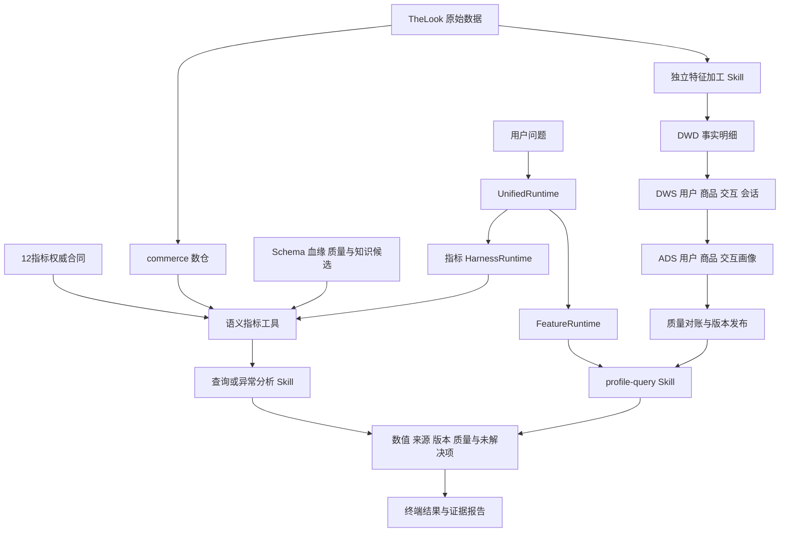

# MyAgent 项目总报告

报告日期：2026-10-12。项目目录：`C:\Users\Nidhog\OneDrive\Desktop\MyAgent`。

本报告总结当前源码、指标合同、数据发布与保存的验收记录。本次只整理报告，没有重新运行全部测试或调用模型。运行成绩按对应记录的范围说明，不累加重叠测试，也不把历史成功记录当作生产可用性承诺。

## 1 项目是什么

MyAgent 是一个面向电商数据开发与业务分析的本地 Data Agent。它将两类工作连起来：

1. **数据开发与交付**：把 TheLook 原始数据加工成有粒度、有窗口、有质量和血缘的 DWD、DWS、ADS 数据产品。
2. **数据查询与分析**：将自然语言转换为受限任务，执行指标查询、异常分析或画像读取，并返回可追溯的结果。

项目不以训练推荐算法为目标。面向推荐、CTR/CVR 场景，重点提供行为明细、主题汇总、画像和交互特征；没有曝光或支付事实时，明确拒绝创造真实 CTR 或支付成功率口径。

核心设计是：模型或规则负责理解需求，权威合同与确定性代码负责计算，工具负责受控执行，Skill 组织领域过程，Harness 保存状态与证据。

## 2 当前完成情况

| 模块 | 已实现 | 主要边界 |
|---|---|---|
| 数据来源 | TheLook 七表，3,358,422 行原始数据 | 公开合成数据、一次顺序采集快照 |
| 原有电商数仓 | 5 个 commerce 模型，订单/商品粒度与金额对账 | 全量本地加工，非生产增量 |
| 主题数据开发 | 10 张 DWD/DWS/ADS 表，独立构建、验证、发布 | 增量、迟到修正与补数本次不做 |
| 语义层 | 12 个版本化指标、合法维度与单事实 SQL 编译 | 不支持任意跨事实 Join |
| 自然语言 | 指标路径有真实模型接口及保存的执行记录；画像路径有限规则解析 | 画像尚未扩展到真实模型 Task Schema |
| 知识检索 | 词法知识候选与结构化权威解析 | 没有向量检索、RRF 或重排器 |
| 元数据 | SQLite 技术图；新数据产品另交付 JSON 血缘与契约 | 占位 Owner，非完整企业治理平台 |
| Skill | 7 个注册查询/分析能力；另有独立加工 Skill | Markdown 规范由执行代码落实，不自行执行 |
| 异常分析 | 比较、前提验证、组件拆解、下钻、质量与证据报告 | 数学贡献不等于因果根因 |
| 运行管理 | 指标 Harness 有状态、回执、预算、取消、恢复、重试及熔断 | 画像有独立会话与受限 Worker，不自动继承指标熔断重试 |
| 本地工具协议 | 13 个 MCP 工具，真实 stdio 验证 | 主 Agent 仍采用进程内工具调用 |
| 使用入口 | 同一个 ask/chat；另有结构化 profile 与加工命令 | 任意画像排名、比较和自由 SQL 不支持 |

当前版本已经完成本地核心闭环，但不能称为生产级通用 Agent、完整推荐平台或自动因果诊断系统。

## 3 整体架构



文字版调用逻辑：

```text
TheLook raw
  |-- commerce dbt -> 语义指标 -> 查询 / 异常分析
  `-- feature dbt  -> DWD -> DWS -> ADS -> 独立发布

ask / chat
  `-> UnifiedRuntime
       |-- 指标问题 -> HarnessRuntime -> LangGraph
       |                -> Skill -> Compiler -> Worker
       `-- 画像问题 -> FeatureRuntime -> profile-query
                        -> 指定日期 release -> Worker

所有结果 -> 来源 / 日期 / 版本 / 质量 / 证据边界
```

数据、语义、元数据和执行管理分别承担不同职责。字段血缘帮助解释来源，指标合同定义计算规则；知识案例辅助理解需求，不能覆盖权威公式。

## 4 数据开发怎样落地

### 4.1 原始数据与业务选择

七张 raw 表为 users、products、orders、order_items、inventory_items、events、distribution_centers。

有用户、商品、浏览与下单事实，可做行为主题与推荐方需要的数据交付；没有真实推荐曝光候选、曝光位置、点击关联、支付尝试或实收流水。

因此：

- product 事件称为商品页面浏览，不改称广告点击。
- purchase 事件与订单商品事实分别存放，不默认能唯一关联。
- 下单商品金额不等于财务收入或支付实收。
- 订单当前状态不等于过去某一天已经完成的历史状态。

### 4.2 当前十张表

以下为当前成功发布版本 `2026-10-11-7abc6af92efb` 的实际行数，截止时间为 UTC 2026-10-11 00:00。

| 层 | 表 | 行数 | 一行代表什么 |
|---|---|---:|---|
| DWD | dwd_behavior_event | 2,430,702 | 一条事件 |
| DWD | dwd_product_view | 845,586 | 一次合法商品页面浏览 |
| DWD | dwd_order_item | 181,946 | 一条订单商品 |
| DWS | dws_user_behavior_day | 196,306 | 日期 × 用户 |
| DWS | dws_product_behavior_day | 693,193 | 日期 × 商品 |
| DWS | dws_user_product_day | 196,598 | 日期 × 用户 × 商品 |
| DWS | dws_session_behavior | 681,937 | 截止日期 × 会话 |
| ADS | ads_user_profile_daily | 100,000 | 截止日期 × 用户 |
| ADS | ads_product_profile_daily | 29,120 | 截止日期 × 商品 |
| ADS | ads_user_product_features | 181,909 | 截止日期 × 用户 × 商品 |

用户画像包括 7/30 天浏览、30 天加购事件、下单量、金额和最近下单间隔。商品画像包括浏览、匿名浏览、下单商品量与金额。交互画像仅覆盖已观察到的用户商品对，不生成全量笛卡尔积。

会话按 session_id 跨日组织。没有观察到 purchase 时标为 `UNKNOWN_NOT_VERIFIED_NEGATIVE`，不当作未转化负例；观察到 purchase 也不宣称支付成功或订单归属。

### 4.3 加工与发布流程

```text
读取截止日和源采集记录
  -> 检查截止日不超源观察时间
  -> 只读复制五张相关 raw 表到候选库
  -> dbt 构建 DWD / DWS / ADS
  -> dbt 数据检查
  -> 从 raw 独立重算计数、金额与画像真值
  -> 可选全量重建，再次对账与内容稳定性验证
  -> 输出契约、血缘、质量和日志
  -> 成功后切换 feature-mart/active.json
```

原始库 hash 保持不变，原 commerce 查询快照不因画像加工重新发布。构建失败时不切换成功版本。发布目录保留数据库、编译 SQL、manifest、运行结果、质量、元数据与契约。

本次只支持全量构建。同日重建不重复累积，属于全量替换稳定性；不是生产增量或迟到补数。

## 5 Agent 怎样执行请求

### 5.1 指标查询与异常分析路径

```text
自然语言
  -> TaskInterpreter
       -> 词法知识候选
       -> 权威指标 / Metadata / 实际维度值
       -> 规则或真实模型输出 Task
  -> 日期、口径、筛选与维度校验
  -> LangGraph 选择查询或诊断分支
  -> 注册 Skill
  -> AgentTools.plan -> SQLCompiler.compile
  -> AgentTools.execute -> 只读 Worker
  -> 证据模板报告
```

模型提交 metric_id、时间窗口、分组和筛选，不提交自由 SQL 或物理表名。语义合同当前版本为 commerce-v2，提供订单量、下单金额、客单价、购买用户数、商品量、完成商品金额、完成/取消/退货订单数及占比共12个指标。

编译器用 SQLGlot AST 生成单事实 SELECT；先聚合分子分母再除，零分母返回 null。指标级合法维度防止通过状态筛选破坏占比分母。

订单事实在 dbt 中先按 order_id 聚合商品分支，再关联订单和用户，避免一对多 Fanout。无法证明粒度安全的运行期 Join 被拒绝，而不是让模型猜测。

### 5.2 画像与数据产品路径

```text
“查看用户76706截至2026-10-11的画像”
  -> UnifiedRuntime 识别画像任务
  -> FeatureRuntime 解析明确日期与实体 ID
  -> FeatureRequest 校验
  -> 缺字段：CLARIFY -> 回复字段补丁 -> 继续
  -> profile-query Skill
  -> 选择该日期成功 release
  -> 验证库 / 契约 / 血缘 hash
  -> 固定 SELECT + 绑定参数 -> 只读 Worker
  -> 特征 + as_of + release_id + 质量 + 血缘
```

目前画像路径使用有限规则。即使统一入口设置为 llm 模式，明确画像请求也先走这条规则路径，不额外请求模型。缺日期不默认使用最新日期；不存在实体返回 found=false，不制造零特征。

画像会话保存到独立 SQLite，使用 feature- 前缀。缓存恢复也会重新检查发布产物完整性；已完成结果不会因为缓存而绕过版本检查。

## 6 核心概念与实际实现

### Agent Loop 与 ReAct

项目具备持续交互、任务状态推进、工具观察、前提验证和停止机制。指标路径使用固定 LangGraph 分支图；画像路径使用独立有界任务执行。

当前不是模型看完每次结果后自由选择下一工具的完整 ReAct 循环，也没有 React 网页前端。使用 LangGraph 不自动意味着自主规划或原生持久化恢复已经完成。

### RAG 与 Schema Linking

知识路径检索业务别名、指标文本、案例与 Skill 参考，采用词法评分。结构化路径根据候选 metric_id 重新读取权威公式、粒度、合法维度、真实枚举、Schema、血缘与质量。

RetrievalContext 将这些内容分开保存。案例帮助找到候选，公式由合同决定。维度值链接将“美国”“男性”转换为实际枚举 United States、M；未知值澄清，防止伪零。

这里的双路指知识发现与结构化解析，不是词法加向量的混合检索。

### Metadata 与知识图谱

原指标目录使用 SQLite 的 entities、aspects、relationships，保存 Dataset、Field、Job、Flow 和有向依赖。按 URN 定位实体，用 Aspect 存 Schema、Owner、质量及转换属性。

表级血缘来自 dbt depends_on；字段值血缘和 Join/WHERE/GROUP 等控制依赖由 SQLGlot 分开解析。图查询使用有界遍历，遇到未解析或截断保持不完整标记，不依赖专用图数据库。

新特征仓的元数据作为独立 JSON 交付，包含表契约、字段来源与控制依赖，并绑定发布 hash；尚未统一合并回原 SQLite 目录。技术依赖图也不是业务因果图。

### Skill

注册能力为 metric-query、comparison、drilldown、quality-check、anomaly-analysis、evidence-report、profile-query，共7项。

另外有 warehouse-feature-engineering 加工包，由独立命令执行器加载，负责写入构建，不开放给旧只读查询工具任意落表。它不计入上述7项注册查询能力。

SKILL.md 说明目的、步骤与停止条件，references 提供领域口径，执行器校验输入并调用确定性处理器。Markdown 本身不是代码执行器。

### Harness 与观测

指标 Harness 保存会话、节点状态、查询回执和事件，管理查询/时间预算、取消、只读重放、瞬时错误重试及本地熔断。会话绑定主体、策略、语义、数据和 Skill 资源版本。

画像 Runtime 保存自己的任务与回执，使用有界只读 Worker，不宣称拥有指标路径全部重试、熔断或分布式恢复能力。加工命令则记录阶段日志并限制单次 dbt 时长，未接入完整 Harness。

恢复与回执复用只适用于当前只读范围，不能宣称写副作用 exactly-once。

### MCP

当前有13个本地工具：原8个指标/元数据工具，加 get_user_profile、get_product_profile、get_user_product_features、get_session_profile、describe_data_product。

真实 stdio 已完成 initialize、list_tools 和画像读取验证。主 Agent 直接调用领域服务，不为每次执行额外经过协议层。MCP 解决工具调用边界，不自动解决计算正确性或权限。

## 7 异常分析怎样避免编造原因

工作流先比较两个同口径、等时长、互不重叠的窗口。如果用户说下降而实际没有下降，返回前提反证。

随后执行金额、加法或比例的数学拆解，最多两个维度下钻，核对总体与分组贡献残差，再检查数据质量、覆盖、历史状态与观察成熟度。

比例总体为 `Σ分子 / Σ分母`，不能平均各组比例。某组贡献用它在总体分母下的两窗口差值计算；不同维度是不同解释视角，不能将渠道贡献与国家贡献再次相加。

已有真实模型诊断记录显示：订单完成占比从24.8252%上升到26.4920%，变化1.6668个百分点，执行14次查询。由于没有独立业务事件、水位和可信历史状态，结果保持 `INSUFFICIENT_EVIDENCE`，`causal=false`。

这说明项目能够完成查询和数学解释，同时明确业务根因尚未证明。它没有把“贡献最大”直接说成“造成变化”。

## 8 为什么选择这些组件

| 组件 | 在项目中解决的问题 | 需要承担的限制 |
|---|---|---|
| DuckDB | 本地数据加工与分析执行 | 不代表生产仓库的并发与容灾 |
| dbt | SQL 模型、依赖、编译和质量检查 | PASS 不证明业务完整性 |
| SQLGlot | AST 编译、结构检查及血缘解析 | 不证明 Join 基数或业务因果 |
| Pydantic | Task、Query、FeatureRequest 参数边界 | 类型正确仍需语义校验 |
| LangGraph | 指标任务显式分支、节点和停止 | 当前固定 Workflow，非通用自由 Agent |
| SQLite | 元数据图、会话、回执和熔断持久化 | 单机并发与连接管理仍有工程限制 |
| HTTPX 与模型接口 | 指标路径的受限意图转换 | 模型理解仍可能错，不能跳过校验 |
| MCP SDK | 本地工具发现与协议调用 | 不替代领域服务、Skill 或 Harness |

MetricFlow、DataHub、WrenAI 是研究参考。当前 Agent 不导入三者核心服务：自建语义合同与编译器、自建元数据目录与技术血缘、自建上下文与任务链路。不强行对已编译 SQL 再做一次 Wren 编译，也不重复维护多套权威公式。

## 9 实际验证与证据

| 记录 | 结果 | 说明 |
|---|---|---|
| 当前特征 dbt 构建 | 每次10个模型、23项检查通过 | 实际执行两次 |
| 独立数据对账 | 48项通过 | raw计数金额、画像/交互真值和会话观察 |
| 重建稳定性 | 10张表内容摘要与行数一致 | 全量替换，非生产增量 |
| 新能力专项测试 | 14项通过 | 澄清、篡改、权限边界、缓存与会话语义等 |
| 相关回归 | 57项通过 | 原查询、Skill、运行管理与新能力，和专项有重叠 |
| 真实本地查询 | 5类自然语言请求成功 | 画像路径有限规则，结构化结果一致 |
| 本地 MCP | 13工具发现及画像调用成功 | 与进程内画像结果一致 |
| 历史核心测试 | 保存121项通过记录 | 较早版本记录，不等于当前完整重跑数量 |
| 历史真实模型查询 | 美国男性完成订单占比24.07% | 有模型执行记录，不是准确率评测 |

14、57、121不能简单相加成当前独立测试数量。工程测试、模型烟测、业务效果与生产可靠性是不同证据，本项目未声称模型准确率或真实业务收益。

主要证据：

- [当前数据发布与48项对账](C:/Users/Nidhog/OneDrive/Desktop/MyAgent/docs/feature-phase2-verification.json)
- [真实画像与MCP调用](C:/Users/Nidhog/OneDrive/Desktop/MyAgent/docs/feature-phase2-live-demo.json)
- [14项专项测试](C:/Users/Nidhog/OneDrive/Desktop/MyAgent/docs/feature-phase2-tests.xml)
- [57项相关回归](C:/Users/Nidhog/OneDrive/Desktop/MyAgent/docs/feature-phase2-regression.xml)
- [历史真实模型指标查询](C:/Users/Nidhog/OneDrive/Desktop/MyAgent/docs/core-scope-live-query.json)
- [历史真实模型异常分析](C:/Users/Nidhog/OneDrive/Desktop/MyAgent/docs/core-scope-live-diagnosis.json)

## 10 项目难点与解决方式

**粒度与关联膨胀。** 订单和商品是一对多，行为与交易也是多对多风险。通过明确主键、分支预聚合、合法单事实编译和独立对账避免“SQL正确但指标错误”。

**时间一致性。** 所有特征窗口按 UTC 闭开区间处理；未来事件标记并排除。当前属性不随意加入历史特征，观察时间与完整性水位分开。但真实过去摄入时间仍缺，不能宣称生产 PIT 认证。

**自然语言歧义。** 指标、日期、维度和过滤值分别校验；缺失或歧义先澄清。画像用明确实体与日期的有限解析，保证核心链路落地，而不是声称任意语言都能理解。

**跨版本结果混用。** 指标绑定合同与数据版本；画像读取指定日期 release 并验证产物 hash，缓存恢复也重验。旧计划和回执不能在无检查条件下进入新版本。

**数值贡献与根因混淆。** 将比较、代数分解与因果判断分开，没有独立证据时停止确认根因。会话缺 purchase 不自动成为负例，同样遵循“不把未观察到当作已证明”。

**两条 Agent 路径共存。** 用 UnifiedRuntime 分派指标与画像，让新工具进入同一入口，同时保留各自版本、会话和执行约束。

## 11 当前边界和待查证事项

以下事项没有完成，或不能由已有记录证明：

- 增量加工、迟到修正、幂等补数、生产调度：按用户要求不实施。
- 真实曝光CTR、支付CVR、订单归属链路：数据事实不足。
- 推荐算法、模型训练与准确率评测：不是当前工作目标。
- 任意画像问法、排名或比较：有限规则范围之外需要澄清或后续适配。
- 生产完整性水位、业务有效时间历史、真实过去摄入时间：未验证。
- 商品历史可售性：画像候选全集来自当前目录，历史可用性未知。
- 企业SSO、完整行列权限、多租户、远程MCP与分布式运行：未建设。
- 技术血缘对任意SQL完整覆盖、业务因果图：未完成。
- 指标知识/Prompt/model版本的完整绑定、跨资源发布事务、元数据扫描统一预算、保留清理与并发压力：仍需专项设计或验证。

旧 `progress.md`、README部分早期段落保留六指标、八工具或未接真实模型等历史描述。当前状态应以实际合同、注册表、本报告和最近验收记录为准，不能混用不同时期的数量。

## 12 面试与项目表达

### 一分钟介绍

> 我做的是一个本地电商数据开发与分析 Agent。使用 TheLook 七张合成表，先通过 dbt 明确订单和商品粒度，再独立构建十张 DWD、DWS、ADS 表，交付用户、商品、交互和会话数据。上层实现十二个版本化指标与确定性 SQL 编译器，以及知识候选检索、结构化元数据、注册 Skill 和运行管理。
>
> 同一个 ask/chat 入口可以进行指标查询、异常分析和画像读取。指标路径有真实模型执行记录，画像路径目前使用有限规则和参数化工具。所有结果带数据版本、口径和质量证据。项目重点不是训练推荐模型，而是保证算法方和业务方拿到正确粒度、正确时间窗口、可追溯的数据；缺曝光、支付或完整性证据时明确停止相关结论。

### 可以写进简历的成果

- 基于 DuckDB/dbt 构建电商分层数仓与画像数据产品，交付10张DWD/DWS/ADS表，通过原始计数金额、窗口特征和会话真值对账验证加工结果。
- 实现12个权威指标与SQL AST编译、元数据和技术血缘、7项注册Skill及统一Agent入口，支持指标查询、证据驱动异常分析和版本化画像查询。
- 实现会话、回执、版本验证及本地工具调用，完成真实模型指标烟测、真实画像查询和MCP stdio验证，明确数据完整性与因果归因边界。

### 面试最应讲清的六个问题

1. **为什么不是直接NL2SQL？** 类型和语法无法保证Grain、分母、时区与口径，必须由合同和确定性编译约束。
2. **怎样避免Fanout？** 先聚合一对多分支，再按唯一键关联，并进行主键和金额对账。
3. **面向推荐做了什么？** 行为清洗、主题汇总、画像和交互特征交付，没有训练推荐算法。
4. **RAG与元数据如何协作？** 检索发现候选，结构化定义给权威事实，不能用案例覆盖公式。
5. **怎样解释异常？** 先验证前提，再拆解与对账，最后区分数学观察和未证明的业务原因。
6. **现在离生产还有什么距离？** 快照时间与完整性、增量和调度、权限、并发与运维，以及更广自然语言覆盖均需进一步工作。

## 13 使用入口与源码地图

在 MyAgent 根目录：

```powershell
# 画像自然语言与持续聊天
.\.venv\Scripts\python.exe -m local_agent.cli ask "查看用户76706截至2026-10-11的画像"
.\.venv\Scripts\python.exe -m local_agent.cli chat

# 结构化交互特征
.\.venv\Scripts\python.exe -m local_agent.cli profile --product user_product --user-id 76706 --product-id 23546 --as-of 2026-10-11

# 全量构建及重复稳定性验证
.\scripts\build-feature-mart.ps1 -AsOf 2026-10-11 -VerifyRepeat
```

指标LLM模式按本机已有配置运行；画像读取不需要额外模型请求。原指标快照有24小时质量门禁，历史烟测成功不意味着当前无需重新验证即可使用；画像使用独立成功发布版本。

| 入口 | 核心源码 |
|---|---|
| 统一路由 | [feature_agent.py UnifiedRuntime](C:/Users/Nidhog/OneDrive/Desktop/MyAgent/src/local_agent/feature_agent.py:224) |
| 画像工具 | [FeatureTools](C:/Users/Nidhog/OneDrive/Desktop/MyAgent/src/local_agent/feature_agent.py:79) |
| 画像状态 | [FeatureRuntime](C:/Users/Nidhog/OneDrive/Desktop/MyAgent/src/local_agent/feature_agent.py:145) |
| 数据构建 | [feature_pipeline.py build](C:/Users/Nidhog/OneDrive/Desktop/MyAgent/src/local_agent/feature_pipeline.py:223) |
| 独立对账 | [validate](C:/Users/Nidhog/OneDrive/Desktop/MyAgent/src/local_agent/feature_pipeline.py:41) |
| 指标编译 | [semantic.py SQLCompiler](C:/Users/Nidhog/OneDrive/Desktop/MyAgent/src/local_agent/semantic.py:55) |
| 指标Workflow | [harness.py build_agent](C:/Users/Nidhog/OneDrive/Desktop/MyAgent/src/local_agent/harness.py:27) |
| 注册Skill | [skills.py](C:/Users/Nidhog/OneDrive/Desktop/MyAgent/src/local_agent/skills.py:49) |
| 元数据目录 | [catalog.py](C:/Users/Nidhog/OneDrive/Desktop/MyAgent/src/local_agent/catalog.py:11) |
| 使用说明 | [feature-phase2-guide.md](C:/Users/Nidhog/OneDrive/Desktop/MyAgent/docs/feature-phase2-guide.md) |
| 详细实现与面试材料 | [原实现报告](C:/Users/Nidhog/OneDrive/Desktop/MyAgent/docs/MyAgent-项目实现与面试报告.md) |

本项目的当前成果是：从原始数据到分层数据产品，再到语义分析和画像读取的本地闭环；正确性依赖明确口径、粒度、窗口、执行约束和可核验记录，而不是模型单次回答的可信程度。
