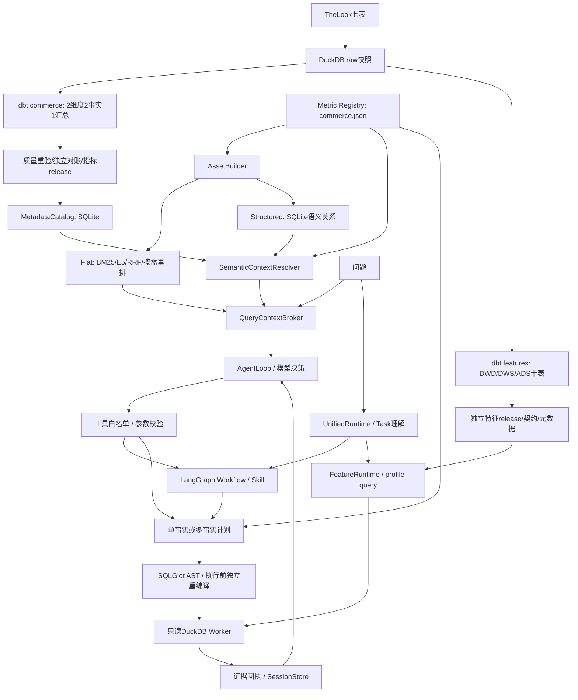
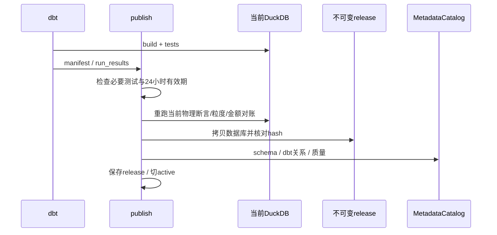
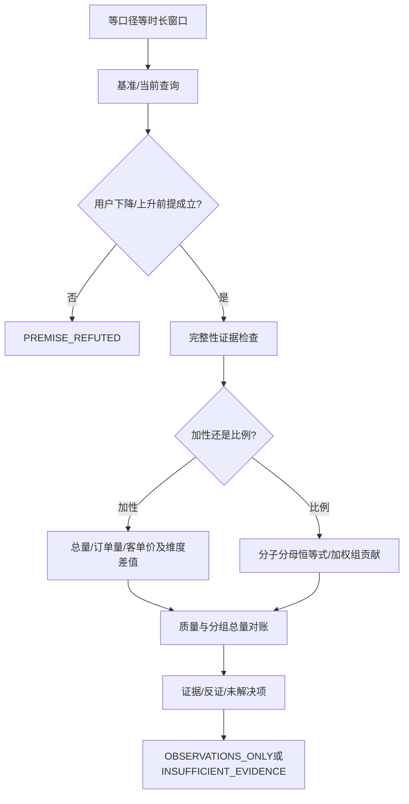

# MyAgent 整体学习手册：从数据开发到自主 Agent

本手册对应本次整体项目验收的源码，实现基线为第四阶段完成后的 MyAgent。它解释实际执行，不把设计愿景当作已实现能力。验收结果、时间和可机器读取证据见 [整体验收报告](PROJECT-ACCEPTANCE.md)、[核心执行回执](project-final-acceptance.json)。

阅读规则：先理解一次查询怎样得到可信数字，再理解 Agent 怎样选择动作，最后阅读检索、诊断、加工与运行管理。旧阶段报告和早期 Word 文档是历史记录；本手册与本次验收报告是当前学习入口。

## 1. 先用一句话解释项目

MyAgent 是面向电商数据开发和分析的本地 Data Agent：以 TheLook 合成电商数据建立可验证数仓和画像产品，以版本化指标注册中心固定计算语义，以双路检索提供候选及约束，由模型选择有限工具，再通过确定性编译和只读执行得到可追踪证据。

它有两个学习维度：

- **数仓维度**：采集、分层、粒度、关联、指标口径、质量检查、画像交付和版本发布。
- **Agent维度**：任务理解、语义检索、自主工具选择、多候选计划、Skill、状态记录、执行约束和证据停止条件。

模型不负责决定数据库权限、改写权威公式或直接运行自由 SQL。这里的“自主”是让它决定下一步查什么、用哪个合法工具、是否需要澄清；不是让它越过工程契约。

## 2. 当前真正完成了什么

|领域|实际能力|应避免的说法|
|---|---|---|
|数据源|TheLook七表，本次快照3,358,422行|接入了真实企业交易/支付系统|
|指标数仓|2个维度、2个事实、1个日汇总；12个单事实指标|全面覆盖企业指标体系|
|跨事实|注册1个派生指标items_per_order@1；先聚合后关联|任意多表Join规划|
|特征开发|3张DWD、4张DWS、3张ADS；用户/商品/交互/会话查询|已经训练CTR/CVR/推荐模型|
|任务理解|有限规则及真实模型结构化输出|所有自然语言表达均可靠识别|
|自主Agent|模型逐轮选12个白名单工具|ask/chat默认已是自主Agent|
|Multi Plan|2–3个同目标候选，选一个逐步执行，最多3次proposal|多个Agent并行搜索或数据库成本优化器|
|RAG|BM25-style、E5向量、RRF、条件Cross-Encoder、Registry解析和SQLite关系|完整GraphRAG或百万指标性能已验证|
|元数据|物理schema、Owner声明、dbt任务/关系、质量、部分值血缘和控制血缘|完整DataHub治理产品|
|Harness|会话、事件、回执、版本约束、共享预算、指标Worker重试/熔断|全部路径恢复和重试能力相同|
|MCP|13个本地stdio工具；Agent自身使用进程内工具|Agent每次动作都经过远程MCP|
|验收|工程正反例、实际数据对账、真实模型取数冒烟|模型准确率、生产认证或因果验证|

## 3. 三条入口必须分开理解

|入口|模型参与|执行组织|画像|恢复|
|---|---|---|---|---|
|ask/chat rules|无需模型；有限规则输出Task|LangGraph Workflow固定组织步骤|统一入口规则路由|Workflow可重放与复用当前版本回执|
|ask/chat llm|模型一次理解Task，随后受校验|执行仍是Workflow|画像仍规则解析|同上|
|agent|模型每轮决定tool/clarify/finish|Python AgentLoop循环；工具内部可执行Skill/Workflow|自主工具白名单当前没有画像工具|保存状态，但明确不支持中断resume|
|agent --multi-plan|模型提出、选择、逐步执行候选|MultiPlanManager约束目标和顺序|同上|同上|
|profile / 画像ask/chat|规则或结构化FeatureRequest|独立FeatureRuntime|支持4类数据产品|独立会话与release校验|
|本地MCP客户端|取决于外部客户端|FastMCP调用同一受控服务|13工具中包含画像工具|不自动套用整个Harness预算|

**关键区别**：Workflow和Agent可以组合。外层Agent自主选择“运行异常分析”，内部异常Skill用确定性步骤完成比较和对账，这种组织是当前实现；不需要为了自主而把每次算数都交给模型。

## 4. 总体架构与文字调用链



```text
离线数据开发
  TheLook -> raw -> dbt -> 当前物理断言+独立raw对账
  -> 不可变warehouse/feature数据库 -> release和hash -> active指针

离线语义资产
  commerce.json + business.json + references
  -> AssetBuilder -> Flat文档 + Structured节点/边
  -> 变化文档编码 + SQLite关系差量写入 + 墓碑
  -> 完整snapshot -> 最终发布锁 -> active原子切换

自主查询
  question -> AgentLoop.start -> SessionStore.create/版本绑定
  -> QueryContextBroker.prepare
     -> RetrievalService.retrieve -> Flat候选
     -> SemanticContextResolver.resolve -> Registry/元数据/关系索引证据
  -> ModelDecision -> Decision校验 -> guard_request -> 工具参数校验
  -> run_query -> SkillExecutor -> RuntimeTools.plan/execute
  -> service.AgentTools.plan -> SQLCompiler -> 服务端plan_id/hash
  -> service.AgentTools.execute -> 权限/版本/窗口/SQL重编译
  -> Worker -> 数值+质量+口径+release -> Observation
  -> 下一轮模型 -> 引用实际证据finish / 澄清 / 停止
```

## 5. 源码地图：按职责读，不必逐文件通读

以下为当前核心文件的类/方法起始行。完整自动生成符号和SHA256见 project-final-acceptance.json.source_symbols/source_sha256。

|问题|源码入口|阅读重点|
|---|---|---|
|从哪进入|src/local_agent/cli.py:12 main；feature_agent.py:224 UnifiedRuntime|入口分派与三类模式|
|自然语言如何成为请求|tasks.py:38 TaskInterpreter；:79 parse；:117 _rules；:170 _model|时间/歧义/过滤保留，最终Task契约|
|自主循环如何实现|agent_loop.py:130 AgentLoop.start；:244 guard_request|第一次检索、每轮决策、观察、停止|
|工具如何执行|agent_tools.py:42 AgentTools；:79 call|模型名称只匹配白名单，实际业务分发|
|Workflow如何走|harness.py:27 build_agent|StateGraph节点与错误出口|
|Skill如何落地|skills.py:49 SkillRegistry；:83 SkillExecutor|输入schema、依赖、文档资源与代码分支|
|指标如何编译|semantic.py:21 Query；:39 SemanticRegistry；:60 expression；:89 compile|固定表/维度、聚合后比例、SQL AST|
|多事实如何关联|multi_fact.py:46 MultiFactCompiler.compile|共同维度/时间基础/先聚合/空值/末尾LIMIT|
|多候选计划如何选|multi_plan.py:49 propose；:124 select；:134 execute_step|目标签名一致、候选ID、步骤顺序|
|计划为何不能替换SQL|service.py:144 plan；:211 execute|请求、主体、版本、hash和独立重编译|
|如何保存执行|runtime.py:16 SessionStore；:109 RuntimeTools.execute；:151 binding|账本、回执、租约、恢复与失效|
|Flat检索怎样融合|retrieval_service.py:28 retrieve；dense_retrieval.py:234 rrf|前置授权、融合、歧义不能被排序覆盖|
|Structured怎样解析|semantic_context.py:46 resolve；structure.py:84 query|权威重读与投影图，二者不是同一权威|
|如何增量发布|assets.py:11 build；dense_retrieval.py:114 publish_index|同源派生、复用、墓碑、发布锁|
|模板缓存怎样用|query_templates.py:22 compile|只缓存聚合AST，新绑定参数，执行重编译|
|元数据来自哪里|catalog.py:30 ingest；:117 field_lineage；:145 lineage|实体/Aspect/关系/dbt产物/保守解析|
|异常怎样验证|diagnosis.py:11 run|前提反证、分子分母、分组重构、证据不足|
|画像怎样生成和查|feature_pipeline.py:223 build；feature_agent.py:110 read_profile|加工与查询分离，日期和release固定|
|重试与熔断|resilience.py:84 retry_call；:35 CircuitBreaker|瞬时错误分类、次数与半开探测|
|最终在哪里执行SQL|worker.py:6 main|只读、禁外部访问、资源上限|
|MCP实际协议|mcp_server.py:8 FastMCP服务，:86 main|stdio适配，无远程服务假设|

注意项目中有两个同名AgentTools：service.AgentTools是可信业务服务，agent_tools.AgentTools是模型动作适配器。读调用链时必须用模块限定名区分。

## 6. 数据仓库：为什么先定义粒度

### 6.1 原始数据和两条加工路径

原始表分别是distribution_centers、products、users、orders、order_items、inventory_items、events。原始events约243万行，总行数335万；语义资产只有21份。**事实数据量与RAG资产量不是同一规模问题**：检索指标定义，不把每条订单变成向量文档。

commerce路径用于固定指标：

```text
users ---------------------> dim_users -----------------------+
products + distribution ---> dim_products -----------+        |
orders + order_items + inventory + unique dimensions  |        |
                    -> fct_order_items(order_item_id) |        |
                    -> 按order_id先汇总明细 ---------> fct_orders(order_id)
fct_order_items -> dws_daily_sales
```

fct_orders一行一订单；fct_order_items一行一件商品明细。订单事实的金额来自先聚合到order_id的明细，因此后续统计订单量不会因明细Join膨胀。当前商品件数按明细行计数，源没有quantity字段。

### 6.2 12个标准指标与1个跨事实派生

|指标ID|公式/对象|需要牢记|
|---|---|---|
|order_count@1|订单事实COUNT(*)|全部状态订单|
|booked_amount@1|SUM(booked_order_amount)|下单金额，不是实收|
|average_order_value@1|booked_amount/order_count|先聚合再除；零分母null|
|buyer_count@1|COUNT DISTINCT user_id|跨国家/日期等分组不能盲目累加|
|item_count@1|明细事实COUNT(*)|一明细一件|
|complete_item_amount@1|Complete明细金额和|当前快照状态，不是历史当日状态|
|complete_order_count@1|Complete订单条件计数|当前订单状态|
|complete_order_rate@1|完成订单数/订单数|订单完成占比，不是支付/访问转化|
|cancelled_order_count@1|Cancelled订单条件计数|当前快照状态|
|cancelled_order_rate@1|取消订单数/订单数|同窗口同过滤|
|returned_order_count@1|Returned订单条件计数|没有退款资金流水|
|returned_order_rate@1|退货订单数/订单数|不是历史退款率|
|items_per_order@1|明细件数/订单数，多事实注册|只在合法共同维度上关联|

versioned ID用于防止名称变化掩盖口径变化。合同里的version字符串是整体标识；SHA256识别精确内容。新增口径需要明确指标ID、事实、grain、时间基础、聚合性质、维度范围、单位和质量验证。

### 6.3 加性、半加性、非加性

下单金额在互斥明细集合上可加；订单量在按互斥订单维度分组时可加；distinct买家数通常跨组不可加；比例不能把各组值求和或简单平均。

例如：A组金额100/订单1=100，B组金额900/订单9=100，两组平均恰好100。但把B金额改为450，其客单价50；简单平均75，总体应为550/10=55。正确性来自分子分母在同一总集合聚合，不来自一个看起来合理的结果。

项目显式支持受限count/sum/distinct/conditional_count/conditional_sum/ratio，不提供任意窗口函数、库存余额半加性规则或任意用户表达式引擎。

### 6.4 特征开发十表

|层|表|粒度/交付作用|
|---|---|---|
|DWD|dwd_behavior_event|event_id；标准化、匿名/异常标志、截止资格|
|DWD|dwd_product_view|event_id；可解析的product页面访问|
|DWD|dwd_order_item|order_item_id；下单明细与时间资格|
|DWS|dws_user_behavior_day|activity_date,user_id；用户日行为|
|DWS|dws_product_behavior_day|activity_date,product_id；商品日行为|
|DWS|dws_user_product_day|activity_date,user_id,product_id；交互日汇总|
|DWS|dws_session_behavior|as_of_date,session_id；会话观察|
|ADS|ads_user_profile_daily|as_of_date,user_id；7/30日用户特征|
|ADS|ads_product_profile_daily|as_of_date,product_id；商品特征|
|ADS|ads_user_product_features|as_of_date,user_id,product_id；已观察交互对|

特征截止as_of为UTC当天00:00，统计其之前的数据，例如截至10月11日即不包含10月11日当天。7/30日不是未来7/30日标签。DWD保留匿名和异常行，DWS/ADS显式选择符合资格的事件，不静默修复源数据。

会话可能跨天，项目不会凭现有数据认定会话已闭合。purchase事件不代表资金支付成功，没有purchase事件标记为UNKNOWN_NOT_VERIFIED_NEGATIVE。用户商品表只保存已观察交互对，不构建用户×商品全笛卡尔积，也不把缺记录伪装成负样本。

### 6.5 为CTR/CVR/推荐业务交付了什么

已经交付可被推荐业务使用的行为清洗、窗口聚合和实体特征查询，重点是生产数据产品。CTR需要可信曝光/点击事实；CVR还需要明确转化事件与观察成熟期。本数据不能把页面访问叫广告点击，也不能把Complete叫支付成功。当前可以讲“面向推荐业务的数据开发”，不能讲“完成了CTR/CVR标签生产和线上推荐效果验证”。

严格PIT需要同时满足event_time截止与当时可见的ingestion_time；当前ingested_at源于整批快照观测时间，不是每行历史到达时间。只按event_time过滤不能重建过去实际可知的数据。

## 7. 可信发布：为什么不能直接查正在改的数据库

service.AgentTools.publish读取真实dbt结果和manifest，要求必要检查通过、凭证不超过24小时；随后在当前物理库重跑断言、检查事实主键粒度、对账订单/明细/raw金额、尝试编译所有标准指标。复制数据库前后校验hash，构建本地元数据目录，保存release并切active。



```text
dbt PASS -> 不能直接信任旧产物
  -> 检查生成时间
  -> 断言真正运行到当前数据库
  -> raw独立对账
  -> 复制前后hash一致
  -> 数据/合同/目录hash组成release
  -> 查询每次复核release
```

这里没有伪造“完整性水位”。质量检查通过证明主键、关系、状态和金额等检查成立；不证明所有迟到数据已经到齐。重新build能刷新真实质量检查时间，但不会改变原始源观测时间，也不会自动获得历史状态。

本次整体初验确实因24小时质量过期失败，之后真实重跑build和发布再验收。遇到同样问题应重新检查，不应手改generated_at。

边界：commerce的catalog是home下共享SQLite，active使用固定active.partial；数据库快照虽不可变，整个发布流程没有第四阶段索引那样完整的并发发布锁，也不提供目录/active跨文件事务保证。当前应单发布者运行；并发生产发布、原子目录版本化和GC未验收。

## 8. 自然语言理解：不是简单把中文“翻译给模型”

自然语言本来就是模型的输入。关键转换是把含歧义的业务表达变成**可验证的执行契约**：指标ID、UTC闭开时间、合法维度、精确过滤、任务类型和比较基准。

例如“今天转化率为什么比昨天低”包含：待确认指标、今天/昨天、下降假设、诊断任务。但本地转化率未定义且今天尚未结束，因此应先澄清，不能随意映射订单完成率后解释下降。

规则模式通过business.json别名与有限日期解析；未知限定语会停止，不忽略。模型模式输出Task JSON，再做相同schema、维度、过滤、时间检查。模型提取只是候选解释，不是业务授权。

Query结构示例：

```json
{
  "metric_id": "average_order_value@1",
  "start": "2026-09-01",
  "end": "2026-10-01",
  "group_by": ["country"],
  "filters": {},
  "limit": 100
}
```

Query禁止额外SQL、表名、自由表达式、principal；最多31天、4个不重复维度、1000展示行。Task诊断要求两个等时长、不重叠窗口，指标/过滤相同，总量比较从标量开始。

明确条件保护guard_request会核对已识别的指标、筛选和时间，拒绝静默改变目标。但这些规则不能证明任意自然语言已完整理解；当前summary_verified=false是诚实边界。

## 9. Flat RAG：怎样召回，为什么需要混合检索

### 9.1 索引什么

AssetBuilder从Registry、business.json案例/别名和Skill参考派生21份当前资产。Flat文档包含定义、同义词、grain、常用维度和业务提醒；公式不在两份独立业务文件里维护。指标定义删改后应重新发布，旧别名不能继续指向删除指标。

文档稳定ID由kind、原ID和source摘要组成。orders/items/multi_fact/knowledge是检索分区，不等于企业Domain治理。

### 9.2 召回与融合

精确别名适合标准指标；BM25-style兼顾稀有词和词频，中文tokenizer为当前有限实现；E5适合“平均每张订单的金额”等非精确别名。两路排名用RRF融合：

```text
score(asset) = Σ 1 / (60 + rank_in_each_route)
```

RRF利用排名避免直接相加词法分数和向量相似度。它不是置信概率，不能保证第一名就是正确口径。

Cross-Encoder对query-document一起打分，适用于竞争候选/长尾；唯一精确指标或明确歧义跳过。最多10候选，raw logit不是概率，没有基于校准置信度的完整智能路由系统。

### 9.3 实际调用与降级

```text
retrieve(question)
 -> 当前主体/策略/Registry校验
 -> 当前可见资产和partition过滤
 -> BM25-style候选
 -> 可选E5查询向量、授权资产精确相似度扫描
 -> 稳定ID RRF
 -> exact/ambiguous判断 + 按需Cross-Encoder
 -> 候选ID、来源、排名、版本、降级trace
 -> Structured Resolver重读权威定义
```

普通CLI默认lexical；hybrid能明确降级到词法，hybrid-required缺模型/索引即停止。重排off/auto/required类似，但精确/歧义跳过仍属于合法策略。required不意味着每条问题一定重排。Structured auto可退回当前Registry，显式关系工具需要新鲜已发布图。

当前向量以JSON保存并精确扫描，不使用FAISS/Milvus/pgvector/ANN。缓存减少重复加载，但不同问题仍启隔离CPU进程，冷启动可能显著影响120秒预算；没有吞吐承诺。

## 10. Structured RAG、Metadata Graph、知识图谱的区别

### 10.1 Structured Resolver

SemanticContextResolver读取当前Registry，递归展开组件，计算合法共同维度和时间基础，读取对应物理schema/Owner/quality。只有明确要求枚举时才加载维度值，不把全部仓库枚举塞进首次prompt。

它不生成自由Join路径：如果要关联不同事实，只接受multi_fact中已注册共同维度和时间基础，population必须明确。候选相似度没有权利新增关系。

### 10.2 语义关系投影

AssetBuilder同时产生61节点、140边，节点含metric/fact/dataset/field/dimension/entity_key/conformed_dimension。entity_key来自注册grain，不是自动NER抽取。GraphService支持dependencies/impact有界遍历，默认depth3、max_nodes80，上限6/200。只遍历当前主体可见节点。

```text
依赖：metric:average_order_value@1
 -> metric:booked_amount@1 / metric:order_count@1
 -> fact:orders -> dataset:commerce.fct_orders -> 注册字段/粒度键

影响：field:commerce.fct_orders:booked_order_amount
 -> metric:booked_amount@1 -> metric:average_order_value@1
```

字段能影响指标，并不等于该字段变化导致了业务异动；关系可达也不等于允许SQL Join。

### 10.3 物理MetadataCatalog

```text
entities(urn, kind, name)
aspects(urn, name, payload)
relationships(upstream, downstream, kind)
```

URN使用urn:local:dataset:duckdb:commerce.fct_orders等本项目命名空间。Aspect保存schema、ownership、quality、field_lineage、control_lineage；flow/job保存dbt工程与模型任务。表血缘来自manifest.depends_on；值血缘来自SQLGlot表达式解析；控制依赖单独记录Join、Where、Group、Having等影响行集合的条件。

COUNT(*)不一定有某个单字段值来源，但Join条件/过滤条件能改变计数，所以只做值血缘不够。解析不支持/有歧义时保留unresolved和complete:false。Owner为local-study-owner且verified_business_owner:false，不宣称是真实企业负责人。

### 10.4 为什么SQLite足够

当前是少量资产和有界关系遍历，SQLite关系表与索引足够表达依赖。语义图是一种数据模型，不要求专用图数据库。项目没有Neo4j服务，没有完整GraphRAG的社区发现/摘要/global search，也没有企业Glossary/Domain审批产品。

## 11. 第四阶段：资产如何更新与保持一致

```text
Registry/知识变化
 -> 统一派生当前文档+关系
 -> 校验旧完整snapshot
 -> 相同provider identity且正文未变：复用向量
 -> 新增/更新：仅变化文档编码
 -> 删除：当前文档消失 + 最小墓碑
 -> 关系SQLite复制旧快照，差量upsert/delete
 -> 写完整新快照及各文件hash
 -> 发布锁下重查源版本/active竞争/权限
 -> 原子active切换
```

这叫增量编码和关系差量维护，但比较仍扫描全部资产、文件仍完整写新快照；不是生产CDC、流式索引或分布式事务。坏旧索引会阻断复用，不静默绕过hash。墓碑不存全部旧敏感正文；恢复同稳定ID会清除墓碑。

计划和会话绑定Registry、资产、策略、release以及检索/图配置，变更后旧状态不能继续执行。此设计宁可要求新会话，也不接受混合新旧口径；代价是索引发布后旧会话失效较保守。

## 12. Semantic Layer与SQL Compiler：可靠数字的核心

### 12.1 自建实现的范围

SemanticRegistry读取commerce.json。SQLCompiler把受限聚合与查询参数转换为SQLGlot AST，表/列来自可信合同，过滤值成为字面量，不接受模型SQL。并不是调用MetricFlow，也不是复制MetricFlow类名后改接口。

核心代码思想（简化，完整见semantic.py）：

```python
numerator = self.expression(metric['numerator'], seen + (metric_id,))
denominator = self.expression(metric['denominator'], seen + (metric_id,))
return exp.Div(
    this=exp.Cast(this=numerator, to=exp.DataType.build('DOUBLE')),
    expression=exp.Nullif(this=denominator, expression=exp.Literal.number(0)),
)
```

比例聚合后的除法是SUM(amount)/COUNT(*)而非AVG(每天客单价)。零分母返回null；null表示无法计算，不应在模型回答中偷换成0。

### 12.2 计划与执行分两步

plan返回plan_id、SQL、逻辑grain、口径、原请求/有效请求、权限/数据/语义版本和approval_hash。计划保存在服务进程，调用者不能用自己提供的SQL替换。approval_hash是完整性摘要，不是人工审批或远程授权签名。

execute不只检查hash：重新授权、重新读取release绑定、重新解析原请求、重新编译，并比较SQL。这防止计划存储篡改、旧权限复用和缓存公式偷偷改变。

```python
effective, role = self.enforce_request(parse_query(plan['requested_query']))
recomputed = self.compiler.compile(effective, role['minimum_group_size'])
if recomputed['sql'] != plan['sql']:
    raise ValueError('SQL differs from compiler output')
```

最终Worker只读DuckDB、禁外部访问、单线程、256MB内存，受父进程超时/取消控制；结果最多1000行。Worker是内部信任边界，不是OS沙箱，也不应作为自由SQL端口暴露。

## 13. 多事实Join：三个错误与正确方案

### 13.1 直接Join事实导致Fanout

订单O1金额100有2条明细，直接orders JOIN items后SUM(order_amount)=200，订单数COUNT(*)=2。DISTINCT金额不能解决：两个不同订单金额相同会被错误去重。

**正确方案**：事实A按目标共同维度聚合，事实B同样聚合，然后关联唯一分组。项目支持orders与items共同day/country/gender/age_band/traffic_source，两边都以订单下单UTC日为时间基础。

```sql
WITH b0 AS (
  SELECT country, COUNT(*) AS value
  FROM commerce.fct_orders
  WHERE order_date >= DATE '2026-09-01' AND order_date < DATE '2026-10-01'
  GROUP BY country
), b1 AS (
  SELECT country, COUNT(*) AS value
  FROM commerce.fct_order_items
  WHERE order_date >= DATE '2026-09-01' AND order_date < DATE '2026-10-01'
  GROUP BY country
)
SELECT COALESCE(b0.country,b1.country) AS country,
       b0.value AS orders, b1.value AS items,
       b1.value::DOUBLE/NULLIF(b0.value,0) AS items_per_order
FROM b0 FULL OUTER JOIN b1
  ON b0.country IS NOT DISTINCT FROM b1.country;
```

这是说明性SQL；生产执行SQL由AST生成，不能把这个示例直接提交为Agent工具参数。

### 13.2 相同名字的维度不一定可关联

两个fact的country可能分别是注册国家和收货国家；相同列名不足以证明语义一致。项目合同显式注册同源共同维度，时间基础也要一致。未来新增退款/支付/库存事实需重新定义业务实体和映射，不能只扩展工具名。

### 13.3 分组并集/交集改变业务集合

union用FULL OUTER保留任一事实存在的组；intersection用INNER只保留双方存在的组。缺分支保留null，不自动补零；NULL维度用NULL安全等值，避免重复空组。各分支先完整聚合再Join，LIMIT只在最终展示，否则可能丢组。

按category统计订单量当前不支持：一个订单能跨多品类，需要先决定“含该品类的去重订单数”“订单金额分摊”等新的口径。图上存在订单与商品关系不能替代该业务决定。

## 14. Agent Loop与ReAct：自主选择到底在哪里

```text
每轮：构造上下文 -> 模型选择一个结构化动作 -> 校验 -> 执行 -> 保存观察
                              ^                         |
                              +-------------------------+
终止：clarify / finish引用有效证据 / 错误或预算STOPPED
```

ModelDecision使用Responses严格JSON输出tool/arguments_json/message/evidence_ids。模型能选择查询、上下文、比较、诊断、关系和候选计划。Action/Observation形成ReAct式交替；项目不依赖某个名为ReAct的库，不保存或展示模型私有思维链，也不声称原生function_call协议。

默认6轮决策、3次检索，参数上限12/6；会话默认16查询/120秒。首次自动检索上下文为bootstrap，显式search/resolve/relations共享搜索次数限制，不能把预算数理解为总数据库扫描次数。维度枚举与hash/模型加载也有成本，未完全纳入逻辑查询账本。

模型输出结构例子：

```json
{"action":"tool","tool":"run_query",
 "arguments_json":"{\"metric_id\":\"average_order_value@1\",\"start\":\"2026-09-01\",\"end\":\"2026-10-01\"}",
 "message":"","evidence_ids":[]}
```

ModelDecision将arguments_json解析为字典，Decision验证跨字段一致，再用Query等工具契约验证。tool动作不允许夹带最终回答。finish必须引用实际成功Observation ID；它不能凭空引用e99。

但有证据引用仍不能保证回答文字每个数字/条件都正确。普通Agent的finish只要求引用成功Observation，成功的检索/目录观察也可被引用，并没有通用代码强制“数值问题必须有run_query结果”；multi-plan模式另外要求实际可执行步骤证据。学习/演示数值回答时要核对真实查询回执，不能只看COMPLETE。summary_verified:false、causal_claim:false明确这一点；当前真实模型只验收取数happy path，复杂决策准确率未评测。

另一有限边界：guard_request在识别到明确日期表达时核对窗口，但普通Agent缺日期的问题并没有统一硬性代码阻止模型自行选窗口；模型提示要求澄清，不能把这个提示等同于服务端强制。Task模式的_model则要求能解析明确窗口。学习当前实现时要区分提示约束与确定性执行约束。

## 15. Multi Plan：提供选择，但不改变目标

propose_plans要求2–3个候选，每候选1–6步；候选白名单仅describe_metric/get_context/run_query/run_comparison/run_diagnosis/run_multi_fact。搜索、结构关系可由外层Agent先调用，当前不是任意候选DAG。

服务端预检schema、时间、权限、语义、编译和目标指纹。候选必须具有相同可执行数值任务集合，可以改变“先核对上下文再查询”等组织，不允许“金额改成订单量”伪装另一计划。

```text
propose -> 返回服务端候选p-ID
select(p-ID) -> 标为SELECTED
run_plan_step(p-ID,0) -> 实际证据
下一轮观察 -> run_plan_step(...,1) / 重新propose / finish
```

不能跳步或重执行已执行步骤；重提使旧候选ID失效。最多3次proposal，候选查询成本是逻辑次数上界，不是金额/延迟或物理优化器成本。当前不自动并行执行所有候选。

候选p-ID与SQL plan_id不是同一层：前者决定做哪些动作，后者决定本次受控SQL。真正执行时仍独立重编译。

## 16. Skill：不是一段Prompt，也不是每个文件都自动执行

SkillRegistry有7项：metric-query、comparison、drilldown、quality-check、anomaly-analysis、evidence-report、profile-query。还有独立warehouse-feature-engineering加工包，但不在7项注册查询Skill里。

```text
warehouse-anomaly-attribution/
  SKILL.md
  references/metric-rules.md
  references/attribution-methods.md
  references/tool-contracts.md
  assets/report-template.md
```

文档规定执行方法与边界，资源hash进入会话绑定；输入/输出schema来自Python模型，确定性计算在SkillExecutor和DiagnosisEngine。当前运行入口是固定代码分发，不是模型任意发现一个SKILL.md就加载其中任意脚本。

依赖图启动验证完整无环，深度最多4。dependencies说明能力依赖，只有代码实际调用self.run才执行子Skill，不自动对依赖名称进行拓扑执行。SkillSpec的max_queries与tools也不能理解成通用隔离沙箱：查询实际共享RuntimeTools账本，诊断引擎另有自身预算；元信息并未为任意未来插件提供通用权限拦截器。

因此新增Skill不能只写Markdown：还需契约、注册、分发、确定性实现、预算/证据行为及必要回归。报告模板负责表达证据，不授权模型生成未经验证的根因。

## 17. 异常分析：能证明哪些内容



```text
compare -> 检查用户前提 -> 分子/分母或量价 -> 合法维度下钻
 -> 分组重构总量 -> 质量/窗口/成熟度证据 -> 有界报告
缺完整性水位/业务事件证据 -> 保留数字 -> 停止确认因果
```

订单金额A=N×P，对称量价拆解：

```text
volume = (N1-N0)*(P0+P1)/2
basket = (P1-P0)*(N0+N1)/2
volume + basket = A1-A0
```

比率R=A/N：

```text
numerator   = (A1-A0)*(1/N0+1/N1)/2
denominator = (A0+A1)*(1/N1-1/N0)/2
两项和 = R1-R0
```

分组比率贡献用A_g1/N_total1-A_g0/N_total0，而不是各组ratio直接相加。每个维度内总分子/分母需对账回总量；不同维度分解是不同切片，不能把渠道贡献和国家贡献再次相加，否则重复解释同一变化。

注册Skill下比例诊断两窗口总比率2次、分子2次、分母2次、每个维度4次；2维度共14查询，最多16查询、60秒。直接DiagnosisEngine默认8查询/60秒、且无executor时比例维度拆解未完整执行；MCP run_diagnosis当前走这个直接入口。两个路径不可混称相同覆盖。

当前输出包括用户前提反证、代数恒等式、分组残差和完整性/成熟度缺口。没有业务活动日志、实验或外部因果证据，所以即使数学贡献对账通过，也不应回答“广告投放导致下降”已证明。

## 18. Harness、重试、熔断与恢复

SessionStore保存sessions、events、receipts。运行前版本绑定、执行前扣查询预算、查询后先保存回执，再checkpoint节点。180秒租约防止同一会话同时执行；这不是分布式调度器。

Workflow恢复是重新规划并重放，复用同主体/同版本/同请求的已授权回执；不是从任意Python栈指令继续。版本变化应新建会话。只读回执复用不能推导写入操作exactly-once，也不代表生产补数已实现。

指标Worker瞬时终止才进入TransientFailure重试，默认最多3次，熔断阈值3，冷却30秒，半开仅1探测；权限、口径、时间、hash等确定性错误不重试。每个重试仍扣查询预算，不能靠重试突破16次。

**路径差异**：Task模式OpenAI provider带有自己的retry_call；AgentLoop.ModelDecision目前直接HTTP调用并遇错停止，没有相同自动模型重试。画像Worker超时15秒，没有指标Worker同等重试/熔断，FeatureRuntime取消在前后检查，不能宣称取消立即传播到正在执行的画像子进程。自主Agent明确拒绝resume，但支持show/cancel和澄清后新turn。

这是可接受的学习工程边界，也是真实面试能主动说明的限制。

## 19. MCP、权限与可观测性

本地FastMCP公开13工具：describe_metric/get_context/get_lineage/plan_query/execute_query/compare_windows/search_business/run_diagnosis，和5个画像/契约工具。Agent进程内白名单12工具含multi-plan/relations，但不含画像。两套工具不同，不代表漏掉了一次API调用。

```text
实际stdio：ClientSession -> list_tools/call_tool -> FastMCP -> service.AgentTools -> Worker
进程内：AgentLoop -> agent_tools.AgentTools.call -> Skill/服务 -> Worker
```

Runtime事件中的mcp_tool:'execute_query'是工具名语义标注，同时transport:'in-process'，不能凭字段名声称真实网络MCP。

本地默认信任OS用户，服务主体local-study-user。受限能力令牌绑定us-analyst，强制United States过滤、指标/维度白名单、小组>=5，禁止用户级画像；模型不能提交principal解除过滤。token HMAC、expiry、issuer、revocation可验证，但不是企业IdP/SSO、多租户或数据平台全局RLS。

可观测信息包括状态、决策、成功/错误Observation、模型usage、工具事件、重试和熔断事件、口径/策略/release/资产绑定、数据回执及audit.jsonl。没有全量OpenTelemetry链路、统一监控平台或追加不可篡改审计承诺。部分元数据列值枚举读取不进入主查询尝试计数，应在解释资源成本时说明。

## 20. 缓存：四种缓存不要混淆

|缓存|内容|作用|关键边界|
|---|---|---|---|
|词法索引|授权资产/token计数|同进程复用|资产版本变化重建|
|查询向量/重排分数|模型结果，容量各32|减少重复模型加载|模型identity/正文/问题绑定，无事实结果|
|QueryTemplateCache|聚合AST，容量256|重用编译形状|不保存日期/过滤值/完整SQL/答案；独立执行重编译|
|会话receipts|真实查询结果|Workflow重放避免重复只读查询|同会话/主体/请求/版本，仍需重验授权|

模板checksum是意外损坏防护，不是对恶意本地管理员的密码学隔离。真实执行重新编译提供额外一致性保证；不把缓存视为新的指标定义来源。

## 21. 框架选择与三项目借鉴

|技术/项目|在本项目解决的问题|代价和边界|
|---|---|---|
|DuckDB|本地SQL和列式聚合，轻量复现|单机资源、非企业分布式引擎|
|dbt|声明依赖/分层/检查/产物，为元数据提供证据|独立开发环境；当前全量，不是CDC调度器|
|SQLGlot|程序构建AST、校验结构、解析部分血缘|不能替代业务grain或证明完整血缘|
|Pydantic|拒绝未知字段、校验Query/Task/工具输入|schema通过仍需语义和权限校验|
|LangGraph|Workflow状态节点和分支|自主AgentLoop主要是项目自己的Python循环|
|SQLite|轻量目录、语义关系、会话、缓存、熔断|本地并发/容量和运维受限|
|E5 / Cross-Encoder|词面变化候选与长尾重排|冷启动、资产规模与准确率未完整评测|
|OpenAI Responses|受约束Task/动作决策|API可用性/输出仍需严格服务校验|
|MCP SDK|外部本地客户端标准工具发现/调用|不替代业务权限/Skill/Harness|
|MetricFlow参考|指标/事实/grain、组合聚合与确定性编译思想|本项目自建受限子集，不运行MetricFlow服务|
|DataHub参考|Entity/Aspect/URN/Relationship和血缘/质量思想|本地目录不是DataHub完整治理实现|
|WrenAI参考|语义上下文支持自然语言查询与Agent|不把MetricFlow结果再次交给Wren编译；无运行依赖|

三项目核心类没有直接复制进本项目。面试应说“研究源码后独立实现了范围受限的语义与元数据能力”，不说“复刻了三个平台全部能力”。各上游研究报告的具体源码证据属于此前独立研究，本次验收以MyAgent源码为依据。

## 22. 运行手册：学习时实际执行这些步骤

在MyAgent根目录执行。不要把代码块里的解释或占位符当真实参数。

```powershell
# 查看固定目录和注册Skill，不消耗模型API
.\.venv\Scripts\python.exe -m local_agent.cli metrics
.\.venv\Scripts\python.exe -m local_agent.cli skills

# 质量过期时真实重建/发布；不重新下载源数据
.\scripts\build-warehouse.ps1

# 基础规则取数与明确歧义
.\.venv\Scripts\python.exe -m local_agent.cli ask "查询2026年9月订单量"
.\.venv\Scripts\python.exe -m local_agent.cli ask "2026年9月销售额是多少"

# 连续Workflow交互；画像仍规则解析
.\.venv\Scripts\python.exe -m local_agent.cli chat

# 实际模型自主模式：读取已保存本机DPAPI配置，执行会产生API请求
.\scripts\start-agent.ps1 -Question "2026年9月平均每张订单的金额是多少"

# 多事实结构化例子
.\.venv\Scripts\python.exe -m local_agent.cli multi-query --request config\multi-fact-query.example.json

# 当前已发布的语义关系；不依赖专用图数据库
.\.venv\Scripts\python.exe -m local_agent.cli relations metric:average_order_value@1 --depth 4
.\.venv\Scripts\python.exe -m local_agent.cli relations field:commerce.fct_orders:booked_order_amount --direction impact

# 指定日期的数据产品
.\scripts\build-feature-mart.ps1 -AsOf 2026-10-11 -VerifyRepeat
.\.venv\Scripts\python.exe -m local_agent.cli profile --product user_profile --as-of 2026-10-11 --user-id 12989

# 本次整体本地核心验收，不调用付费模型
.\.venv\Scripts\python.exe scripts\project-acceptance.py
.\.venv\Scripts\python.exe -m pytest
```

启用真实Dense需准备.retrieval-venv、本地权重和索引，见retrieval-phase2-guide.md。启用Cross-Encoder见phase3-guide。上面start-agent默认hybrid/auto，可能降级，应阅读trace。强制神经链路验收可传-RetrievalMode hybrid-required -RerankMode required；这些模式不能自动安装缺失权重。

数据库、release、权重、索引、会话、签名key和DPAPI凭据都不上传GitHub，新clone不会自动具备本机可运行数据。环境分为.venv、.warehouse-venv、.retrieval-venv，避免依赖混装。当前按Windows+editable安装验收，完整Linux/macOS、独立wheel资源打包未验收。

## 23. 输出状态怎么读

|状态/字段|含义|你该如何解释|
|---|---|---|
|COMPLETE|该受限任务执行完成|不等于模型文字被业务证明|
|CLARIFY|执行前缺口径/日期/维度等|补充明确条件，不默认选第一名|
|STOPPED|资源/权限/版本/执行等不允许继续|阅读error和事件，修复条件后新建或恢复支持的会话|
|PREMISE_REFUTED|用户说下降但对比不成立|先修正问题，不继续编根因|
|INSUFFICIENT_EVIDENCE|有数值，但缺完整性/因果等证据或部分流程被阻断|看unresolved/stopped_reason区分正常证据不足与工程停止|
|OBSERVATIONS_ONLY|只报告观察与贡献|仍不宣称因果|
|result_may_be_truncated|达到LIMIT可能有未显示分组|不能用展示数据声称全量归因|
|summary_verified:false|模型摘要未被逐项自动证明|以实际回执数字与口径为准|
|causal_claim:false|没有因果证明|用“观察到/代数贡献”，不用“导致”|

CLARIFY/STOPPED/INSUFFICIENT_EVIDENCE命令行通常退出码2；部分是预期业务状态而非程序崩溃。COMPLETE下空窗口null或画像found:false也有各自明确语义。

## 24. 面试复习：30个进阶问题与完整回答

### 1. 项目最核心的价值是什么？

把“语言看起来懂”与“数据计算真的对”拆成独立责任。LLM理解并选择动作，Registry固定口径，编译器固定grain和Join规则，发布与执行校验固定数据版本，证据报告明确限制。这样失败能定位到理解、检索、编译、数据或执行阶段，不全归于Prompt。

### 2. Agent和Workflow的区别，在你的项目哪里体现？

Workflow的步骤顺序由StateGraph确定，模型可做一次Task理解；AgentLoop每轮由模型从工具白名单选择动作，读取真实结果后继续。复杂诊断作为工具内部Workflow执行，因此自主决策和确定性业务流程可以组合。本项目ask/chat与agent入口明确不同。

### 3. 为什么不用LLM直接写SQL？

SQL语法正确不保证指标口径、时间集合、grain、权限正确。受限IR让模型提交业务意图，由合同与编译器生成AST，禁止任意物理表/表达式。代价是覆盖范围较窄，但当前学习工程可解释、可对账；未知问题澄清而不是任意尝试。

### 4. Semantic Layer与Metadata分别维护什么？

Semantic维护计算含义：哪个fact、怎样聚合、组件、时间基础、合法维度、单位。Metadata维护对象及证据：真实字段、任务关系、Owner、质量、物理血缘。schema存在不代表业务口径有效；指标定义存在也不代表数据质量通过。查询需要两者交汇。

### 5. 双路RAG会不会导致两份指标定义？

不会让两路分别成为权威。AssetBuilder从同一Registry派生Flat文档和Structured关系，候选只携带ID；Resolver与执行重新读取Registry。知识案例可以提醒错误口径，但不能覆盖公式。资产版本/hash使改动后旧索引/会话失效。

### 6. 为什么用BM25和Dense，而不是只用向量？

明确metric ID、术语与稀有业务词适合词法；同义表达和长尾改写适合Dense。混合召回覆盖两类情况；RRF按rank融合，避免不可比原始分数。相似度只帮助候选发现，不能代替口径澄清。

### 7. 为什么Cross-Encoder按需使用？

它对问题和候选共同编码，排序能力可帮助长尾，但每对候选推理成本高。已明确唯一指标没必要再排序，明确歧义也不能靠模型分数替用户决定。项目只对有竞争/长尾的至多10资产重排并记录trace；没有未经验证的性能收益百分比。

### 8. Structured RAG等于知识图谱或GraphRAG吗？

不等于。Resolver主要是确定性Registry解析，图保存注册关系以支持依赖/影响查询；没有自动实体关系抽取、社区摘要或global search。SQLite就能表示当前有界图。是否换专用图数据库取决于规模与遍历需求，而非术语。

### 9. 字段值血缘为什么不够？

SUM(sale_price)的值来自sale_price，但WHERE状态、JOIN键和匹配规则决定哪些行进入SUM；COUNT(*)甚至没有单个值字段。项目分别保存field_value与control_join/filter/group，未解析部分明确标记。完整SQL语义需要更广范围解析，当前没有声称全覆盖。

### 10. Fanout是什么，为什么COUNT DISTINCT不是普遍解法？

一对多Join复制左侧事实，订单金额和计数可能倍增。COUNT DISTINCT订单ID能修某个计数，但不能通用修复金额和比率；SUM DISTINCT金额会误去重相同金额的不同订单。应先固定事实grain，聚合到合法目标grain再关联。

### 11. 不同事实共享country就能Join吗？

不一定，还需同一业务含义、映射、时间基础及基数约束。注册国家与收货国家同名也不等义。当前只允许合同共同维度，且两个fact时间都按订单UTC下单日；新增fact需适配与质量检查。

### 12. union与intersection为什么要用户明确？

它们决定哪些业务分组进入结果，并非优化器自由选择。union保留任一分支有数据的组；intersection只保留共同组。模型静默选择可能改变问题。缺分支null不自动为0，除法分母零仍null。

### 13. 为什么多事实各分支不能先LIMIT？

分支截断会把本应匹配的分组删除，导致外连接遗漏/错误null和比例变化。当前先完整聚合各fact，Join后最后排序和LIMIT。展示截断会标记，诊断不能用截断数据证明全量贡献。

### 14. 多计划优化了什么，不优化什么？

模型可选择同一数值目标下先核对上下文或直接查询等动作组织，观察结果后重提。它不选择任意物理Join、不并行跑所有候选、不自动计算数据库成本。目标签名保证策略变化不偷换业务问题，SQL实际计划仍即时校验生成。

### 15. finish引用证据就代表答案正确吗？

不代表。它证明被引用Observation真实存在且成功，不能自动证明文本所有数字和因果描述正确。项目返回完整证据并标summary_verified:false；真实模型成功取数只能证明该路径，不能宣称泛化准确率。

### 16. 怎么避免模型漏掉美国、男性或时间过滤？

用DimensionResolver将业务词映射真实枚举，guard_request与TaskInterpreter._model对已识别明确条件进行核对，服务再加权限行过滤。结构化请求最终编译，不把自然语言原词当SQL值。当前保护是有限语言识别，不承诺覆盖任意省略/复合条件。

### 17. 为什么今天与昨天不能直接比？

今天尚未结束，且快照观测日限制和迟到数据可能使时间覆盖不等。当前只允许完整UTC日；源max时间不是完整性水位。成熟订单状态与历史状态还缺证据，应该澄清或报告证据不足，而不是解释为业务下降。

### 18. 为什么Complete订单占比不是支付成功率？

支付需要支付尝试、结果、重试、退款/撤销等资金事实和明确分母；TheLook只有当前订单/明细状态与purchase事件。把不同事件口径混用会得到一个数字但业务问题未被回答。项目在任务理解层拒绝这种替代。

### 19. 异常诊断如何保持数学正确？

先同口径窗口比较确认用户前提，再对加性指标做分组差值、金额做对称量价、比例做分子分母恒等式。下钻总量必须重构原总量，残差超过阈值停止；每个维度独立解释，不能累加多个维度的贡献。

### 20. 数学贡献能证明原因吗？

不能。它说明变化怎样在已观测数据内分解，未排除迟到、状态成熟、共同因素，也没有业务事件或实验。项目明确causal:false且缺独立证据时INSUFFICIENT_EVIDENCE。面试可讲“证据驱动异常分析”，不要讲“自动找出真实根因”。

### 21. Skill相比普通函数多了什么？

有可读入口、领域参考、输入输出schema、依赖、执行预算、前后置语义与证据格式，并参与运行资源hash绑定。最终能力仍由确定性代码实现；文档不是安全沙箱，新增Skill要完成注册/分发/测试。这样可复用业务能力且界限明确。

### 22. Harness解决的核心问题是什么？

执行状态散落在内存时难审计、预算难统一、崩溃后可能重复执行。Harness保存Session/Event/Receipt，执行前扣预算、失败保留状态、恢复重验版本权限并只读重放。当前自主模式恢复未实现，不能一概说Harness解决了所有恢复。

### 23. 为什么有些错误不重试？

非法维度、权限拒绝、合同hash变化、过期质量是确定性错误，重试不会变正确且会消耗资源；只对明确瞬时错误有限重试。熔断避免连续故障不断调用，半开一探测防止恢复风暴。重试也受共享查询次数和deadline约束。

### 24. MCP替你实现了哪些安全能力？

它提供工具发现和传输规范，业务安全仍在服务里。真实stdio与进程内动作要区分。模型不能靠MCP参数自报管理员，计划仍重新校验；远程身份、租户隔离、全局预算并没有因为用了MCP就自动完成。

### 25. 为什么发布时重跑dbt测试，而不只信PASS文件？

旧run_results可能对应另一份数据库或已过期的数据。当前重跑编译断言到实际库，再独立核对grain/金额，复制前后hash一致。质量有效期过期就停止。本次验收真实遇到了这件事，修复的是证据，而不是删除检查。

### 26. 特征加工怎样避免泄漏？

用明确UTC as_of和7/30日历史窗口，行为/订单明细资格检查，匿名/未来/无效关联不直接当训练正负例。当前没有逐行历史ingestion、SCD2属性和可信曝光点击，因此只能声明事件截止约束，不能声明严格PIT训练集或CTR标签完备。

### 27. 重复全量重建通过，等于幂等补数吗？

不等于。VerifyRepeat比较同一输入两次全量构建的表内容摘要和独立对账，证明本次重复加工稳定；生产增量需要checkpoint、分区覆盖、迟到重开、删除/状态修正与回滚策略。当前明确未做CDC/迟到修正/生产幂等补数。

### 28. 大指标规模最先遇到什么瓶颈？

不是这335万事实行都要向量化；目录规模扩大后，当前全量资产比较/授权集合构造、JSON精确向量扫描、完整文件hash和每问题模型冷启动先成为瓶颈。应先量测，再考虑常驻Worker、分区增量、ANN和索引后端，保留Registry与权限边界。

### 29. 项目最大的工程难点是什么？

是多层一致性：模型选的指标、检索资产、当前Registry、数据release、权限、缓存和会话必须对应同一有效语义；还要避免grain与时间误解。通过同源资产、显式共同维度、版本绑定、独立重编译与raw对账解决可验证部分，未解决部分显式停止。真实模型tool带叙述的失败也说明协议跨字段约束需要提示和回归共同保障。

### 30. 如何证明你真正实现了，而不是拼框架？

展示一个实际调用链：自然语言选average_order_value@1、结构请求生成受控AST、执行前重验、Worker查真实release、raw独立回算一致；再展示负例：按品类订单量拒绝、支付事实缺失澄清、版本变更旧会话拒绝；最后展示14查询诊断仅报告数学贡献且停止因果。源码类/方法、运行JSON和JUnit证据比框架名称更有说服力。

## 25. 一周以内的学习顺序

|天|任务|完成标准|
|---|---|---|
|1|读本手册1–8，运行规则查询与歧义例子|能讲数据源、grain、指标口径及三入口|
|2|读semantic.py/service.py/multi_fact.py，手算Fanout例子|能解释AST、聚合后比例、先聚合Join、执行重编译|
|3|读AgentLoop/工具/MultiPlan，跟踪一份真实模型回执|能逐轮指出选择、输入、实际观察、预算和停止|
|4|读双路检索/资产/结构图；运行search与relations|能解释同一权威、融合与重排、图不授权Join|
|5|读诊断/Skill/Harness，复述14查询|能区分观察、数学贡献、反证、因果证据|
|6|读十表dbt与FeatureRuntime|能解释推荐数据开发、窗口、匿名/负例/PIT限制|
|7|按30题口述并录音，查整体验收证据|每个主张都能指出源码或回执，遇未做内容诚实说明|

不要第一天逐文件通读，也不要先背全部框架术语。先画出一条实际查询，再扩展边界。最终目标是别人给你一条问题时，你能指出每一层输入输出、哪个组件负责正确性，以及证据不足时为什么停止。
