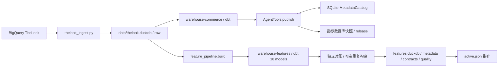
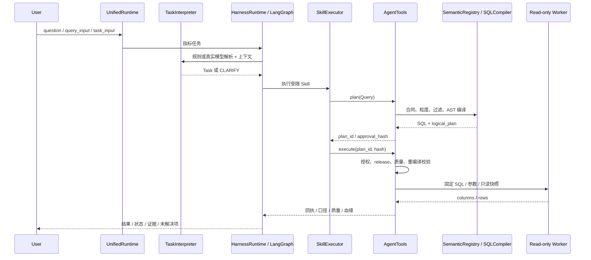

# MyAgent 整体架构与调用关系

更新基线：2026-10-12。本文描述当前代码；历史证据数字不代表本次又执行了所有数据构建或模型请求。

## 设计目标与职责边界

系统将“数据生产”和“分析读取”分开。dbt 构建 Grain 明确的数据，发布阶段保留质量、来源和契约；语义编译器决定指标怎么算；Agent 只选择受限请求和流程，不能生成任意 SQL 或扩大授权。

MetricFlow 启发语义中间表示与编译分层；DataHub 启发实体、Aspect 和关系组织；WrenAI 启发语义上下文与查询前策略验证。运行时未导入这些项目，不需要相邻源码仓库、远程 DataHub 或第二个 SQL 编译器。

## 两条数据生产链路



```text
指标加工：raw -> dbt commerce -> manifest + 成功 run_results
        -> publish 重跑检查与金额/键对账 -> 快照 + SQLite 目录 + release
画像加工：raw 只读复制 -> 独立候选 features.duckdb -> dbt 10 模型
        -> 48 项独立对账 -> 可选二次构建内容签名对比
        -> JSON 契约/元数据/质量/hash -> release.json -> active 指针
```

commerce 输出两维度、两事实与一个汇总；feature 输出 3 DWD、4 DWS、3 ADS。指标目录和特征 JSON 目录尚未统一成一个企业图谱。Metadata Graph 使用 SQLite 关系/JSON 技术血缘，不依赖专用图数据库。

## 请求执行关系



画像分支：`UnifiedRuntime -> parse_feature_question -> FeatureRequest -> FeatureRuntime -> profile-query -> FeatureTools.read_profile -> release/hash/主体校验 -> 固定 SELECT Worker -> evidence`。它使用有限规则，不因 `--intent-mode llm` 自动改成模型画像理解。澄清补丁保留 ID 与日期；未发布日期澄清、不存在实体返回 `found:false`。

## 核心模块与方法

|源码入口|作用|约束|
|---|---|---|
|`cli.main` / `chat.chat_loop`|统一命令与持续问答|状态与退出码明确；不是 Web UI|
|`feature_agent.UnifiedRuntime`|指标/画像任务分流|feature 会话与指标会话分存|
|`tasks.TaskInterpreter.parse`|问题转 Task；规则或模型|语法正确不保证语义正确，歧义需澄清|
|`retrieval.KnowledgeRetriever` / `retrieval_context`|词法候选、合同、元数据、维度值上下文|无向量模型或重排；不是全语言覆盖|
|`semantic.Query` / `SemanticRegistry`|结构化 IR 与版本化口径|合同在 `contracts/commerce.json`；无自由表/SQL|
|`semantic.SQLCompiler.compile`|指标递归展开为 SQLGlot AST|单事实聚合、同事实比例、合法维度；拒绝隐式 Join|
|`catalog.MetadataCatalog`|实体/Aspect/关系、任务与字段血缘|SQLite；复杂 SQL 未解析显式保留|
|`service.AgentTools.plan/execute`|服务端计划与读取|发布、身份、版本、hash、重新编译检查|
|`skills.SkillRegistry/SkillExecutor`|注册输入输出、依赖与执行器|7 项查询/分析 Skill；加工 Skill 独立|
|`harness.build_agent`|LangGraph 查询/诊断流程|有界固定分支，不是动态无限工具循环|
|`diagnosis.DiagnosisEngine.run`|比较、组件拆解、下钻、质量、报告|验证前提；数值贡献不代表因果|
|`runtime.HarnessRuntime/SessionStore`|状态、事件、回执、预算、恢复|恢复重验主体与版本，旧 plan 需重新生成|
|`resilience.retry_call/CircuitBreaker`|瞬时错误重试与熔断|永久错误停止；画像没有同等重试承诺|
|`feature_agent.FeatureTools/FeatureRuntime`|画像查询与持久任务|按截止日期冻结 release；缓存也重验产物|
|`feature_pipeline.build`|独立 dbt 数据产品构建与发布|全量 table 构建；300 秒单次 dbt 超时|
|`worker.main`|单独 DuckDB 读取进程|只读、禁外部访问、1 线程、256MB、≤1000 行|
|`mcp_server`|13 个 stdio 工具适配|Agent 主流程进程内调用，不是原生模型工具循环|

## 指标正确性与异常流程

```text
问题 -> 提取指标/当前窗口/基准窗口/过滤/预期方向
     -> 比较同口径、同过滤、等长且不重叠窗口
     -> 如果前提不成立：PREMISE_REFUTED
     -> 如果成立：组件拆解 -> 合法维度下钻 -> 分组贡献与残差对账
     -> 质量、观察窗口、历史状态与水位检查
     -> 数值证据 + 反证 + 未解决项
     -> 缺独立业务因果证据：INSUFFICIENT_EVIDENCE，不确认根因
```

比例由聚合后的分子/分母相除，零分母 null；distinct 不跨分组任意累加。订单与订单商品事实分开；Fanout 在加工预聚合与编译器拒绝隐式 Join 两处防护。订单完成占比属于当前快照状态，不是支付转化率。

## Tool、Skill、MCP、Harness 的关系

Tool 是确定性操作；Skill 规定业务步骤、输入输出与证据；Harness 管运行过程。Skill 目录中 SKILL.md、references 与 assets 会被读取，但文档不会自己执行代码。预算声明与实际执行控制不能混为一谈。

MCP 只是工具发现和调用传输。本地工具为八项指标工具加五项画像工具；stdio 日志不能污染协议输出。`plan_id` 是服务会话内对象，跨进程或重启后重新规划。无远程服务、企业平台或模型自由函数选择循环。

## 运行约束、恢复与观测

指标默认 16 次查询、120 秒任务预算；Worker 通常最多 30 秒，诊断自身最多 60 秒。瞬时失败最多 3 次尝试，连续失败阈值 3，熔断冷却 30 秒。画像 Worker 15 秒，不自动重试。数据构建不走完整指标 Harness。

SQLite 记录任务、状态、事件、查询回执与熔断。恢复重验身份、口径和版本；可复用授权的只读回执，不承诺写入 exactly-once。画像 `feature-` 会话恢复必须重验发布产物 hash，不能只信历史 COMPLETE。

本地签名主体和行过滤属于单机防护，不是企业 IdP/ABAC 或同 OS 用户文件隔离。hash 证明内容一致性，不是身份签名或因果正确性。

## Trade-off 与当前缺口

- 受限 IR 换取可验证口径，代价是不支持任意 SQL、多事实 Join 与任意分析问题。
- 本地 DuckDB 与 SQLite 简化部署，代价是没有分布式计算、远程授权或集中审计。
- 独立发布数据产品减少半成品读取，但指标与画像两套发布尚未统一；单指针切换不等于分布式事务。
- 全文件 hash 易解释但有 I/O 成本；版本一致不证明指标业务定义正确。
- 公共数据支持数据开发演示，但无真实支付/曝光点击与可信水位。历史观测不是业务生效时间 SCD2。
- 未实现生产增量、迟到修正与补数；没有推荐训练和系统模型准确率验收。

更多工程边界和面试答案见 [进阶问答](MyAgent-Agent与数仓面试进阶问答.md)。
