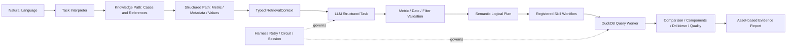

# 本地核心链路：精简范围后的实际实现

本轮按用户要求：权限不扩展为企业治理；保留执行观测；MCP仅体现本地调用；Harness增加有界重试和熔断，不计算金额；核心建设聚焦自然语言、双路检索、语义层、异常Workflow及可读可执行Skill。

## 1. Skill从简短描述升级为领域能力包

```text
skills/warehouse-anomaly-attribution/
├── SKILL.md
├── references/
│   ├── metric-rules.md
│   ├── attribution-methods.md
│   └── tool-contracts.md
└── assets/
    └── report-template.md
```

没有新增schemas、policies、Skill内tests或独立贡献计算脚本。输入模型和确定性计算仍由现有Python核心承担。其他5项能力也有各自目录式SKILL.md，并引用共享领域规范。

实际加载：TaskInterpreter按查询/诊断读取入口和相关参考；SkillExecutor执行时读取对应入口，记录资源hash和实际引用；evidence-report读取assets模板并生成Markdown报告。旧commerce-query.md/commerce-diagnosis.md仅保留兼容链接，不再作为模型执行指令源。

入口讲清目的、步骤和停止条件；references讲grain、成熟度、加法/比例贡献以及工具错误处理；模板组织真实结果，无法填补不存在的证据。目录文件由代码加载，但Markdown本身不是Python执行器；关键约束仍在受控代码中落实。

## 2. 四项核心能力现在怎样协作



### 自然语言理解

真实模型输出严格Task/Query，不提交自由SQL。新增两个ISO闭开窗口的4端点解析、“最近N天”的完整UTC日窗口、明确国家/性别筛选保护、未知值澄清、缺比较基准拒绝猜测。支付/核验成功率因本地无事实表而澄清，不能映射成订单状态占比。

上轮上下文可以供模型延续；规则追问仅支持明确分组变更并保留原筛选。未支持的日期语法、时区、OR/多值筛选或复杂业务任务仍要求澄清；本轮没有宣称任意自然语言均可理解。

### 双路检索

知识路径检索业务别名、案例与领域参考，用词法排名提供候选。结构化路径按metric_id读取权威定义、分子/分母组件、事实grain、允许维度、真实维度值、字段血缘、质量与时间证据。

RetrievalContext分别保存knowledge_hits、semantic、metadata、constraints、dimension_values和metric_components；source/hash保留知识与语义版本，来源不可信时停止。它不是把所有内容拼成普通Prompt，也不对权威公式进行RRF投票。

未额外引入Embedding/RRF/Cross-Encoder或向量数据库：这里“双路”指知识候选发现和结构化权威解析，不声称已实现词法+向量Hybrid Search。维度枚举最多展示有限样本，高基数值用参数化精确匹配验证；未知值不会直接返回伪零结果。

### Semantic Layer

12个指标继续以commerce-v2合同为唯一定义源。SQLCompiler输出真实SQL和可解释logical_plan：scan、grain、日期字段、UTC窗口、过滤、分组、聚合类型、比例组件和语义hash。维度值先链接到真实数据，再进入单事实编译器。

多事实Join和跨引擎执行不是本批能力：订单事实没有品类维度时拒绝请求，不凭血缘猜Join。比例先聚合再除；订单状态占比禁止状态筛选破坏分母。

### 异常Workflow

真实执行 comparison → premise验证 → 分子分母/金额拆解 → 最多两个维度下钻 → quality-check → 模板报告。比例贡献按各组分子/总分母差值计算，检查总体、分子与分母的对账残差。

质量检查新增当前与对照cohort的订单观察年龄范围、历史状态是否验证、成熟度是否验证和语义版本。年龄差只是一项观察条件，不是已识别的因果原因；没有生产水位或历史状态时仍明确证据不足。

## 3. 重试与熔断实际行为

| 情况 | 行为 |
|---|---|
| 明确瞬时网络错误、临时限流/模型过载、查询worker异常退出 | 最多3次尝试，指数退避加少量随机延迟 |
| 权限/口径/维度/未知值/错误grain、模型拒绝或格式错误 | 不自动重试 |
| 服务端额度或账号配置错误 | 不自动重试；不建设金额管理 |
| 查询超时、取消、总预算耗尽 | 终止，不重复执行高成本超时查询 |
| 连续3次瞬时失败 | 本地SQLite记录熔断，冷却30秒 |
| 冷却结束 | HALF_OPEN仅一个探测；成功复位，失败重新熔断 |

OpenAI整次操作最多45秒，单次HTTP尝试最多15秒且受剩余截止时间约束。Retry-After有效时按要求等待；超过5秒重试等待上限时停止本次重试，不提前违反服务端要求。模型与DuckDB分别有熔断key，共用本地resilience.sqlite。模拟协议测试使用独立临时熔断库，不影响真实模型健康状态。

每次实际数据库重试都扣会话查询额度；没有嵌套SDK自动重试导致次数放大。事件记录attempt-start/failed/succeeded、retry-scheduled、circuit-open。只保存状态、次数、耗时和用量观察，不计算费用。

## 4. 使用与观察

```powershell
.\scripts\start-openai.ps1 -Chat
.\.venv\Scripts\python.exe -m local_agent.cli health
.\.venv\Scripts\python.exe scripts/mcp-local-demo.py
```

聊天中 `/show` 查看状态、证据和观测汇总；`/health` 查看熔断；`/resume`在剩余预算内恢复；`/new`开始新问题。已保存会话绑定Skill资源及报告模板hash，Skill文件更新后应新建会话，避免用不同规范续跑旧任务。

观测汇总包含完成节点数、Skill调用数、工具尝试数、重试/失败/熔断数、回执复用与模型Token用量。不扩展SSO、ABAC、多租户或远程运维；现有本地查询约束保留。

MCP演示是真实stdio initialize → list_tools → plan_query → execute_query，发现8工具并返回6319单，记录在mcp-local-call.json。核心Workflow仍直接调用AgentTools；事件中transport=in-process与对应MCP工具名只是边界映射，不能描述成每次都走协议。

## 5. 真实执行记录

- core-scope-live-query.json：真实模型理解“2026年9月美国男性订单完成占比”，country=United States、gender=M，结果0.24066390041493776，即24.07%。
- core-scope-query-report.md：上述查询实际使用Skill模板生成的报告。
- core-scope-live-diagnosis.json：自然语言包含两个7天闭开窗口、男性筛选，执行14次查询，形成3项分解及质量证据。
- core-scope-diagnosis-report.md：占比从24.8252%升至26.4920%，变化1.6668个百分点；当前cohort观察年龄34至40天，对照65至71天，历史状态与成熟度未验证，结果INSUFFICIENT_EVIDENCE，未确认业务根因。
- core-scope-tests.xml：本轮完整工程回归记录；此后小范围变更另外做了针对性验证。不是模型准确率评测。

本次范围的核心链路已可本地运行。没有新增企业权限平台、远程MCP、金额计费、Skill内企业配置或复杂测试目录；未实现的通用多事实Join、任意语言和真实因果识别保持明确边界。

接口重试依据：[OpenAI官方Rate limits](https://developers.openai.com/api/docs/guides/rate-limits)。
