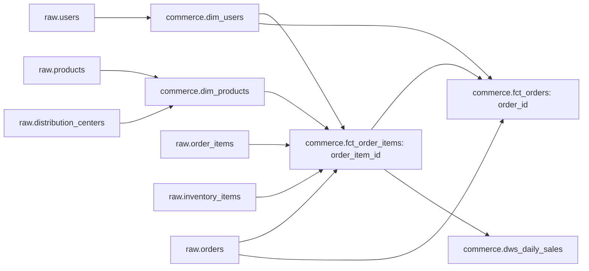

# 本项目数据与粒度

官方来源：bigquery-public-data.thelook_ecommerce，程序生成电商数据。原始获取在同工作区semantic-data-agent-lab完成，经过完整行数/SHA256校验；本项目接收其数据库副本并独立重新dbt build、检查与发布。原始JSONL仍在原接入目录，不假装本项目再次下载。获取证据保留在thelook-source-manifest.json，详细盘点在thelook-profile.json。

|表|行数|主键/粒度|
|---|---:|---|
|raw.distribution_centers|10|id|
|raw.products|29,120|id|
|raw.users|100,000|id|
|raw.orders|125,416|order_id|
|raw.order_items|181,946|id，一件商品明细|
|raw.inventory_items|491,228|id|
|raw.events|2,430,702|id|

数据库：data/thelook.duckdb。七表主键检查通过；已检查八条关联不存在非空外键孤儿。订单声明件数、订单明细用户、明细库存商品关系及金额由dbt和发布代码验证。

订单事实先聚合明细，再关联订单，避免Join Fanout；明细事实只连接唯一键维度。events尚未连接订单/明细，也没有进入销售指标。

日期以UTC下单日定义；金额转DECIMAL(18,4)，这是本地分析精度选择，没有来源币种/结算确认假设。Complete/Returned等是当前快照状态，没有历史状态流水；用户和商品属性不是SCD2。

面向Agent的用户维度不包含姓名/邮箱；原始层仍保留官方合成身份字段，本地单用户进程限制不等于完整企业RLS/CLS。

初次盘点记录681,946个session、1,124,193条匿名事件，1672条事件时间晚于当时盘点时刻。它们保留在raw，不被静默修复；漏斗需另行明确匿名归属、会话粒度、事件顺序和观察窗口。国家名称同义/语言差异也未自动合并。

官方表使用顺序获取，不是跨表事务快照；每表版本/行数检查及完成时源版本检查通过，但没有可信覆盖水位。数据公开可读，特定再分发许可尚未独立确认；raw/数据库默认Git忽略。

新机器可运行scripts/thelook_ingest.py获取官方数据，需要本机gcloud登录，并通过THELOOK_GCLOUD设置工具路径；数据获取不属于Agent查询运行时。随后scripts/build-warehouse.ps1创建独立开发环境、构建、保存断言、生成目录并发布。
