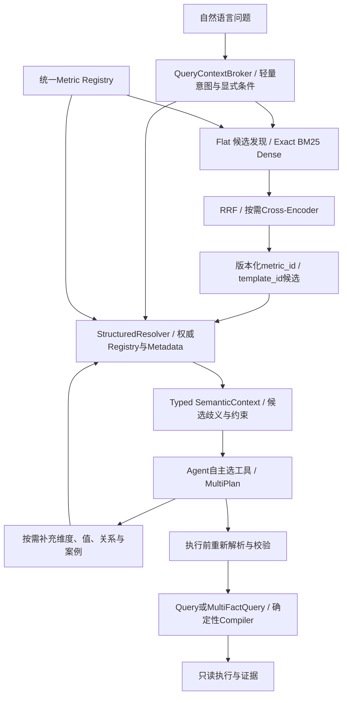

# 双通路语义检索基础设施设计与当前接入审计

日期：2026-10-12。本文件是设计与代码核查，尚未新增向量模型、索引服务或执行真实模型评测。

## 结论

Flat RAG + Structured RAG + 统一 Metric Registry 的方向合理。但两路最好承担“候选发现”和“权威语义解析”的互补职责，不能把 Flat RAG 高相似度命中当成可以跳过语义校验的理由。Structured RAG 不只是复杂查询的备用通路；所有执行请求必须从同一注册中心解析口径、维度、粒度与时间语义。

现有 SemanticRegistry 已是指标权威定义的雏形。应扩展存储与查询接口，而非再建一个内容独立的 Metric Registry。搜索索引是它的派生投影，不是第二份事实来源。

## 当前代码实际上怎样引用检索

|入口|实际调用|检索对执行的影响|
|---|---|---|
|ask/chat rules|TaskInterpreter.parse 调用 KnowledgeRetriever.search，随后进入 _rules|选择主要依赖最长别名；排序候选主要成为证据，未知语言仍澄清|
|ask/chat llm|parse 检索后 resolve_context；_model 输入 authoritative_contexts、retrieved_evidence|知识与权威结构确实进入模型任务理解；执行仍由固定 Workflow 管理|
|agent|工具适配开放 search_business、describe_metric、get_context；每轮模型可选择|search_business 是可选动作；不选就不执行该检索；未强制统一双路上下文|
|multi-plan|模型提出候选，静态校验参数、权限、窗口和编译器|计划合法性校验不是业务语义检索，也不证明自然语言指标选择一定正确|

源码依据：retrieval.py 的 search/metric_candidates/paths；retrieval_context.py 的 resolve_context；tasks.py 的 parse/_model；agent_tools.py 的 call；agent_loop.py 的 start。当前 search 使用内存构建的 BM25 风格评分、别名加权与案例/领域参考；没有 Dense、RRF 或 Cross-Encoder。paths 是分类标注，不是两个独立检索后端。

## 建议架构



```text
问题 -> 精确ID/别名匹配或Hybrid召回 -> 候选metric_id
     -> Registry重读版本、口径、时间与粒度
     -> 按需解析维度/枚举/实体关系/质量
     -> 结构化上下文交给Agent
     -> 模型选候选、澄清、提出计划、补充检索
     -> Semantic Layer重验 -> 编译 -> Worker -> 证据
```

精确匹配可直接走结构解析；高频模板也必须重验。必要时可并行召回案例/文档与结构实体，合并成不同类型字段；不要将结构约束与相似度分数一起投票。

## Flat RAG 的资产

每个指标生成一份可搜索的语义资产，不枚举所有日期/国家/渠道组合。字段包括 asset_id、metric_id、版本、标签、定义摘要、别名、单位、Grain摘要、领域、状态及来源版本；公式仍以Registry重读为准。

验证模板保存 Query/MultiFactQuery 结构骨架、参数schema、适用范围、依赖版本与验证记录，不把历史SQL字符串直接交给执行器。历史问题保存真实条件、结果口径、数据版本与案例性质，不能把案例结论当新问题答案。

Exact/BM25/Dense并列候选按稳定asset_id去重。RRF融合排名，不将BM25原分数和cosine直接相加；Cross-Encoder只重排有限候选。RRF/重排分数不是“选中指标业务正确概率”。高分不允许跳过明确歧义；如销售额/实收、订单完成/支付成功仍需澄清。

初期只索引现有指标、注册跨事实派生和少量验证模板，模型/索引接口可替换。未取得对比数据前，不宣称Dense、RRF或重排一定优于当前词法方案。

## Structured RAG 的实体与约束

建议存储：metrics、metric_aliases、metric_components、dimensions、metric_dimensions、entities、relations、constraints、query_templates、asset_versions。JSON可继续作为编辑入口，数据库作为同版本查询投影；或者数据库成为唯一编辑权威、JSON成为导出。不能双向各自改口径。

必须区分：

- Metadata依赖图：字段/表从哪里来。
- 语义关系图：哪些实体键、基数、时间、桥表归属支持合法分析。

血缘可达不证明能Join。StructuredResolver解析出的候选关系须进入现有共同维度、时间基础、基数与聚合约束。当前只支持orders/items聚合后关联，不能因检索发现events/order之间有路径就开放新的事件归因Join。

维度组合按需构造。低基数维度可缓存枚举；高基数ID/商品/自由文本值按请求做受控精确查询，不能把所有值和所有组合塞进模型上下文。日期由确定性解析处理；用户实体值不要仅靠向量近似匹配。

SQLite已足够完成本地接口验证；后续按并发、更新和授权需求迁移关系数据库。关系数据库可保存和查询关联，是否专门引入图数据库取决于真实多跳查询复杂度与收益，不因为名为Structured RAG就必须迁移。

## 统一接口（建议，不是当前已实现API）

```text
retrieve_candidates(question, trusted_scope, registry_version)
  -> typed candidates + asset_version + retrieval_trace
resolve_semantics(metric_ids, requested_dimensions, window, filters, population)
  -> definitions + grain + components + dimensions + relationships + unresolved
validate_request(Query | MultiFactQuery, semantic_context_binding)
  -> validated request or CLARIFY/STOPPED
```

SemanticContext建议包含：候选与来源、解析后的权威定义、业务实体与值、合法维度、时间、聚合/关系约束、Registry和索引版本、可信权限范围、检索策略、未解决歧义。它不是把全部知识拼成一个大Prompt。

权限在检索前过滤，重排和模型之前只保留可见内容；执行层再次授权。版本失效时重新解析，不能靠过期embedding描述改写最新定义。记录索引快照、Registry版本、模型版本、命中、排除原因、解析与编译结果；敏感内容不无期限保存。

## 接入位置

1. KnowledgeRetriever后增加统一RetrievalService，提供exact/hybrid候选接口。
2. 扩展resolve_context为SemanticContextResolver，同时解析多个指标、注册派生与共同维度。
3. QueryContextBroker给第一次Agent决策提供轻量候选，保留Agent按需调用工具探索的权利。
4. agent_tools的search_business改为统一服务；增加按需解析工具，避免原工具只返回文本hits。
5. TaskInterpreter._model与AgentLoop用同一个Typed Context，减少入口差异。
6. MultiPlanManager与AgentTools.plan执行前重新验证Registry绑定和结构约束。模型不提交公式或Join键。

检索不是每一步都必调。明确指标ID的结构化请求可以跳过相似检索，仍必须走权威解析。自主选择与确定性校验可以共存，不必把自主Agent改回一条固定分析Workflow。

## 分阶段实施

第一阶段：统一权威与接入。定义Context、Registry查询、统一search/resolve接口、首次决策候选与按需工具；缓存词法索引；记录检索是否参与、使用了哪些候选。用改写输入能从检索识别现有指标、歧义能澄清、多事实约束仍有效、过期索引不改写口径来验证链路。

第二阶段：Dense与RRF。Registry更新时构建离线派生资产；增加EmbeddingProvider、DenseIndex、rank fusion、稳定ID去重与版本过滤。候选数量/阈值是调参项，不写死为准确率承诺。

第三阶段：按需重排与高频IR模板缓存。精确ID不调用重排；候选竞争或长尾才考虑重排。失败降级到词法/结构解析，无法唯一确定则澄清。缓存键包含语义、模板与策略版本；缓存结果另需绑定数据release，不能混用。

第四阶段：大规模关系索引与增量更新。关注领域分区、ACL过滤、多版本、删除墓碑、原子索引发布、增量重建、延迟和候选覆盖。没有生产指标规模前不必一次安装完整搜索/图数据库平台。

RAG解决语义资产和指标目录规模，不解决大事实表计算。亿级数据的查询性能仍依赖数仓加工、分区裁剪、聚合表、执行引擎与扫描预算。

## 资料

- [Elastic RRF文档](https://www.elastic.co/docs/reference/elasticsearch/rest-apis/reciprocal-rank-fusion)：按排名融合不同召回结果。
- [Sentence Transformers Retrieve & Re-Rank](https://sbert.net/examples/sentence_transformer/applications/retrieve_rerank/README.html)：候选召回与Cross-Encoder重排分层。

这些资料解释通用检索机制，不证明本项目已经实现或采用特定产品。
