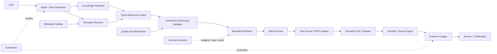

# 根据思路文件形成的架构审查与总体设计

依据：`思路.txt` 与当前 `src/local_agent` 实现。本次交付架构审查和总体设计，不宣称文件中的全部生产能力已经实现。金融案例为目标设计，当前可执行数据域仍为 TheLook 电商。

## 1. 思路审查

整体方向成立：自然语言先成为受约束任务，指标定义由语义层解析，工具执行受权限与资源约束，异常结论必须有证据。现在的 Task → Query → SQLCompiler → DuckDB 已沿这条方向实现。

需要修正的边界：

| 原设想 | 推荐处理 | 原因 |
|---|---|---|
| Flat RAG 高频组合 | 业务知识与案例检索 | 保存参数化案例，不枚举日期×性别×渠道全部组合 |
| 高频指标预计算归入 RAG | 独立 Query Cache / Aggregate Store | 数据结果需要水位、权限与语义版本，文档相似度不等于缓存命中 |
| Structured RAG | Semantic Resolution / Metadata Retrieval | 指标兼容性是确定性约束，不是文本排名结果 |
| 两路结果全部 RRF | 只融合同类型检索候选的排名 | 公式、权限、血缘不能投票降权或被案例覆盖 |
| 血缘用于自动确定 Join | 单独维护合法 Join 关系和基数契约 | 血缘表示来源依赖，不证明关联唯一性或业务合法性 |
| Skill 自由嵌套 | 注册能力，由有界 Workflow 组合 | 保证预算、错误传播和版本可审计 |
| MCP 包办企业治理 | MCP 是协议，治理由服务与 Harness 实现 | 工具 schema 本身不提供数据权限、隔离和因果正确性 |
| Harness 替代 Workflow | Harness 管运行，Workflow 管业务步骤 | 避免两套系统各自重试、各自扣预算 |

目前不需要为了这份文件同时引入向量库、专用图数据库、多 Agent 和 Cross-Encoder。先用离线难例证明词法召回不足，再评估增加语义召回的收益；权限过滤始终在返回上下文之前完成。

## 2. 总体架构与权威来源



图中的 MCP Adapter 是可选入口。当前本地 Harness 直接调用 AgentTools，已有 stdio MCP Server 可供外部客户端使用；不能将当前内部调用描述成每一步都经 MCP。

唯一权威指标定义保持在 contracts/commerce.json。目录保存表字段、任务、Owner 和质量证据，业务知识只保存别名、词义和案例引用。它们通过 metric_id、dataset URN、版本号连接；不能在案例、Prompt、缓存和指标表各维护一份公式。冲突时拒绝或提示过期，不能用排名决定公式。

## 3. 当前实现证据与缺口

以下为阅读时的一基行号，后续修改可能变化。

| 模块 | 真实实现定位 | 已有能力 | 未完成 |
|---|---|---|---|
| NLU | tasks.py:38 TaskInterpreter，:68 parse，:138 _model | 规则/真实模型任务转换、日期/指标一致性校验 | 多轮会话与完整比较基准策略 |
| Retrieval | retrieval.py:29 search，:64 link | BM25式词法评分、别名、权限前置、指标到目录链接 | 向量召回、重排、版本化 RetrievalContext |
| Semantic | semantic.py:21 Query，:39 SemanticRegistry | 指标、事实粒度、允许维度与比率定义 | 通用多事实 Join 规划、独立维度注册表 |
| Compiler | semantic.py:52 SQLCompiler，:82 compile | 单事实确定性 SQL AST、受限日期/维度/过滤 | 多引擎执行适配及成本估算 |
| Tools | service.py:143 plan，:162 execute | 计划绑定身份/版本、执行复核、子进程隔离 | 远程身份、服务配额与可靠异步查询 |
| Workflow | harness.py:26 build_agent，:68 StateGraph | 查询/诊断有界分支、失败停止 | durable checkpoint、resume、取消与会话隔离 |
| Diagnosis | diagnosis.py:6 DiagnosisEngine | 预算、分子分母与维度验证、反证、证据不足停止 | 因果识别、口径变更与任务事故关联诊断 |
| MCP | mcp_server.py:8 FastMCP，:12–57 工具入口 | 8个 stdio 工具与实际协议测试 | 远程 OAuth、租户隔离、限流与熔断 |
| Access | access.py:19 AccessController，:98 enforce | 本地签名身份、指标/维度限制、行过滤 | 企业 IdP、完整 ABAC、数据库侧权限保障 |

Skill 当前为两份 Markdown 规范加代码分支，不是通用版本化 Skill Registry。trace 当前主要是节点名称和结果证据，不是完整分布式 tracing。已有真实模型冒烟测试也不代表生产准确率。

## 4. 核心接口设计（待实现契约）

Task 理解应分工：LLM 提议意图、指标候选、限定条件和假设；日期工具解析时区与闭开窗口；Semantic Resolver 决定权威指标/维度；Validator 执行兼容性与权限；Workflow 决定实际可执行步骤。没有比较基准时先澄清，后续可对已批准的默认基准展示并记录选择依据。

```json
{
  "retrieval_context_version": "1",
  "knowledge_hits": [{"document_id":"case-1","source_version":"v1","score":0.8}],
  "semantic": {"metric_id":"payment_success_rate@1","definition_version":"v1","grain":"payment_attempt_id","allowed_dimensions":["gender","channel"]},
  "metadata": {"dataset_urn":"urn:local:dataset:demo:payment_attempts","catalog_version":"v1","lineage_complete":false},
  "constraints": {"timezone":"UTC","baseline_required":true,"coverage_verified":false},
  "authorization_ref": "server-bound-policy-reference",
  "conflicts": [],
  "warnings": ["Design example only; not an existing metric"]
}
```

身份只来自服务端可信上下文，不能由上述 JSON 或模型声明。knowledge_hits 是排序候选，semantic/constraints 是权威结构，两个部分不得统一转成普通文本后丢掉约束。可以先词法发现指标，再按已解析ID读取结构化目录；确定ID的请求可跳过宽召回。物理路径、凭据、敏感字段不送模型。

结果缓存键至少包含 metric version、数据 release/watermark、UTC窗口、分组、规范化过滤、权限scope/version。口径发布、数据更新、权限更新都使相关缓存失效；预聚合是否可用由指标可加性决定，distinct和ratio不能盲目sum/avg。

SkillSpec 建议字段：id/version、input_schema/output_schema、preconditions/postconditions、required_tools、permission_scope、timeout、retry_policy、idempotency、tests。复合能力声明静态 DAG；注册时检测环，执行时只调用固定节点，统一累计查询数、Token和时长。深度上限与预算是显式配置，不能仅写在 Prompt 中。只读查询可在剩余预算内重试可恢复故障，权限拒绝/口径非法不能重试；模型调用不得无限重试。

HarnessSession 建议字段：session_id、trusted_subject、policy_version、semantic_version、release_id、deadline、query_budget、token_budget、state_version、cancellation、evidence_refs。模型决策生成候选计划，确定性 Workflow 只接受已注册步骤；工具执行服务再次校验权限，远程服务不能仅信任客户端声明。

状态恢复必须重新验证凭据、权限、指标版本和数据release。计划ID当前在内存中，不能直接靠把 StateGraph 状态落盘宣称可恢复；需要持久化计划或重新规划。取消需传播到数据库子进程，超时状态和证据写入审计。

## 5. 金融案例与真实停止边界

“昨天男性用户的金融支付成功率为什么下降了？”在当前项目应要求澄清/停止：没有该指标，没有支付尝试数据，没有指定比较基准。不能用 Complete 商品状态替代支付成功，也不能假造昨天数据。

下述为金融数据接入后的模拟设计：用户明确昨天与前天、UTC、payment_attempt口径，数据生产方提供覆盖两个窗口的水位；语义定义成功尝试数/全部有效尝试数，gender来自经过唯一键验证的维度。维度关联优先在数仓建设，查询读取单事实。

```json
{"metric_id":"payment_success_rate@1","start":"2026-10-10","end":"2026-10-11","group_by":[],"filters":{"gender":"male"},"limit":100}
```

```sql
-- 设计示例，仅适用于具有明确尝试粒度的模拟金融事实表。
SELECT SUM(CASE WHEN success THEN 1 ELSE 0 END) * 1.0 / NULLIF(COUNT(*), 0) AS value
FROM demo.fct_payment_attempts
WHERE attempt_date >= DATE '2026-10-10'
  AND attempt_date < DATE '2026-10-11' AND gender = 'male';
```

模拟值：对照900/1000=90%，当前850/1000=85%，下降5个百分点。Workflow 先检验下降是否存在，再核查质量、水位与口径版本，拆分成功/尝试计数，按渠道检查变化和构成，记录反证、覆盖与截断。某渠道贡献负向变化只能说明统计分解，不能直接断言供应商故障是原因。因果结论需实验或充分识别条件；只有日志相关性时标记待验证假设。

正常路径返回结构化证据；检索失败要求补充指标；指标歧义要求选口径；数据库故障记录失败并有界重试或停止；权限拒绝在检索和执行两端阻断；质量或覆盖不足允许展示描述性结果但停止归因。每条结论引用可追踪的 query_id、release、定义版本与证据，而不是仅给模型自报置信度。

## 6. 实施顺序与验收

1. **当前 PoC 收敛**：修订真实执行说明，固定电商权威指标与枚举值，扩展真实模型评测。先确保限定条件不丢失、错误 grain/fanout 被拒绝、零结果能区分无数据与错误值。已有92项测试和少量真实冒烟不是终点。
2. **MVP 检索与能力治理**：新增 typed RetrievalContext、引用版本校验、维度值注册表、SkillSpec/Registry和显式Workflow。验收权限无泄露、冲突必停、组合预算不超、能力版本可回放。保持 SQLite目录和DuckDB执行，避免基础设施扩散。
3. **MVP 运行治理**：独立 runtime/state_store、request/session IDs、事件日志、预算与取消、恢复验证、结果证据模板。补错误分类、诊断有限状态机与真实难例评测。可恢复不等于重复执行有副作用工具。
4. **按需求服务化**：api、tools/adapters、mcp/client、mcp/server、evaluation模块分层；模型和业务核心不依赖HTTP框架。先单机服务入口，再按身份/并发需求设计企业认证；Docker只打包运行，不打包个人密钥和现有Windows虚拟环境。
5. **Production 前置条件**：真实身份与库侧行列权限、租户隔离、可信数据水位、版本发布/回滚、持久状态、追踪告警、限流熔断、压测与安全评测。只有存在跨引擎需求才建设Hive/Trino等适配器，只有离线指标证明收益才引入Vector/RRF/Reranker。

目录演进建议：保留 semantic/catalog/tasks/diagnosis 核心；增设 retrieval/context.py、skills/registry.py、runtime/session.py、runtime/budget.py、runtime/state_store.py、tools/adapters/、api/ 与 evaluation/。这些是计划结构，尚未创建实现。

所有验收分开报告理解正确率、指标解析准确率、维度/值链接准确率、SQL结果对账率、澄清召回率、权限越界率、诊断证据覆盖、延迟与Token成本。不得用“SQL成功执行”作为“业务答案正确”的替代。
