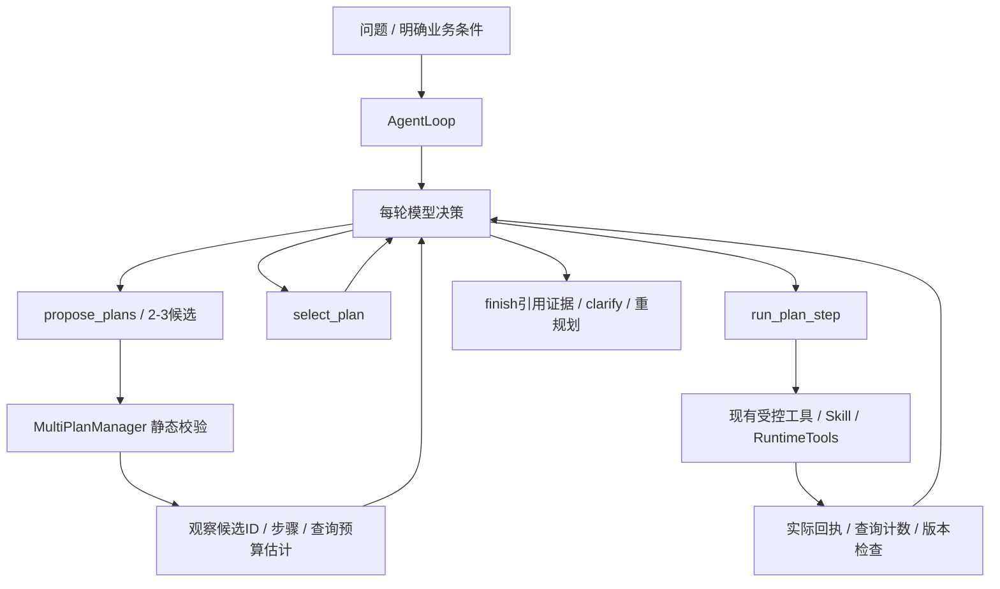
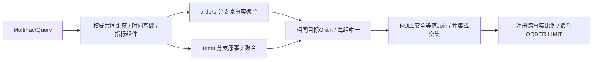

# Multi Plan 与多事实 Join：实现与使用说明

本轮在现有 `agent_loop.py`、`agent_tools.py` 基础上扩展，不替换自主循环；保留 ask/chat 的固定 Workflow 入口。当前实现是有界自主决策与受控语义执行，不能理解成任意 SQL Agent。

## 1. 两种自主程度

- `ask/chat`：规则/模型理解 Task，代码决定查询或异常 Workflow。
- `agent`：每轮模型选择工具，读取观察结果，再继续、澄清或结束。可以不预检索。
- `agent --multi-plan`：模型提出 2–3 个候选方案，服务端验证，模型选方案，然后逐步执行；观察结果后可重新提出方案，最多 3 轮 proposal。

Multi Plan 不是同一请求自动执行多个候选、不是多 Agent 并行，也不是数据库物理优化器。候选必须保持相同数值任务；当前主要允许改变上下文核对/查询步骤的组织，而不允许替换指标、窗口、分组、过滤或 union/intersection 语义。模型选择方案，代码验证并执行；代码仍应决定哪些动作合法。

## 2. 候选计划调用关系



```text
question -> AgentLoop -> ModelDecision
  -> propose_plans(candidates) -> validate schemas / dates / authority / compiler / objective
  -> 当前turn服务端候选plan_id
  -> select_plan(plan_id)
  -> run_plan_step(plan_id, step_index=0) -> actual observation
  -> 下一轮模型决定：执行下一步 / 重提方案 / 澄清 / 引用证据结束
```

逻辑候选 ID 与 SQL 执行 plan_id 不同。候选只含白名单工具和结构化参数；执行时才调用 AgentTools.plan 生成 SQL 计划，执行前仍重验身份、release、合同、重新编译及 hash。

代码入口：

|模块|核心对象/方法|作用|
|---|---|---|
|`agent_loop.py`|`AgentLoop.start`、`guard_request`|决策循环、用户条件保护、观察与终止|
|`agent_tools.py`|`AgentTools.specifications/validate/call`|工具 schema 与实际分发|
|`multi_plan.py`|`Candidate/PlanStep/Proposals`|候选与步骤契约|
|`multi_plan.py`|`MultiPlanManager.propose/select/execute_step`|校验、选择、逐步执行与版本化重提|
|`runtime.py`|`RuntimeTools.execute`|真实查询扣预算、瞬时重试、回执复用|

每个候选最多 6 步；首版最多 3 次重提，每次 2–3 方案。相同方案不应只改 label 伪装成不同策略；重复动作不会重复执行。旧候选 ID 在重提后失效。保存已选择方案和每次观察，快照不会因后续状态更新而改写历史记录。

候选成本只是逻辑查询次数上界，未含瞬时重试、维度枚举读取与数据库扫描成本，不是耗时/金额估计。所有真实查询仍由共享账本限制；估计不能绕过预算。

## 3. 多事实语义：先聚合后关联

支持的真实事实：

- `commerce.fct_orders`：一行一个 order_id。
- `commerce.fct_order_items`：一行一个 order_item_id。

直接明细 Join 会复制订单金额。正确计划：每个指标在自身事实上计算，聚合到目标共同维度，然后 Join 聚合结果。



```text
orders(order_id) -> GROUP BY country,traffic_source -> b0(country,traffic_source,order_count)
items(order_item_id) -> GROUP BY country,traffic_source -> b1(country,traffic_source,item_count)
b0 FULL OUTER JOIN b1
  ON b0.country IS NOT DISTINCT FROM b1.country
 AND b0.traffic_source IS NOT DISTINCT FROM b1.traffic_source
-> item_count / NULLIF(order_count,0)
-> 最后排序与LIMIT
```

共同维度来自 `contracts/commerce.json.multi_fact`，首版注册 day、country、gender、age_band、traffic_source。两事实的日期都定义为订单 created_at 的 UTC 日期，而不是订单日与商品 created_at 日混用。发布中的原关系检查也验证订单商品 user_id 与订单 user_id 一致，防止共同用户维度来源不一致。

新注册派生口径：`items_per_order@1`，即同窗口、共同维度与过滤下 item_count@1 / order_count@1。12 个原单事实指标保留；跨事实派生定义单独注册，未将任意模型公式加入权威指标目录。

## 4. 请求与 SQL 示例

```json
{
  "kind": "multi_fact",
  "metric_ids": ["order_count@1", "item_count@1"],
  "ratio_ids": ["items_per_order@1"],
  "start": "2026-09-01",
  "end": "2026-10-01",
  "group_by": ["country", "traffic_source"],
  "filters": {},
  "population": "union",
  "limit": 100
}
```

```sql
WITH b0 AS (
  SELECT country, COUNT(*) AS value
  FROM commerce.fct_orders
  WHERE order_date >= DATE '2026-09-01' AND order_date < DATE '2026-10-01'
  GROUP BY country
), b1 AS (
  SELECT country, COUNT(*) AS value
  FROM commerce.fct_order_items
  WHERE order_date >= DATE '2026-09-01' AND order_date < DATE '2026-10-01'
  GROUP BY country
)
SELECT COALESCE(b0.country,b1.country) AS country,
       b0.value AS orders, b1.value AS items,
       CAST(b1.value AS DOUBLE)/NULLIF(b0.value,0) AS items_per_order
FROM b0 FULL OUTER JOIN b1 ON b0.country IS NOT DISTINCT FROM b1.country;
```

这是简化解释，实际 SQL 由 SQLGlot AST 构建。分支不能先 LIMIT，否则可能丢失后续关联组；限制只在最终结果使用。NULL 维度用 NULL 安全比较避免生成重复 NULL 组。scalar 请求的各分支是无 GROUP BY 聚合，每个分支严格一行，才允许 CROSS JOIN。

`union` 保留任一分支存在的组；`intersection` 仅保留所有分支都有的组。缺失分支保持 null，不自动补零。小组抑制也可能导致分支不可见，不能将 null 当作已证实无业务。零分母 null；distinct 在原事实目标窗口重算，不把每日 UV 相加。

## 5. 运行与迁移

合同更新为 commerce-v3-multi-fact，旧发布与会话会因 hash 变化停止，这是预期保护。质量仍有效时执行 publish；如果过期，先重跑 build-warehouse.ps1。

```powershell
# 从MyAgent仓库根目录运行
.\.venv\Scripts\python.exe -m local_agent.cli publish
.\.venv\Scripts\python.exe -m local_agent.cli multi-query --request config\multi-fact-query.example.json
# 模拟模型决策 + 真数据回执与raw独立回算，不消费模型API
.\.venv\Scripts\python.exe scripts\multi-plan-demo.py
# 自主模式：必须已经在当前进程配置OPENAI_API_KEY/OPENAI_MODEL
.\.venv\Scripts\python.exe -m local_agent.cli agent "UTC闭开[2026-09-01,2026-10-01)按国家和渠道查询订单量、商品件数与每单商品件数，保留分组并集" --multi-plan --max-steps 8
```

`start-openai.ps1` 默认进入原 ask/chat，不能把它等同于上述 agent 命令。新增自主启动器会加载已有 DPAPI 配置并在退出时恢复环境变量，不打印密钥：

```powershell
.\scripts\start-agent.ps1 -MultiPlan -Question "UTC闭开[2026-09-01,2026-10-01)按国家查询订单量、商品件数与每单件数，保留分组并集"
```

agent CLI 本身只读环境变量；启动器负责解密。真实模型调用不在本次模拟演示范围。

`multi-query` 是单次显式服务请求，执行计划完整校验；Agent 模式通过 RuntimeTools 共享任务预算。MCP 仍是原 13 工具，此次新增的是 Agent 进程内工具，不声称已增加远程或新的 MCP 工具。

## 6. 当前真实演示与验证

`docs/multi-plan-live-demo.json`：模拟模型选择先查元数据的方案，真实 TheLook 查询执行一次；58 个国家/渠道分组全部从 raw.orders/raw.order_items/raw.users 独立回算通过，返回未截断。模型决策是模拟，不是模型规划成功率。

专项小数据测试证明：一笔订单100含两件商品，另一笔200含一件，直接 Join 后 SUM(order_amount)=400；新计划返回300，商品件数3，每单件数1.5。另测并集/交集、NULL键、缺失分支、未知过滤值、注册比例、时间基础、角色强制过滤、小组抑制、篡改计划、预算与回执复用、旧候选失效及目标不变。

本轮完整回归结果在完成报告记录；测试不证明任意自然语言语义、任意 SQL Join 或因果正确性。

## 7. 明确未开放的能力

- orders 按 category 聚合仍拒绝；同一订单跨多个品类时需要定义多重归属或金额/权重分摊，不能自动COUNT DISTINCT修补。
- 任意原始事实明细 Join、多对多桥表、SCD2时态Join、不同业务时间的cohort归属、非等值条件，尚未支持。
- events/session 与订单/支付没有可信归属规则，不能据时间接近自动造转化链路。
- 候选计划当前是同数值任务的不同组织方式，尚无自由DAG、子步骤结果占位引用、并行候选试跑、代价学习或自动探索任意假设。
- run_diagnosis 内部仍是确定性 Workflow；外层模型能选择它，不等于里面每一个下钻都由模型决定。
- 新增自主方案保存在turn状态，首版仍不支持中断后从任意计划步骤恢复；resume明确拒绝。澄清followup开启新turn，不重放旧SQL ID。
- finish要求真实执行步骤证据，但模型摘要仍 `summary_verified:false`、`causal_claim:false`；引用正确不证明自然语言数字和结论全部正确。

## 8. 下一阶段的工程方向

在当前契约之上，再引入显式实体键和关系类型（many-to-one、bridge、allocation、temporal），以及最终任务目标与验证步骤分离的DAG。扩展应先准备反例、业务口径和数据质量条件，再开放新动作；不能让模型自由挑 Join 键来替代业务定义。
