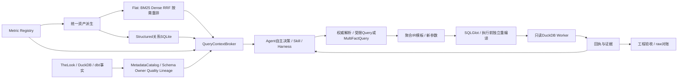

# 双路 RAG 四阶段完整迭代验收报告

日期：2026-10-12。结论：本机学习工程范围验收通过。最终全量229项通过；真实本地E5/Cross-Encoder、真实gpt-6.1-sol与TheLook执行链路通过，客单价与raw独立对账一致。没有模型准确率、生产规模或企业合规认证结论。

## 四个阶段最终落地

|阶段|最终能力|主要实现|
|---|---|---|
|一：统一权威与接入|同一候选服务、首次决策上下文、按需权威解析；公式从Registry重读|RetrievalService / QueryContextBroker / SemanticContextResolver|
|二：Dense与RRF|真实CPU向量召回、稳定资产ID、RRF、版本校验和明确降级|LocalEmbeddingProvider / DenseIndex / read_snapshot|
|三：重排与模板|条件Cross-Encoder、两类模型缓存、聚合IR模板复用、参数新绑定、执行重编译|LocalReranker / QueryTemplateCache / service.plan/execute|
|四：生命周期与关系|统一Flat/Structured派生、增量编码、墓碑、关系差量写入、原子切换、分区、依赖/影响工具|AssetBuilder / publish_index / GraphService / query_relations|

最终快照：21份可搜索资产、384维向量、61个语义节点、140条关系。图节点包括13个指标（含跨事实派生）、事实、数据表、字段声明、维度、粒度实体键和注册共同维度。当前使用SQLite和JSON精确扫描，没有专用图数据库。

## 端到端执行



```text
用户问题
  -> 首次候选检索（授权/分区前置，BM25 + E5 -> RRF -> 条件Cross-Encoder）
  -> 当前Registry组件、grain、维度与约束 + Metadata + 已发布关系索引证据
  -> LLM决定下一动作，工具参数按Pydantic契约校验
     可查询关系、解析更多语义、查询/比较/诊断、提出多计划或澄清
  -> plan：当前身份/策略/release校验 -> 语义IR模板 -> 本次日期/过滤/LIMIT
  -> execute：从原请求独立重编译 -> SQL一致性 -> 只读Worker
  -> 实际结果和版本回执 -> 下一次模型决策 -> 引用证据结束
```

MCP仍为原13个本地stdio工具，搜索接统一候选服务；新增query_relations属于Agent进程内工具，当前Agent共12工具。原注册Skill仍7项，不通过增加名称伪装能力覆盖。模型决策协议是Responses结构化动作JSON，不是宣称已使用原生function_call/MCP远程协议。

## 验收矩阵

|检查|结果|证据与范围|
|---|---|---|
|最终工程全量回归|PASS|229 passed，262.02秒；覆盖元数据、语义、权限、Agent、Workflow、缓存与四阶段检索|
|第四阶段契约检查|PASS|15项；含真实LLM形状的工具叙述拒绝测试|
|真实Dense/RRF/重排|PASS|E5 384维、Cross-Encoder raw logit，首次上下文参与选择；同进程重复打分缓存命中|
|Flat/Structured一致性|PASS|同一AssetBuilder生成指标文档与指标节点；Registry始终唯一权威|
|真实数据取数|PASS|客单价88.22046842854883，raw.order_items金额/raw.orders数量独立回算一致|
|真实LLM自主工具选择|PASS|gpt-6.1-sol，账户模型预检200；2次真实模型调用，run_query -> finish，1次实际查询，引用e1|
|关系工具进入Agent|PASS|模拟决策模型在真实本地模型/数据链路调用query_relations -> run_query -> finish；不是固定生产Workflow替模型选择|
|字段影响分析|PASS|booked_order_amount -> booked_amount@1 -> average_order_value@1；依赖影响不等于因果|
|元数据证据|PASS|schema、ownership、quality、字段值/控制血缘均读取既有MetadataCatalog；Owner/完整血缘不冒称业务已验证|
|增量更新|PASS|真实编码器：无变化复用21；单案例正文更新仅编码1、复用20|
|删除与恢复|PASS|真实案例删除编码0、1墓碑；恢复编码1、墓碑清除；指标删除另由隔离fixture测试验证|
|旧投影/会话/计划失效|PASS|资产变化后旧图拒绝查询，旧会话与计划绑定拒绝复用|
|授权与分区|PASS|权限/分区在排名和遍历前；未知节点、敏感字段、分区冲突停止或澄清|
|并发/失败发布|PASS|本地发布锁、active竞争检查、损坏旧索引拒绝复用；失败不覆盖指针|
|模板复用与新结果|PASS|第三阶段窗口订单数1311/1379各自raw对账；执行仍重编译，旧答案不复用|
|多计划与不同grain|PASS|重新运行真实TheLook多计划，58返回分组独立回算，无展示截断；先聚合再关联|
|异常分析与停止归因|PASS（工程范围）|全量测试覆盖14查询诊断、贡献重构和INSUFFICIENT_EVIDENCE；不宣称发现业务因果|
|Python/PowerShell/CLI|PASS|编译、脚本解析、关系CLI、缓存CLI、diff检查|
|模型准确率/生产吞吐|NOT_PERFORMED|用户本轮聚焦核心链路；单次成功不等于统计准确率或百万目录能力|

此前完整228项也通过；修正真实模型输出契约后重新完整运行229项。相关77项、后续16项专项均通过，覆盖重叠，不相加。

## 真实LLM验收发现并解决的问题

第一次账户预检成功，但模型输出tool动作时带了说明文字，违反Decision.coherent的跨字段契约。系统STOPPED，查询消耗为0，没有放宽校验或执行错误动作。

修复：在ModelDecision的提示与字段描述里明确tool动作要求message为空、evidence_ids=[]；终止动作tool=null、arguments_json={}。补充HTTP模拟协议测试与“非法叙述必须在查询前停止”回归，保留第一次失败记录。

第二次真实gpt-6.1-sol成功选择average_order_value@1，提交UTC闭开9月窗口，再引用实际查询e1结束。回答明确下单金额不是实收，并提示合成数据/覆盖完整性未验证。数值与raw对账一致。

这次只验证一个真实LLM取数happy path，未用真实LLM验收异常诊断、复杂多计划的泛化准确率；这些路径的工程与真实数据演示使用模拟决策模型。API模型与Responses使用依据见 [官方模型文档](https://developers.openai.com/api/docs/models/gpt-6.1-sol)；账户是否可用以本次预检与实际响应为准。

## 完整证据文件

- [四阶段集成回执](retrieval-iteration-acceptance.json)：当前快照、检索名次、关系、元数据、真实编码器生命周期、真实LLM决策/usage、raw对账。
- [第一次真实LLM失败记录](retrieval-iteration-first-live-attempt.json)：执行前停止，零查询；没有保存密钥或请求Authorization。
- [多计划真实数据回执](multi-plan-live-demo.json)：58个分组的独立回算；模拟决策模型。
- [第三阶段模板与参数回执](retrieval-phase3-live-demo.json)：1311/1379独立对账；历史阶段记录。
- `tests/test_retrieval_phase1.py`、phase2/3/4与其他模块回归：权限、版本、budget、fanout反例、篡改拒绝。
- [第四阶段操作与实现](retrieval-phase4-guide.md)：Mermaid、文字调用链、类/方法/行号及更新命令。

## 当前范围与未覆盖项

本轮是可运行的本机工程验收，不是生产上线。没有ANN、分布式发布/图数据库、生产CDC/后台调度、墓碑压缩或旧快照GC；资产差异比较与当前授权集合构造仍全量扫描。向量编码按变化增量，但快照文件仍完整保存。

没有自动NER抽取企业实体、多业务Domain治理、自然语言模板槽位自动生成、跨会话答案缓存或真实LLM准确率评测。当前事实域分区不等同企业Domain；QueryTemplateCache不等同已验证自然语言模板知识库。

没有真实支付/曝光点击事实、可信源端水位、历史状态SCD2或企业IdP/多租户。当前MetadataOwner和血缘完整性有明确限制；统计贡献/依赖影响不能证明因果。规则模式仍为有限语言子集。

MetricFlow/DataHub/WrenAI是研究参考，实际取数、元数据、关系、检索与运行核心在本项目实现，不运行三个上游服务；模型推理使用公开本地模型及用户授权的OpenAI API。

## 后续建议

当前无需立即扩大架构。先用更多实际业务问题验证指标歧义、维度组合、关系探索和诊断证据是否好用；规模增长后再选常驻模型worker、ANN/领域索引、增量调度和关系后端。基础接口已经具备可替换边界，升级不能改变Registry唯一权威、权限前置和独立执行校验。
