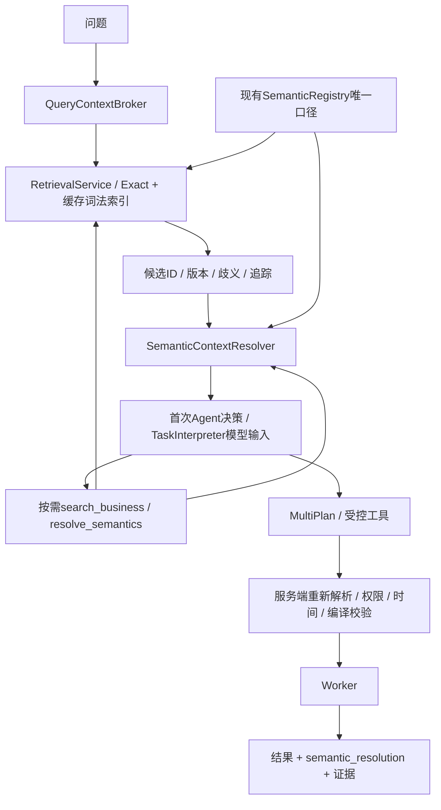

# 双通路检索第一阶段：统一接口与真实接入

日期：2026-10-12。第一阶段已实现“词法候选发现 + 权威结构解析 + 所有入口统一接入”。没有安装Dense、RRF、Cross-Encoder或独立搜索平台，不把当前实现描述成完整Hybrid RAG。

## 1. 核心调用链



```text
自然语言 -> Broker.prepare
         -> RetrievalService.retrieve -> Discovery
         -> Resolver.resolve -> SemanticContext
         -> Agent第一次决策已看到候选与权威结构
         -> 自主选择继续查询、补充检索、澄清或提出方案
执行前  -> Resolver.resolve_request -> Compiler -> 绑定语义版本的计划
执行时  -> 权限、release、资产绑定与重新编译检查 -> Worker -> 证据回执
```

ask/chat规则模式也经过统一Broker，但有限规则仍限制可理解语言；模型模式与自主Agent使用相同Typed Context。接入检索不意味着所有改写表达已可由规则解析器处理。

## 2. 三个统一对象

|对象|职责|接口|
|---|---|---|
|RetrievalService|授权后Exact/词法候选、资产版本、歧义与缓存|retrieve(question, limit)|
|SemanticContextResolver|从当前Registry读取单/多指标、组件、共同维度、元数据和关系规则|resolve / resolve_request / validate|
|QueryContextBroker|给首次决策装配轻量Discovery与SemanticContext|prepare(question, previous_task)|

源码分别在 `src/local_agent/retrieval_service.py`、`semantic_context.py`。现有 `retrieval_context.resolve_context` 作为兼容包装也调用同一解析器。

Discovery包含hits、candidates、ambiguities、registry_version、index_version、trace。SemanticContext包含binding、requested_metric_ids、metrics、components、common_dimensions、relationships、constraints、metadata、dimension_values、unresolved。

## 3. 索引与权威边界

缓存的是授权后的词法语料、分词、文档频率和长度统计。Registry版本、知识资产、领域参考、主体或策略变化会使缓存重建/旧会话停止。每次请求仍重新检查身份；过期/撤销令牌不能继续使用旧缓存。

索引版本是当前Registry、knowledge/business.json、领域参考与实现版本的摘要。若检索期间资产变化则停止；旧index_version不能冒充最新候选。SemanticContext验证会重新读取定义，拒绝公式/组件篡改。

当前只是同进程内存缓存，不是持久倒排索引、向量数据库或分布式索引服务；候选评分仍遍历词法语料，规模扩大后需更换后端。没有将两条路径各自维护成独立公式来源。

## 4. 首次决策与自主权

AgentLoop在首轮模型调用前做一次轻量候选检索和结构解析，结果写入query_context与retrieval-bootstrap事件。不再依赖模型偶然选择search_business才能接触检索。

模型仍决定是否补充检索、解析另一个指标、查看枚举、查询、提出候选计划、澄清或结束。没有自动规定一条异常分析顺序。明确ID识别与业务别名命中是Exact；其余是词法候选，排名不是正确概率。

一次bootstrap独立于max_searches；后者限制自主search_business和resolve_semantics动作，默认最多3次。bootstrap时间包含在任务总deadline内，但不计为数值查询。维度枚举查询仍属于元数据读取，不是完整统一扫描预算，此项生产扩展未完成。

## 5. 按需结构解析

新增进程内工具：

```json
{
  "tool": "resolve_semantics",
  "arguments": {
    "metric_ids": ["order_count@1", "item_count@1", "items_per_order@1"],
    "requested_dimensions": ["country"],
    "value_dimensions": [],
    "expected_asset_version": "来自Discovery的index_version"
  }
}
```

不接受模型公式、SQL或principal。最多6个请求指标、4个目标维度和2个明确枚举维度。默认不加载全部维度值；首次上下文的文本参考做长度预览，完整内容可按需读取。

多事实关系仍是注册的aggregate_then_join规则。category不是订单/商品事实共同维度时返回unresolved；时间基础不一致也标记未解决。发现元数据路径不能开放任意原始Join或事件支付归因。

新增resolve_semantics属于Agent进程内工具。MCP仍原13项，仅把原search_business接到统一服务，不新增远程MCP部署。

## 6. 执行前后的绑定

每次AgentTools.plan都解析当前Query/MultiFactQuery；即使直接提交结构化请求，没有相似检索，也不能跳过Registry授权解析。计划新增semantic_resolution：binding、metric_ids、common_dimensions、relationships。

binding包括Registry版本、数据release、资产版本、可信主体与策略hash。执行重新检查绑定；查询回执也携带semantic_resolution。原SQL重编译、只读Worker、强制行过滤、版本和预算防线保留。

运行会话新增retrieval_assets绑定，因此升级前保存的旧会话可能无法恢复，需要新建会话；本次没有修改指标公式，不要求仅为代码升级重新采集数据。质量过期仍按原规则重新构建/发布。

## 7. 运行入口

```powershell
# 查看候选、来源版本与歧义
.\.venv\Scripts\python.exe -m local_agent.cli search "2026年9月平均每张订单的金额是多少"
# 查看单/多指标权威结构；不传--values就不扫全部枚举
.\.venv\Scripts\python.exe -m local_agent.cli resolve-semantics --metric items_per_order@1 --dimension country
.\.venv\Scripts\python.exe -m local_agent.cli resolve-semantics --metric order_count@1 --values country
# 模拟模型读取检索上下文，执行真实TheLook与raw独立对账，不消费模型API
.\.venv\Scripts\python.exe scripts\retrieval-phase1-demo.py
# 已有本机加密配置的真实自主入口，首轮自动包含query_context
.\scripts\start-agent.ps1 -Question "2026年9月平均每张订单的金额是多少"
```

CLI search现在返回Discovery对象而非旧的纯hits列表；hits仍保留，调用方应通过result.hits读取。ask/chat、模型理解、自主Agent和原MCP search共用候选服务。

## 8. 本次真实验收范围

`docs/retrieval-phase1-live-demo.json`包含：

- 未命中固定别名的改写问题，词法召回客单价候选；模拟模型读取权威单位后选择指标。
- 实际TheLook结果88.22046842854883，与raw订单商品金额/订单数独立回算一致。
- 销售额歧义被停止为CLARIFY，查询次数0。
- 每单商品件数的结构解析保留category不兼容标记。
- 同一服务重复检索索引只构建1次，检索参与事件保存在会话中。

14项专项测试覆盖首次上下文、缓存复用/失效、歧义、多事实组件、按需枚举、权限、旧版本、公式篡改、显式指标ID保护、服务端绑定与Task模型输入。

模型为脚本化/MockTransport；没有真实模型准确率结果，没有泛化语言覆盖保证。指标选择语义仍需要澄清、明确条件保护和后续实际案例验证。

## 9. 下一阶段

第二阶段才增加EmbeddingProvider、DenseIndex、稳定asset_id去重与RRF，保留本阶段的统一接口和版本/授权边界。Cross-Encoder与高频结构模板缓存随后按真实收益接入。当前不宣称已解决企业级并发索引、十万指标性能或亿级事实查询性能。
