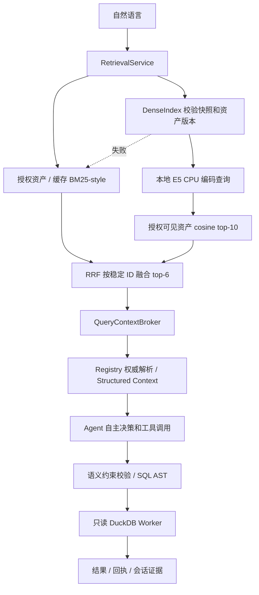

# 双路 RAG 第二阶段：本地 Dense 与 RRF

本阶段在第一阶段统一接口上增加真正的神经向量召回、排名融合、稳定资产标识和离线版本化发布。Flat RAG 内部并行使用词法/Dense；Structured 路径仍从 Registry 动态解析组件、共同维度与关联约束。不是把两个全文搜索器叫作 Flat/Structured，也不是让 embedding 定义指标。

## 运行方式

基础 `.venv` 不需要 Torch；独立 `.retrieval-venv` 保存 CPU 模型依赖。模型和索引在 `data/`，不上传 GitHub。以下在仓库根目录执行：

```powershell
# 首次安装；锁文件是本机验证过的 Windows/Python 3.12 CPU 版本
.\.venv\Scripts\python.exe -m venv .retrieval-venv
.\.retrieval-venv\Scripts\python.exe -m pip install --extra-index-url https://download.pytorch.org/whl/cpu -r requirements-retrieval.lock
.\.retrieval-venv\Scripts\python.exe scripts\prepare-embedding.py
.\.venv\Scripts\python.exe scripts\build-retrieval-index.py

# 现有工具/TaskInterpreter/Agent 共用此设置
$env:OWN_AGENT_RETRIEVAL_MODE = 'hybrid'
.\.venv\Scripts\python.exe -m local_agent.cli search "2026年9月平均每张订单的金额是多少"

# 自主 Agent：读取已有本机加密凭据，会产生真实模型 API 请求
.\scripts\start-agent.ps1 -RetrievalMode hybrid -Question "2026年9月平均每张订单的金额是多少"

# 本机免费闭环：真实 embedding，模拟决策模型，真实 TheLook
.\.venv\Scripts\python.exe scripts\retrieval-phase2-demo.py
```

需要已有有效的数据 release 才能执行取数闭环；离线索引构建只读取语义资产，不扫描事实行。合同更新后，应先按现有数据发布流程重新验证 release，再重建检索索引。

普通 CLI 的 `OWN_AGENT_RETRIEVAL_MODE` 默认 `lexical`；`start-agent.ps1` 默认设置为 `hybrid`，实际自主 Agent 入口会使用向量链路。`hybrid` 在模型/索引缺失、过期、损坏或超时时回退词法，trace 显示 `fallback`；`hybrid-required` 遇到这些情况停止，用于验收，防止降级结果冒充 Dense。Registry 变化、权限撤销、检索中资产/active 变化仍停止，不作为普通模型故障降级。

可用 `OWN_AGENT_DENSE_INDEX` 指定索引目录、`OWN_AGENT_EMBEDDING_PYTHON` 指定隔离运行环境。不同环境需匹配发布时依赖版本；模型升级应先重建而非只替换在线模型。

## 实际调用链



```text
TaskInterpreter 或 AgentLoop 首次决策
  -> QueryContextBroker.prepare
    -> RetrievalService.retrieve
      -> KnowledgeRetriever.search：可见资产 + BM25-style
      -> DenseIndex.search：active -> manifest/hash -> 当前版本
        -> LocalEmbeddingProvider.encode -> embedding-worker.py
        -> 只在当前授权资产集合内取 top-k
      -> rrf：按名次融合，不相加原始分数
    -> SemanticContextResolver.resolve：重读 Registry，不采信检索公式
  -> 模型选择 run_query / 多计划 / 澄清等动作
  -> service.plan -> 确定性语义编译 -> execute -> 回执
```

`search_business`、CLI `search` 和 MCP 原有搜索工具复用同一个服务。未增加远程 MCP 服务、未增加 Skill 数量，Agent 仍可按需探索；检索没有替模型写死异常分析路径。

## 关键实现

|模块|职责|
|---|---|
|`dense_retrieval.EmbeddingProvider`|可替换编码契约；输入文本和 query/passage 类型，输出归一化向量|
|`LocalEmbeddingProvider`|独立子进程；查询 60 秒、构建 300 秒超时；无付费 embedding 调用|
|`publish_index`|从同一 KnowledgeRetriever/Registry 生成资产，保存文档/向量/manifest，最后原子替换 active|
|`DenseIndex.search`|校验 manifest 与数据摘要、语义/策略版本、维度/有限数值/归一化；授权过滤在 top-k 前|
|`rrf`|以 kind/id/source 派生稳定 asset_id，去重并记录每路名次和原分数|
|`RetrievalService`|保留显式指标/别名优先和歧义停止，融合结果进入既有权威解析|
|`HarnessRuntime.binding`|额外绑定 mode、active 摘要和 RRF 算法，索引替换后旧会话需新建|

RRF 使用 `sum(1 / (60 + rank))`，一份资产每路最多贡献一次。`score` 是排名融合分数，`branch_scores` 是原始词法/cosine，`ranks` 是每路名次；都不是业务正确概率。精确指标候选仍优先，存在“销售额”歧义时不会因为高分而直接执行。

单指标 embedding 使用规范摘要，不包含随主体变化的维度清单；返回给模型的正文与合法维度仍是在线授权后的版本。这让管理员发布的共享索引能召回受限主体有权使用的指标，同时不返回管理员的全部维度。指标未授权时整份资产在评分/top-k 之前排除。

## 版本与来源

当前固定模型为 `intfloat/multilingual-e5-small`，Hub commit `614241f622f53c4eeff9890bdc4f31cfecc418b3`。查询前缀 `query: `、资产前缀 `passage: `，最大 512 token，归一化后点积计算相似度；模型的前缀要求见 [E5 官方模型说明](https://huggingface.co/intfloat/multilingual-e5-small/raw/main/README.md)。

本机 worker 使用本地 safetensors，禁止远程自定义代码；验证模型文件 SHA256 与依赖版本。查询设置 `local_files_only=True`，只在准备模型时访问 Hub。相关参数来自 [Sentence Transformers 官方接口](https://sbert.net/docs/package_reference/sentence_transformer/model.html)。

manifest 包含 Registry/资产版本、模型 commit、模型文件摘要、编码参数、依赖版本、索引维度、文档数量、文档/向量文件摘要及策略版本。active 绑定快照路径与 manifest 摘要；构建失败不覆盖旧 active，构建期间资产变化不发布。

`Discovery.index_version` 继续表示语义资产版本，供 StructuredResolver 校验；Dense 快照身份单独保存在 `trace.dense.snapshot_id`。两者不可互换。数仓 release 另外绑定实际数据；重建 embedding 不表示数据已经更新。

## 边界与下一阶段

当前只有少量资产，采用 JSON 向量 + 精确线性扫描，复杂度 O(资产数×维度)。这验证了正确接口，不证明百万级目录吞吐能力；未来可替换 ANN/数据库索引，并保留授权前置与版本契约。事实数据规模由数仓和查询引擎处理，不进入向量索引。

每次 query 启动 CPU 子进程并加载模型，延迟明显，不是低延迟生产服务；下一步可用常驻隔离 worker。当前缓存只覆盖词法资产，不缓存向量查询结果。领域 reference 文本超过 token 上限会截断，后续需段落分块与父资产去重。

没有 Cross-Encoder、高频 IR 模板缓存、增量 embedding 或自动后台重建；合同变化目前触发失效，由管理员重建。没有模型准确率承诺，也没有通过 RAG 开放任意 Join。跨事实仍是现有合法共同维度上的先聚合后关联。

RRF 的排名机制可参照 [Elastic 官方说明](https://www.elastic.co/docs/reference/elasticsearch/rest-apis/reciprocal-rank-fusion)，本项目为自己的小规模实现，没有依赖 Elasticsearch。
