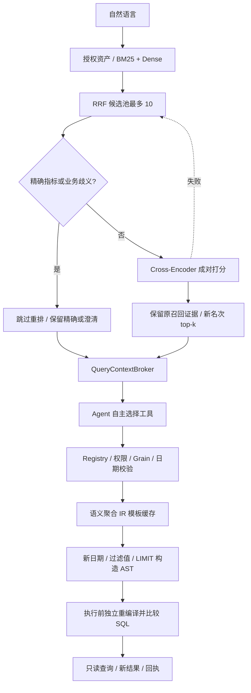

# 双路 RAG 第三阶段：按需重排与语义 IR 缓存

## 本阶段完成的链路

Flat 路径在词法/Dense/RRF 后增加真实 Cross-Encoder，Structured 路径继续解析 Registry。高频查询复用语义聚合模板，参数与实际数据每次重新处理。没有新增另一套指标定义，没有把历史答案作为新答案返回。



```text
AgentLoop / TaskInterpreter
  -> QueryContextBroker.prepare
    -> RetrievalService.retrieve
      -> authorized BM25 / Dense -> RRF 前 10
      -> reranking.rerank
         - 精确指标 / 歧义 / 不足两个候选：skip
         - 候选竞争 / 长尾：LocalReranker -> reranker-worker.py
         - 同进程相同打分请求可复用分数；命中前重验模型摘要
      -> 截断到请求 top-k -> SemanticContextResolver
  -> 模型按需 resolve_semantics / run_query / 多计划 / 澄清
    -> service.plan
      -> 当前 release + 强制权限 + Registry 解析
      -> QueryTemplateCache.compile
         - 命中：复用聚合表达式 AST
         - 未命中：从 Registry 生成表达式
         - 每次重新构造 WHERE 日期、过滤值、LIMIT 与 Join
    -> service.execute：独立从请求重编译，比较 SQL，再运行 Worker
  -> 新结果 + template_cache / semantic_resolution / release 回执
```

## 为什么分层

Dense 适合从较大资产集合召回候选；Cross-Encoder 对问题和候选正文联合打分，适合有限候选重排，不能预先独立计算每份资产的通用向量。这里只重排最多 10 份授权资产，避免对整个目录打分。机制与接口见 [Sentence Transformers 官方 CrossEncoder 文档](https://sbert.net/docs/package_reference/cross_encoder/model.html)。

当前模型为 [cross-encoder/mmarco-mMiniLMv2-L12-H384-v1](https://huggingface.co/cross-encoder/mmarco-mMiniLMv2-L12-H384-v1)，固定 commit `1427fd652930e4ba29e8149678df786c240d8825`。CPU、本地 safetensors、512 token 上限、禁止远程自定义代码。使用 Identity 激活输出 raw logit；数值不等于业务正确概率，不设置“分数高就可以跳过澄清”的规则。

`rerank_score` 决定重排名次，原 `score`、RRF `ranks`、`branch_scores` 与 `retrieval_rank` 保留。候选池从 6 扩至 10，再经重排取用户请求的 top-k；重排不让模型接触未授权资产。

精确匹配包括现有合法指标 ID 和已知别名。`required` 只要求实际需要重排时模型可用，精确请求和明确歧义仍跳过。业务歧义交给用户澄清；重排后的 top-1 不自动等于执行意图。

## 模板缓存究竟缓存什么

`QueryTemplateCache` 是本机 SQLite 存储的确定性语义 IR 模板缓存，不是自然语言到答案的缓存。模板内容包括受控请求形状、版本绑定和各指标聚合表达式。聚合 AST 用 SQL 表达式序列化保存，读取时解析回 AST；不保存完整查询 SQL、日期、过滤值或数据结果。

缓存键包含：指标/派生、分组、过滤字段集合、多事实 population、主体、策略 hash、Registry/资产版本、最小组大小、模板 format、模板实现/单事实和多事实编译器 hash、SQLGlot 版本。不同主体和权限不能混用模板；同样形状的不同日期、过滤值和 LIMIT 可复用。

数据 release 不进入聚合模板键，因为模板不含结果。每次 plan 和 execute 仍重新验证当前 release，计划绑定新 release；旧计划跨 release 执行被拒绝。缓存数据结果如果未来需要实现，必须额外绑定 release，目前没有跨会话结果缓存。

命中仅复用聚合表达式，仍执行维度合法性、分支粒度、时间、population 和 Join 校验，重新生成本次 SQL。`execute` 不读取缓存表达式，从原请求与 Registry 独立重编译，比较完整 SQL。即使本机有人重写缓存并伪造 checksum，错误表达式也会在执行前被拒绝；checksum 不是权限签名。

容量最多 256 份模板，记录 uses/touched，超出后淘汰旧条目。不枚举全维度组合，只保存实际使用的形状；当前不是基于生产流量阈值的自动热点晋升系统。缓存损坏重建，SQLite 不可用时走新鲜编译。

## 使用入口

第二阶段已安装 `.retrieval-venv`。首次准备重排模型：

```powershell
.\.retrieval-venv\Scripts\python.exe scripts\prepare-reranker.py

# 本机已完成准备。真实 Agent 默认 hybrid + auto，无需手工重复设置。
.\scripts\start-agent.ps1 -Question "2026年9月平均每张订单的金额是多少"

# 普通 CLI 显式启用；强制模式用于验收
$env:OWN_AGENT_RETRIEVAL_MODE = 'hybrid-required'
$env:OWN_AGENT_RERANK_MODE = 'required'
.\.venv\Scripts\python.exe -m local_agent.cli search "2026年9月平均每张订单的金额是多少"
.\.venv\Scripts\python.exe -m local_agent.cli template-cache

# 免费本机链路演示：真实 Dense/重排模型 + 模拟决策模型 + TheLook
.\.venv\Scripts\python.exe scripts\retrieval-phase3-demo.py
```

`OWN_AGENT_RERANK_MODE`：普通 CLI 默认 off；启动脚本默认 auto。auto 故障时保留原词法/RRF排序，并记录 fallback；required 故障时停止。可在启动脚本传 `-RerankMode off`，环境变量/模型身份/重排实现变化使旧会话绑定失效。

`OWN_AGENT_RERANKER_IDENTITY` 可以指定模型身份文件；独立模型解释器仍用 `OWN_AGENT_EMBEDDING_PYTHON`。`OWN_AGENT_TEMPLATE_CACHE=off` 可关闭模板缓存；不改变口径和权限。

## 如何观测

- `discovery.trace.reranker`：ready/skipped/fallback、路由、模型版本、候选数量、分数缓存是否命中、身份/实现绑定。
- `discovery.hits`：重排分数、原召回分数与原名次；只有当前可见资产。
- `plan.template_cache` / 查询回执：miss/hit/rebuild_corrupt/disabled/fallback、模板 ID、参数重新绑定、results_cached=false。
- `AgentLoop.show`：首次 retrieval-bootstrap 与实际工具结果，模型是否使用候选由完整执行记录判断。
- CLI `template-cache`：缓存条数、使用次数和容量，不显示事实结果。

## 延迟与边界

查询向量与重排分数分别做同进程最多 32 条的内存缓存，命中前仍重验模型文件摘要。重复问题减少模型加载；新问题仍启动隔离 CPU 进程，不是常驻模型服务，也不保证生产低延迟。embedding 请求上限沿用 60 秒，重排上限 45 秒，Harness 总期限继续约束整个任务；不能把各层超时简单相加为任务承诺。

当前没有 ANN、增量重排索引、模板自然语言槽位自动填充、生产流量调参或真实 LLM 准确率评测。没有跨会话数据结果缓存。原 Harness 的同会话只读回执复用仍在，不应和本阶段语义模板/模型打分缓存混淆。

不同事实仍先聚合后 Join；重排不能扩大合法维度、改变实体基数或开放任意明细 Join。模型摘要与版本校验保证一致性，不证明业务口径或因果归因正确。
