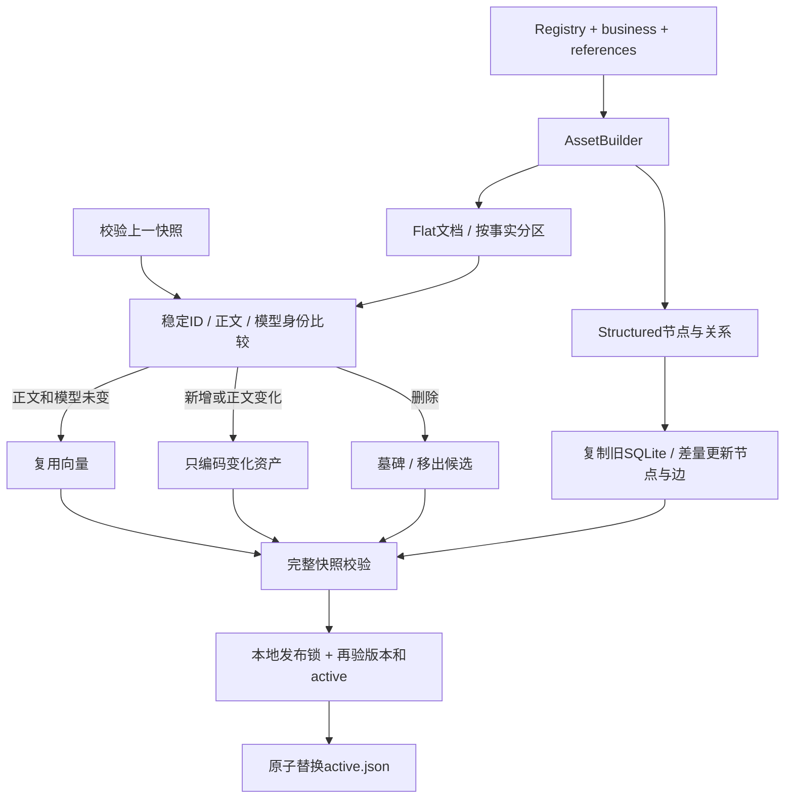

# 第四阶段：统一资产生成、增量生命周期与结构关系索引

本阶段完成本机规模的更新与关系基础设施，不安装专用图数据库、ANN 或完整生产服务。现有目录只有21份资产，采用SQLite关系索引和精确向量扫描，后续可替换底层存储而保留版本与权限契约。

## 实际实现

`AssetBuilder.build` 从同一份 Registry、业务别名/案例和 Skill 参考资料派生 Flat 文档与 Structured 关系。指标公式不从检索文本或LLM抽取。现在含13个注册指标（含1个跨事实派生）、事实/数据表、声明的字段、维度、实体粒度键和注册共同维度；当前合计61节点、140关系。

实体键表示 Registry 的grain声明，不是通过NER发现真实企业业务实体。字段节点是语义依赖声明，不等于物理schema或完整字段血缘；物理schema、Owner、质量和dbt任务/值与控制血缘继续通过MetadataCatalog读取。两类图不能混淆：血缘可达不能授权Join。

Flat指标文档和Structured指标节点的集合来自同一个可见性检查；递归检查组件，拒绝循环或悬空注册组件。删除指标后，旧ID和残留别名不能被相似指标替换。历史案例与参考资料只作为发现证据，不提供指标权威公式。

现有高频IR模板继续由真实受控规划请求生成，保存于QueryTemplateCache；没有把主体相关的模板缓存全量转成共享向量文档，也没有自动生成所有自然语言模板/维度组合。这避免参数、权限和旧口径污染共享资产。

## 统一快照与增量更新



```text
build-retrieval-index.py
  -> KnowledgeRetriever._build_index -> AssetBuilder.build
  -> publish_index
     -> read_snapshot：校验旧manifest、文档、向量、图和墓碑
     -> 比较stable asset_id + embedding正文 + 完整模型身份
     -> 编码变化正文；其余向量复用
     -> 合并墓碑；当前重新出现的资产清除墓碑并重新进入候选
     -> write_graph：复制旧SQLite，节点/边按差异更新
     -> manifest绑定所有文件、Registry、资产、策略与模型
     -> SQLite BEGIN IMMEDIATE发布锁
     -> 重验active摘要、权限、资产版本
     -> os.replace(active)：一次切换Flat/Dense/Structured/墓碑
```

manifest format升级为3，保存 `documents.json`、`vectors.json`、`structured.sqlite`、`tombstones.json` 的SHA256、父快照和delta。format=2的旧Dense快照可以作为经过校验的迁移来源；没有图时首次构建Structured投影。

默认增量比较当前与上一完整快照，编码工作是增量的；当前依然保存完整文档/向量文件，不是流式CDC或分片增量段。图写入为节点/边差量，但仍生成新SQLite快照。旧快照不在线复活；切换到旧版本必须满足当前语义校验，否则停止/降级。

新增/变化资产才编码；删除移出可搜索集合并保留不含正文的墓碑；恢复时清除墓碑。没有模型/编码参数变化时，只有维度等结构属性改变可复用相同语义正文向量；图和文档元数据仍更新。模型身份变化则全部重新编码。

构建失败保留旧active，当前语义已变化时旧索引会被判过期，而不会继续提供旧口径。SQLite发布锁只覆盖最终切换：两个构建者可各自计算，后完成者发现active已变化会停止并要求重建。尚未自动清理未发布/旧快照。

旧active损坏时增量构建拒绝复用；`--full`表示重新编码，不是绕过损坏摘要校验。可在新目录全量构建后做受控迁移，或恢复已校验的快照；不能静默伪造删除历史。

## 分区与授权

当前分区是受信事实域：orders、items、multi_fact、knowledge，不宣称已维护真实企业Domain或Glossary。分区由Registry事实归属自动生成；查询可限定分区，授权集合与分区过滤均在top-k前。显式指标与请求分区冲突时澄清，不悄悄换成域内相似指标。

共享快照由管理员发布；在线文档、节点属性与可遍历集合重新从当前主体的授权Registry构建。关系遍历不穿过不可见节点再返回过滤结果。敏感字段/维度按原策略遮盖；执行层仍有行过滤与最小组大小约束。本阶段没有新增企业IdP/多租户。

## 结构关系与影响查询

SQLite节点主键、关系三元组主键，以及incoming/outgoing索引支持确定性的有界多跳查询。`query_relations`为Agent新增的进程内工具；输入为node_id、dependencies/impact、深度1–6、节点数1–200，不接受SQL。

例如 `field:commerce.fct_orders:booked_order_amount` 的反向影响为 `booked_amount@1`、`average_order_value@1`。指标组件/字段值依赖/条件字段依赖/维度来源/粒度与时间字段各有独立关系类型。

`conformed_dimension`只记录注册映射和“先聚合再Join”约束，不表示可以沿图自由生成关联。SemanticContextResolver仍从Registry解析定义与合法维度，附加 `index_evidence` 说明投影版本/可见范围；GraphService查询返回图发现证据。执行前仍独立编译。

## 操作

```powershell
# 从同一权威生成两路投影，默认增量；本机已迁移完成
.\.venv\Scripts\python.exe scripts\build-retrieval-index.py
# 需要重编码全部当前资产时
.\.venv\Scripts\python.exe scripts\build-retrieval-index.py --full

.\.venv\Scripts\python.exe -m local_agent.cli search "订单数" --partition orders
.\.venv\Scripts\python.exe -m local_agent.cli relations metric:average_order_value@1 --depth 4
.\.venv\Scripts\python.exe -m local_agent.cli relations field:commerce.fct_orders:booked_order_amount --direction impact --depth 4

# 完整本地验收：真实E5/Cross-Encoder与数据；模拟Agent决策
.\scripts\accept-retrieval-iteration.ps1
# 加一次真实LLM冒烟：加载已有DPAPI配置，不输出密钥
.\scripts\accept-retrieval-iteration.ps1 -LiveLLM
```

`OWN_AGENT_STRUCTURED_MODE`默认auto：图缺失/过期/损坏时，SemanticResolver明确回退到当前Registry；required则停止，off禁用索引附加证据。显式调用关系查询必须有新鲜完整投影，不能把内存临时生成关系冒充已发布图。

结构投影的active/实现绑定进入Harness会话与语义计划，即使词法模式也不能跨图版本复用旧会话。资产、图快照或权限在遍历期间变化会停止。新部署后应新建会话。

## 代码定位

|入口|实现|
|---|---|
|统一派生|`assets.py`：AssetBuilder.build，行11|
|完整性检查|`dense_retrieval.py`：read_snapshot，行88|
|增量/墓碑/原子发布|`dense_retrieval.py`：publish_index，行114|
|图差量写入|`structure.py`：write_graph，行10|
|依赖/影响遍历|`structure.py`：GraphService.query，行84|
|模型输出动作契约|`agent_loop.py`：ModelDecision.__call__，行39；Decision.coherent，行25|

## 当前工程边界

完整扫描用于资产差异比较和在线授权集合构造；向量仍精确线性扫描。当前验证的是21资产/61节点/140边，不是百万级目录吞吐。未实现CDC、后台更新调度、跨进程常驻模型服务、ANN、分布式发布、墓碑压缩/快照GC或自动回滚迁移。

关系图目前覆盖注册语义，跨表物理字段和控制血缘仍由既有MetadataCatalog提供；多跳影响范围是依赖影响，不是异常因果归因。不新增不存在的支付、曝光点击事实，不通过检索扩大grain、口径或Join范围。
