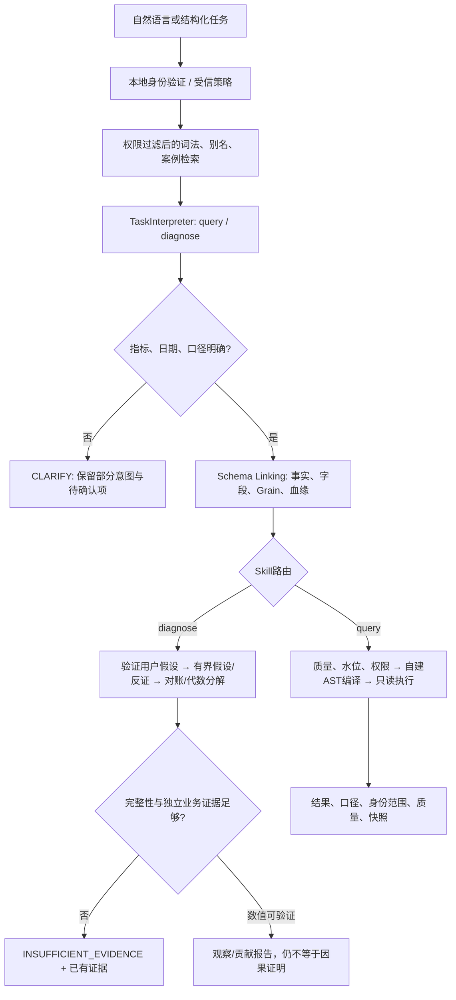

# 七项扩展：实现、证据与边界

本轮按用户选择完成本地规则、模拟模型与工程评测，不调用真实大模型。不依赖MetricFlow/DataHub/WrenAI运行服务，核心新增代码带中文注释。

## 端到端流程

“今天的转化率为什么比昨天低”会保留diagnose意图、commerce-diagnosis Skill提示、今天/昨天时间词。由于转化率未定义且今天未结束，停在澄清阶段，不查询数据或猜测根因。Skill提示不是已执行的诊断。

规则模式的执行协议由代码强制，Skill Markdown是可审查的方法说明；模型模式把说明注入意图提示。修改Markdown不会绕过权限或自动改变受控工具的执行规则。

## 1. 自然语言理解

tasks.py定义Task IR：kind、当前Query、对照Query、预期方向、拆解维度。Query依然禁止SQL、表名、任意表达式、principal。DateResolver用服务侧UTC时钟计算相对时间；比较方向按用户表达顺序，不能把“前天比昨天低”偷偷变成“昨天比前天低”。

规则模式只支持明确子集；多个指标、歧义销售额、未定义转化率、未知限定语、未结束日期、窗口不等长等都会澄清。LLM适配可用MockTransport验证，模型输出还需指标/日期与明确问题一致，且经过权限/编译校验。

本轮规则32/32；不是通用NLU或真实模型准确率。规则不会可靠理解所有自然表达，拒绝是其正常行为。

## 2. 业务知识与Schema Linking

knowledge/business.json保存别名、歧义词、维度映射、案例；仅引用commerce.json权威指标，不重复维护另一套计算SQL。

KnowledgeRetriever.search采用中文二元组/英文词、BM25形式词法评分和精确别名加权，先授权再召回。link从指标走到事实、grain、物理列、目录血缘和Owner。当前没有embedding/向量库，不能把方法称为向量RAG。

15个标注指标问题的检索Hit@3=15/15；来自当前有限用例集，没有独立大规模泛化证据。

## 3. 异常诊断

支持订单量、下单金额、客单价三类已验证假设家族。先检验变化方向；方向与用户假设相反时返回PREMISE_REFUTED，只保留两次总量查询。

下单金额用金额=订单数×客单价，计算对称代数贡献；客单价用金额/订单数，分解分子、分母贡献并核对残差。可加指标按渠道/国家拆解，分组必须与总量对账；隐私抑制、截断、空值、跨快照、预算耗尽时停止扩展。

最大8次查询、2维度、60秒全流程预算（每次最多30秒）。记录query/plan_id/release_id和支持/反驳项。causal_claim始终为false：业务根因需要独立事件、可靠覆盖和反证，当前实现不会把代数贡献包装成因果。

真实TheLook诊断完成8次受控查询后返回INSUFFICIENT_EVIDENCE，因为生产者完整性水位不存在。controlled fixture中验证交易量/客单价变化、比例恒等式、反向假设、预算和截断停止；它们不是真实企业异常真值。

## 4. 评测

evaluation/intent-cases.jsonl是32道人工标注用例，固定参考时钟2026-10-11 12:00 UTC。验证指标、日期端点、维度、比较方向、任务和澄清。

85项自动测试分层覆盖：原六指标原始表对账、规则、Mock模型协议/错误输出、密钥不进入结果、真实MCP八工具、角色权限、令牌撤销/过期、时间水位、Join/Where控制、快照历史、诊断反证和故障注入。

特别增加真实DuckDB副本中的重复明细故障：旧dbt PASS不能发布变更后的库，真实发布代码重新运行断言并拒绝；源数据hash保持原样。报告区分真实TheLook执行、工具替身故障真值、MockTransport、规则识别；real_llm_evaluated=false。

证据：own-agent-tests.xml、verification-summary.json、evaluation-report.json、extensions-demo.json。重跑scripts/evaluate.py及scripts/verify.ps1。

## 5. 时间与完整性

默认release只含snapshot-observation，观察时刻不是完整性水位。计划拒绝未结束UTC日和超过源快照观察的窗口。可信本地管道可提交coverage receipt，绑定数据库hash、观察时间、exclusive完整端点、签发者与证据引用；模型/MCP无写入口。

收据只代表本地管理员接纳的管道声明，没有伪造TheLook源端水位。测试收据来自fixture，不复制成真实发布证明。

SnapshotHistory保存实体变化和晚到记录的观察版本，逐实体事务、重复冲突回滚。已在本地捕获125,416订单和100,000用户的初始观察，未把首次观察时间当成历史业务生效时间。历史查询是“当时本地已知”，不是生产SCD2。没有删除事件时不推断实体删除。

仍缺真实退款/状态变更流水、源端watermark、数仓增量任务与小时级对齐；这些不能靠一次快照凭空补出。

## 6. 血缘

catalog.py保留实体、字段、Aspect、任务和dbt Flow；SQLGlot值依赖与control_lineage.py控制依赖分开。支持Select/CTE下的Join ON/USING、Where/Having/Qualify与Group依赖，记录未知/歧义/嵌套控制解析结果。

字段链示例：订单下单金额→明细金额→原始sale_price；另返回order_id/user_id等关联键的control_join及Group依赖。控制边表示行成员变化，不声称它直接提供金额值。

UNION、复杂相关子查询、部分count(*)行集合、任意SQL方言、排序/limit控制语义仍不完整。complete=false与redacted/truncated信息保持显式。

## 7. 权限

AccessController使用本地HMAC签名短期能力令牌；subject映射由服务器策略决定，模型不能提交role/principal。每次调用检查过期、撤销、策略版本和固定会话身份。令牌/密钥不提交Git，不进入LLM上下文或审计；密钥保护依赖本机文件权限，尚未接入企业密钥管理。

默认本地OS用户为管理员。us-analyst限定美国行、指定指标与维度，禁止用户数指标和敏感分组，目录遮盖敏感字段与相关引用。SQL层HAVING COUNT(*)>=5；计划绑定有效行过滤、主体和策略hash，执行重新编译。小组抑制不是完整统计隐私保护。

只有可信本地CLI有签发/发布入口，MCP不暴露它们。此权限是工具层约束，不是同一OS账号的文件隔离；企业OIDC/SSO、远程认证、多租户、持续审计和差分推断防护仍待集成。
